# Deep Learning, part 2: lab notes

Second part of the [Deep Learning](summary.md) notes: the theory is in the [summary](summary.md), here is the practice.
Based on the material of the laboratory by Carlo Adornetto: the notebooks of **Lab 1 to Lab 8**, the slides *Building Neural Networks from Scratch*
(credits Angelica Liguori), *Neural Networks and Gradient Descent Based Optimization*, *Neural Networks Optimization*, *Input Pipeline Optimization*
and *Transformer Implementation*, plus the notebooks on **TensorBoard** and on **running Colab on a local machine**.
The sections follow the order of the labs.

How to read these notes:

- every exercise ends with a **Parameters recap** table. The same parameters (units, activation, loss, optimizer, epochs, batch size, ...) come back
  again and again, on purpose: by the end of the labs they should feel obvious;
- explanations, fixes and examples that are not in the lab material are marked **Not in the labs**. This includes the problems found in the code of
  some notebooks: they are useful to understand what can go wrong in a real project, which is also how the exam works (a project);
- figures marked *From the labs* come from the notebooks and slides; *From my MIT 6.S191 notes* are taken from
  [ai-engineering-labs](https://github.com/salvo27/ai-engineering-labs); *Not in the labs* figures were drawn for these notes.

## Contents

- [Lab 0: the working environment](#lab-0-the-working-environment)
- [Lab 1: Python libraries and a machine learning recap](#lab-1-python-libraries-and-a-machine-learning-recap)
  - [L1.1 NumPy](#l11-numpy)
  - [L1.2 Pandas](#l12-pandas)
  - [L1.3 Matplotlib](#l13-matplotlib)
  - [L1.4 Linear regression with scikit-learn](#l14-linear-regression-with-scikit-learn)
  - [L1.5 Gradient descent by hand](#l15-gradient-descent-by-hand)
- [Lab 2: neural networks with TensorFlow and Keras](#lab-2-neural-networks-with-tensorflow-and-keras)
  - [L2.1 TensorFlow, tensors and Keras](#l21-tensorflow-tensors-and-keras)
  - [L2.2 Activations, losses and feature scaling](#l22-activations-losses-and-feature-scaling)
  - [L2.3 The workflow on the house price dataset](#l23-the-workflow-on-the-house-price-dataset)
  - [L2.4 Overfitting and regularization](#l24-overfitting-and-regularization)
  - [L2.5 Hands-on: the diabetes dataset and repeated splits](#l25-hands-on-the-diabetes-dataset-and-repeated-splits)
  - [L2.6 K-fold cross-validation](#l26-k-fold-cross-validation)
  - [L2.7 Multi-class classification: Reuters newswires](#l27-multi-class-classification-reuters-newswires)
  - [L2.8 Multi-class classification: Fashion-MNIST](#l28-multi-class-classification-fashion-mnist)
- [Lab 3: a neural network from scratch](#lab-3-a-neural-network-from-scratch)
  - [L3.1 The five ingredients](#l31-the-five-ingredients)
  - [L3.2 SimpleNeuralNetwork: forward and backward](#l32-simpleneuralnetwork-forward-and-backward)
  - [L3.3 The toy dataset and the accuracy trap](#l33-the-toy-dataset-and-the-accuracy-trap)
  - [L3.4 A generic feedforward network](#l34-a-generic-feedforward-network)
  - [L3.5 Diabetes and the confusion matrix](#l35-diabetes-and-the-confusion-matrix)
- [Lab 4: convolutional neural networks](#lab-4-convolutional-neural-networks)
  - [L4.1 Conv2D: filters, padding, strides](#l41-conv2d-filters-padding-strides)
  - [L4.2 Flowers: a CNN on images read from folders](#l42-flowers-a-cnn-on-images-read-from-folders)
  - [L4.3 Data augmentation and dropout](#l43-data-augmentation-and-dropout)
  - [L4.4 Hands-on: cats versus dogs](#l44-hands-on-cats-versus-dogs)
  - [L4.5 UTKFace: predicting gender and age from a face](#l45-utkface-predicting-gender-and-age-from-a-face)
  - [L4.6 Looking inside: feature maps](#l46-looking-inside-feature-maps)
  - [L4.7 Transfer learning: facial landmarks](#l47-transfer-learning-facial-landmarks)
- [Lab 5: recurrent networks and NLP](#lab-5-recurrent-networks-and-nlp)
  - [L5.1 Recurrent networks and LSTM](#l51-recurrent-networks-and-lstm)
  - [L5.2 From text to numbers: TextVectorization and Embedding](#l52-from-text-to-numbers-textvectorization-and-embedding)
  - [L5.3 IMDb with a bidirectional LSTM](#l53-imdb-with-a-bidirectional-lstm)
  - [L5.4 Stacking LSTMs: return_sequences](#l54-stacking-lstms-return_sequences)
  - [L5.5 Next word prediction](#l55-next-word-prediction)
- [Lab 6: autoencoders](#lab-6-autoencoders)
  - [L6.1 A one-layer autoencoder](#l61-a-one-layer-autoencoder)
  - [L6.2 Deeper and convolutional autoencoders](#l62-deeper-and-convolutional-autoencoders)
  - [L6.3 Sparse autoencoder](#l63-sparse-autoencoder)
  - [L6.4 Denoising autoencoder](#l64-denoising-autoencoder)
  - [L6.5 Outlier detection](#l65-outlier-detection)
- [Lab 7: attention and Transformers](#lab-7-attention-and-transformers)
  - [L7.1 Scaled dot-product attention from scratch](#l71-scaled-dot-product-attention-from-scratch)
  - [L7.2 Cross-attention on a toy translation](#l72-cross-attention-on-a-toy-translation)
  - [L7.3 Multi-head attention](#l73-multi-head-attention)
  - [L7.4 Ways to train a Transformer](#l74-ways-to-train-a-transformer)
  - [L7.5 The Transformer step by step](#l75-the-transformer-step-by-step)
  - [L7.6 Training: learning rate schedule, masked loss and accuracy](#l76-training-learning-rate-schedule-masked-loss-and-accuracy)
- [Lab 8: optimization and hyperparameter tuning](#lab-8-optimization-and-hyperparameter-tuning)
  - [L8.1 Optimizers: SGD, momentum, RMSprop, Adam](#l81-optimizers-sgd-momentum-rmsprop-adam)
  - [L8.2 Hyperparameters and search strategies](#l82-hyperparameters-and-search-strategies)
  - [L8.3 Hyperparameter tuning with TensorBoard HParams](#l83-hyperparameter-tuning-with-tensorboard-hparams)
  - [L8.4 Keras Tuner and Hyperband](#l84-keras-tuner-and-hyperband)
  - [L8.5 Making networks smaller: quantization, pruning, clustering](#l85-making-networks-smaller-quantization-pruning-clustering)
  - [L8.6 Input pipeline optimization with tf.data](#l86-input-pipeline-optimization-with-tfdata)
- [Lab 9: TensorBoard](#lab-9-tensorboard)
- [Lab cheat sheet](#lab-cheat-sheet)

---

# Lab 0: the working environment

The notebooks are meant for **Google Colab**: a Jupyter notebook in the browser, with Python, TensorFlow and Keras already installed and a free GPU.

- **GPU:** *Runtime → Change runtime type → GPU*. Check it with `tf.config.list_physical_devices('GPU')` (the next word prediction notebook prints
  `Num GPUs Available: 0` when it runs on CPU).
- **Files:** the datasets are read from Google Drive or uploaded by hand:

  ```python
  from google.colab import drive
  drive.mount('/content/drive')          # Drive appears under /content/drive/MyDrive/...

  from google.colab import files
  uploaded = files.upload()              # opens a file picker; uploaded['toy_dataset.csv'] holds the bytes
  ```

- **Shell commands** start with `!`: `!pip install -q keras-tuner`, `!curl -O <url>`, `!unzip -q file.zip`, `!ls`.
- **Magics** start with `%`: `%load_ext tensorboard`, `%tensorboard --logdir logs`.

**Colab on your own machine.** The notebook *Running Colab on Local Machine* connects the Colab interface to a Jupyter server running locally
(useful when the dataset is on your disk or your machine has a GPU):

```bash
conda create -n colab-env python=3.10
conda activate colab-env
conda install -c conda-forge jupyter
jupyter notebook --NotebookApp.allow_origin='https://colab.research.google.com' --port=8888 --no-browser
```

Then, in Colab, *Connect → Connect to a local runtime* and paste the URL printed in the terminal. In the lab output TensorFlow 2.18.0 was installed
with `!pip install tensorflow`.

**Reproducibility.** The next word prediction notebook fixes all the seeds, so that two runs give the same numbers:

```python
import os, random
import numpy as np
import tensorflow as tf

seed = 42
os.environ['PYTHONHASHSEED'] = str(seed)
random.seed(seed)
np.random.seed(seed)
tf.random.set_seed(seed)
```

> [!TIP]
> **Not in the labs: old and new Keras.** The notebooks were written over several years, so the same thing appears in two forms. They are worth
> recognizing, because copying code between notebooks mixes them:
>
> | Older code (TF 2.x, Keras 2) | Current code (Keras 3) |
> |---|---|
> | `layers.experimental.preprocessing.Rescaling` | `layers.Rescaling` |
> | `optimizers.RMSprop(lr=0.001)` | `optimizers.RMSprop(learning_rate=0.001)` |
> | `Dense(16, input_shape=(10,))` as first layer | `Input(shape=(10,))` followed by `Dense(16)` |
> | `keras.preprocessing.text.Tokenizer` | `layers.TextVectorization` |
> | `model.save('model.h5')` | `model.save('model.keras')` |
>
> The warning *"Do not pass an `input_shape`/`input_dim` argument to a layer"* that fills many outputs is only about the third row: the model still works.

---

# Lab 1: Python libraries and a machine learning recap

The first lab reviews the three libraries used everywhere (NumPy, Pandas, Matplotlib; some examples come from E. Duchesnay et al.,
*Statistics and Machine Learning in Python*, shared as a PDF), then linear regression and gradient descent, the ideas behind every neural network.

## L1.1 NumPy

NumPy adds the **ndarray**, a multidimensional array of numbers of the same type, and vectorized mathematical functions on it.

```python
import numpy as np

a = np.array([1, 2, 3])                    # 1D array from a list
a = np.array([1, 2, 3], dtype='float64')   # choose the type
a = a.astype('float64')                    # or convert it later
b = np.array([range(1, 4), range(5, 8)])   # 2D array: [[1, 2, 3], [5, 6, 7]]
```

**Creating arrays.**

| Call | Result | Note |
|---|---|---|
| `np.arange(3)` | `[0, 1, 2]` | `arange(start, stop, step)`: stop is **excluded** |
| `np.arange(3, 7)` | `[3, 4, 5, 6]` | |
| `np.arange(3, 7, 2)` | `[3, 5]` | |
| `np.zeros(5)`, `np.zeros((2, 3))`, `np.ones(5)` | arrays of 0 or 1 | the shape is a tuple |
| `np.linspace(0, 1, 5)` | `[0, 0.25, 0.5, 0.75, 1]` | 5 equally spaced values, both ends **included** |
| `np.logspace(0, 3, 4)` | `[1, 10, 100, 1000]` | from $10^0$ to $10^3$ |

**Properties.** For `z = np.zeros((3, 4, 6))`: `z.dtype` is `float64`, `z.ndim` is 3 (number of axes), `z.shape` is `(3, 4, 6)`,
`z.size` is 72 (number of elements, $3 \cdot 4 \cdot 6$) and `len(z)` is 3 (length of the first axis only).

**Indexing and slicing.** With `a = np.array([[10, 11, 12, 13], [14, 15, 16, 17]])`:

```python
a[0]        # first row: [10, 11, 12, 13]
a[0, 2]     # row 0, column 2: 12 (same as a[0][2])
a[:, 0]     # first column: [10, 14]
a[:, :2]    # first two columns
a[:, 1:3]   # columns 1 and 2 (3 excluded)
```

**Reshape, transpose, flatten.** `reshape` changes the shape without changing the number of elements (otherwise it raises an error) and it does
**not copy** the data: changing the reshaped array also changes the original one. `a.T` transposes, `a.flatten()` returns a 1D **copy**.

```python
a1 = np.array([[1, 2], [3, 4], [5, 6]])
a2 = a1.reshape((2, 3))     # [[1, 2, 3], [4, 5, 6]]
a2[0, 0] = 100
a1                          # [[100, 2], [3, 4], [5, 6]]: same memory
x = np.arange(24).reshape(2, 3, 4)
x[0, :, :]                  # the first 3x4 block
```

**Vectorized operations.** Arithmetic works element by element, without loops: `a * 2`, `np.sqrt(a)`, `np.ceil(a)`, `np.isnan(a)`, `a1 + a2`, `a1 * a1`.
The **dot product** is `a1 @ a1` or `np.dot(a1, a1)`: with `a1 = np.arange(5)` it is $0+1+4+9+16 = 30$.

**Random numbers and statistics.** Fix the seed, otherwise every run of the cell gives different numbers:

```python
np.random.seed(42)
r = np.random.random((2, 3))     # uniform in [0, 1)
r.mean(), r.std(), r.min(), r.argmin(), r.max(), r.argmax(), r.sum()
r.sum(axis=0)                    # one sum per column, shape (3,)
r.sum(axis=1)                    # one sum per row, shape (2,)
```

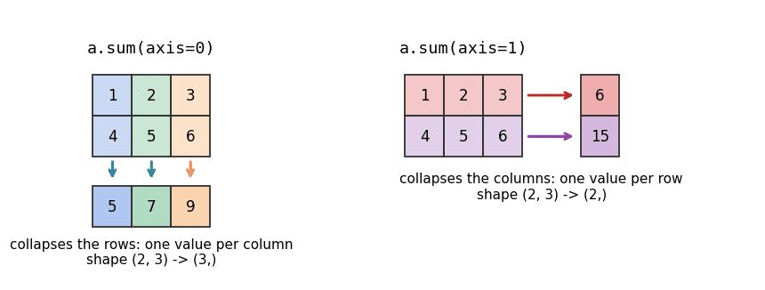
*Not in the labs: `axis` is the axis that disappears. `axis=0` runs down the rows (one result per column), `axis=1` runs along a row (one result per row).*

**Changing arrays.** `np.insert(a, 2, 4)` inserts 4 at position 2, `np.append(a, 2)` adds at the end, `np.delete(a, 2)` removes position 2
(all three return a **new** array). `np.where(a == 2)` returns the positions where the condition holds, so `np.delete(a, np.where(a == 2))`
removes every 2 and `a[np.where(a == 2)] = 4` replaces them. A **boolean mask** selects elements directly: `a[a > 5]`, `a[~np.isnan(a)]`
(the `~` negates the mask). `np.concatenate((a1, a2))` stacks along axis 0 (rows), `axis=1` side by side; `np.unique(a)` returns the sorted distinct values.

> [!TIP]
> **Not in the labs: why NumPy matters for the rest of the labs.** Every dataset becomes an ndarray (or a tensor, which behaves the same way)
> and most bugs in the following labs are **shape** bugs: `(1241, 10)` versus `(10,)`, `(28, 28)` versus `(1, 28, 28)`, `(94956,)` versus
> `(94956, 8200)`. When something breaks, print `.shape` first.

## L1.2 Pandas

Pandas adds the **DataFrame**, a table with named columns (each column has its own type) and an index for the rows.

```python
import pandas as pd

names = ['Nick', 'Jess', 'Winston', 'Schmidt', 'Cece']
births = [150, 200, 100, 50, 70]
df = pd.DataFrame(list(zip(names, births)), columns=['names', 'births'])

df.to_csv('dataframe.csv', index=False)   # index=False: do not write the row numbers as a column
df = pd.read_csv('dataframe.csv')
df.dtypes; df.info(); df.describe()        # types, non-null counts, statistics (count, mean, std, min, quartiles, max)
df.sort_values(['births'], ascending=False)
df['names'][df['births'] == df['births'].max()].values   # name with the most births: ['Jess']
```

Other operations used in the lab:

| Operation | Code |
|---|---|
| first and last rows | `df.head()`, `df.tail()` |
| distinct values | `df['names'].unique()` |
| group and aggregate | `df.groupby(['names']).sum()`, then `.plot.bar(figsize=(15, 5))` |
| transform a column | `df['names'] = df.names.apply(lambda x: x.upper())` |
| filter rows | `df[df['names'] == 'JESS']` |
| remove a column | `df.drop(columns='births')` returns a new DataFrame; with `inplace=True` it changes `df` |
| dates | `pd.date_range(start='1/1/1980', end='12/31/1981', freq='W-MON')`: every Monday |
| index from a column | `pd.read_csv('dataset2.csv', index_col='Date')` |
| two-level grouping | `df.groupby(['States', 'Date']).sum()`, then `.loc['FL']` for one state and `.loc['FL']['1981':]` from 1981 on |

In Lab 2 Pandas is used to explore a dataset before training: `df.describe()`, `df.isna().sum()` (missing values per column),
`df.corr()` (correlation between columns), and `df.values` to get the NumPy array that Keras wants.

## L1.3 Matplotlib

```python
import matplotlib.pyplot as plt

x = np.arange(1, 5)
plt.figure(figsize=(8, 7))           # size in inches
plt.plot(x, 2*x + 5)                 # line
plt.plot(x, 2*x + 5, 'or')           # 'o' = circles, 'r' = red
plt.plot(x, -2*x + 15, '--', label='Second line')
plt.title('Line'); plt.xlabel('x axis'); plt.ylabel('y axis')
plt.legend()
plt.show()

plt.subplot(2, 2, 1)                 # grid of 2x2 plots, select the first (numbering starts at 1)
plt.bar([5, 8, 10], [12, 16, 6], align='center')
plt.hist(np.array([1, 2, 1, 5, 6, 2, 3, 3, 8, 1, 1, 7, 8, 8, 6]))
```

From Lab 2 on, every training ends with the same plot of `history.history` (see L2.3), usually with the object-oriented form
`fig, ax = plt.subplots(1, 2, figsize=(15, 5))` and `ax[0].plot(...)`, `ax[1].plot(...)`.

## L1.4 Linear regression with scikit-learn

The notebook *ML_Recap* fits a straight line $\hat y = \theta_0 + \theta_1 x$ with scikit-learn:

```python
from sklearn.linear_model import LinearRegression

X = np.array([1, 2, 3, 4, 5]).reshape(-1, 1)   # hours studied, as a column: shape (5, 1)
y = np.array([50, 60, 65, 70, 75])             # test score
model = LinearRegression()
model.fit(X, y)
y_pred = model.predict(X)
model.intercept_, model.coef_                  # theta_0 and theta_1
```

`reshape(-1, 1)` turns `[1, 2, 3, 4, 5]` into a column: scikit-learn always wants a 2D input of shape `(n_samples, n_features)`, and `-1` means
"compute this dimension for me".

> [!TIP]
> **Not in the labs: the numbers.** With least squares (summary, [1.3](summary.md#13-regression)):
> $\bar x = 3$, $\bar y = 64$, $\theta_1 = \frac{\sum (x_i - \bar x)(y_i - \bar y)}{\sum (x_i - \bar x)^2} = \frac{28 + 4 + 0 + 6 + 22}{4 + 1 + 0 + 1 + 4} = \frac{60}{10} = 6$
> and $\theta_0 = \bar y - \theta_1 \bar x = 64 - 18 = 46$. Each extra hour of study is worth 6 points; with 1 hour the model predicts 52.

**A model that is too simple.** The second example generates 100 points with $y = x^2$, $x$ uniform in $[0, 10]$, and fits a line:
intercept $-14.90$, slope $9.73$. The line cannot follow the parabola: it is too high in the middle and too low at the ends.
With `train_test_split(X, y, test_size=0.2, random_state=42)` the line is fitted on 80 points (intercept $-15.29$, slope $9.76$)
and the test points show the same systematic error. This is **underfitting**, high bias (summary, [1.4](summary.md#14-training-error-test-error-and-the-bias-variance-tradeoff)).

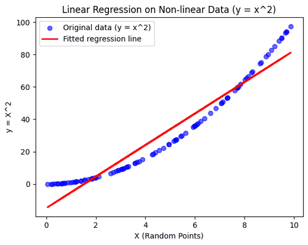
*From the labs.*

**Hands-on.** (1) run a cross-validation, (2) estimate a confidence interval on the test set, (3) use `KFold` from scikit-learn.

> [!NOTE]
> **Not in the labs: a possible solution.**
>
> ```python
> from sklearn.model_selection import KFold, cross_val_score
> from sklearn.preprocessing import PolynomialFeatures
> from sklearn.pipeline import make_pipeline
>
> kf = KFold(n_splits=5, shuffle=True, random_state=42)
> mse = -cross_val_score(LinearRegression(), X, y, cv=kf, scoring='neg_mean_squared_error')
> print(mse.mean(), mse.std())                            # one MSE per fold, then mean and spread
> half = 1.96 * mse.std(ddof=1) / np.sqrt(len(mse))       # rough 95% interval for the mean MSE
>
> poly = make_pipeline(PolynomialFeatures(degree=2), LinearRegression())
> -cross_val_score(poly, X, y, cv=kf, scoring='neg_mean_squared_error').mean()   # about 0: the right model
> ```
>
> scikit-learn maximizes scores, so the MSE comes back with a minus sign (`neg_mean_squared_error`). `shuffle=True` matters when the data are ordered.
> With degree 2 the features are $1, x, x^2$ and the model can represent $y = x^2$ exactly, so the error drops to zero.

## L1.5 Gradient descent by hand

The notebook *ML_Linear_Regression & HandOn* finds the same kind of line **without** the closed formula, with gradient descent, the algorithm used
to train every network of the following labs (summary, [2.4](summary.md#24-the-optimizer)).

```python
np.random.seed(42)
X = np.linspace(0, 10, 30)
y = 2 * X + 3 + np.random.randn(30) * 2      # true line y = 2x + 3, plus noise

m, b = np.random.randn(), np.random.randn()  # random initial parameters
lr = 0.01                                    # learning rate

for step in range(5):
    y_pred = m * X + b                                   # 1. prediction (forward)
    dm = (2 / len(X)) * np.sum(X * (y_pred - y))         # 2. gradient of the MSE
    db = (2 / len(X)) * np.sum(y_pred - y)
    m -= lr * dm                                         # 3. update
    b -= lr * db
```

> [!TIP]
> **Not in the labs: where the gradients come from.** The loss is $L(m, b) = \frac{1}{n}\sum_i (m x_i + b - y_i)^2$. With the chain rule:
> $\frac{\partial L}{\partial m} = \frac{2}{n}\sum_i x_i (m x_i + b - y_i)$ and $\frac{\partial L}{\partial b} = \frac{2}{n}\sum_i (m x_i + b - y_i)$,
> exactly `dm` and `db`. The update $m \leftarrow m - \eta \frac{\partial L}{\partial m}$ moves against the gradient, downhill.

What happens in the 5 steps (recomputed with the same seed; the start is $m = -0.60$, $b = 1.85$):

| Step | Loss (MSE) | $m$ after | $b$ after | `dm` | `db` |
|---|---|---|---|---|---|
| 1 | 243.87 | 1.204 | 2.128 | $-180.5$ | $-27.6$ |
| 2 | 25.95 | 1.757 | 2.217 | $-55.3$ | $-9.0$ |
| 3 | 5.41 | 1.926 | 2.250 | $-16.9$ | $-3.2$ |
| 4 | 3.46 | 1.977 | 2.265 | $-5.1$ | $-1.5$ |
| 5 | 3.28 | 1.992 | 2.274 | $-1.5$ | $-0.95$ |

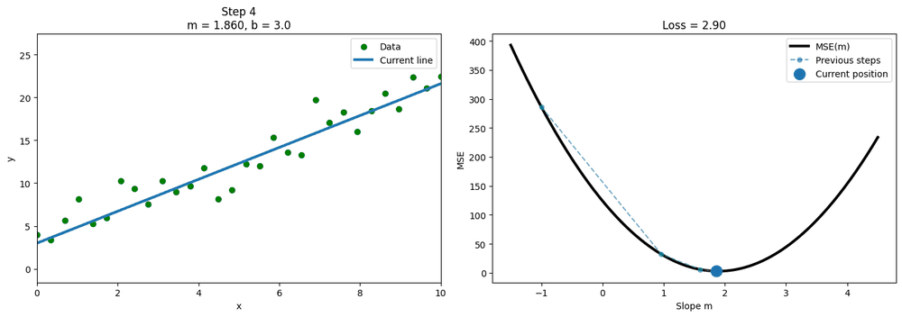
*From the labs: second cell, with $b$ fixed at 3 and $m$ starting from $-1$. Each step goes down the parabola $L(m)$ and the steps get shorter
because the slope of the parabola (the gradient) gets smaller near the minimum.*

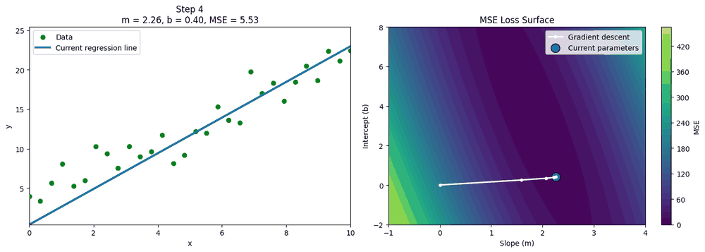
*From the labs: third cell, $m$ and $b$ both start from 0. On the right, the MSE as a function of $(m, b)$ and the path of gradient descent.*

> [!NOTE]
> **Not in the labs: why $b$ hardly moves.** The best line for these 30 points (least squares) is $m = 1.80$, $b = 3.64$. After 5 steps $m$ is already
> 1.99, while $b$ went from 1.85 only to 2.27. The reason is in the gradients: `dm` multiplies each error by $x_i$, which goes up to 10, so it is
> about 6 to 7 times larger than `db` (step 1: $-180.5$ against $-27.6$). With one learning rate for both, $m$ runs and $b$ crawls: the loss surface is a
> long narrow valley (the contour plot). This is the reason for **feature scaling** (L2.2) and for optimizers with one step size per parameter,
> like RMSprop and Adam (L8.1).

**Hands-on.** Run the estimation from several random initializations and report the mean and standard deviation of the results; try a different
model function, for example a polynomial.

**Parameters recap.**

| Parameter | Value here | What it does |
|---|---|---|
| learning rate `lr` | 0.01 | length of each step: too small is slow, too large overshoots and diverges (see L8.1) |
| `n_steps` | 5 | how many updates; in Keras this becomes `epochs` × steps per epoch |
| initialization | random (`np.random.randn()`) or 0 | the starting point; different starts can end in different places |
| loss | MSE | what is minimized; its gradient tells the direction |

---

# Lab 2: neural networks with TensorFlow and Keras

From here on the networks are built with Keras. The lab covers binary classification (house prices, then a hands-on on diabetes),
validation strategies (hold-out, repeated splits, K-fold) and multi-class classification (Reuters, Fashion-MNIST).
The theory is in the summary, sections [3](summary.md#3-classification-with-keras) and [4](summary.md#4-overfitting-and-regularization).

## L2.1 TensorFlow, tensors and Keras

**TensorFlow** is an open-source framework for machine learning and deep learning, created by Google in 2015 (Google Brain), with interfaces for
Python, JavaScript, C++ and Java. It is optimized for operations on tensors and runs them in parallel. Two execution modes:

- **graph execution:** TensorFlow extracts the computation from Python and builds an efficient graph before running it. Faster, less friendly;
  suited to deployment;
- **eager execution** (the default): operations run immediately and return actual values, like NumPy. Slower, friendly; suited to prototyping.

A **tensor** is an N-dimensional array, very similar to a NumPy ndarray: a scalar is a 0D tensor, a vector 1D, a matrix 2D, a batch of color images 4D.
Google also built dedicated hardware for tensor operations, the **TPU** (Tensor Processing Unit).

**Keras** is the high-level Python interface to TensorFlow. Its key elements: the `Sequential` model, the `add` method to stack layers, the
types of layers, activations, losses, optimizers and metrics, and the functions to train (`fit`) and evaluate (`evaluate`).

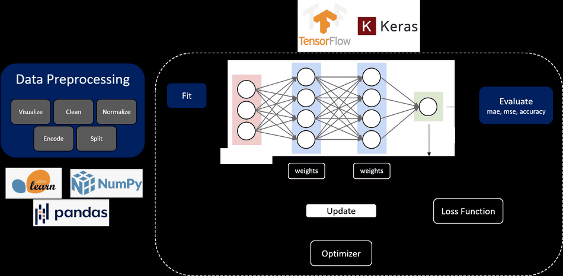
*From the labs: data preprocessing (with Pandas, NumPy, scikit-learn), then fit (forward pass, loss, optimizer, weight update), then evaluation.*

## L2.2 Activations, losses and feature scaling

The notebook *Notes* collects the pieces that every model of the lab uses.

**Activation functions.** The activation of the **output** layer is chosen according to the output we want:

| Activation | Formula | Output range | Typical use |
|---|---|---|---|
| sigmoid | $\sigma(a) = \frac{1}{1 + e^{-a}}$ | $(0, 1)$, 0.5 at $a = 0$ | output of a **binary** classifier: a probability |
| tanh | $\tanh(a) = \frac{e^a - e^{-a}}{e^a + e^{-a}}$ | $(-1, 1)$ | hidden layers, gates of the LSTM |
| ReLU | $\max(0, a)$ | $[0, +\infty)$ | **hidden** layers (default choice) |
| softmax | $\frac{e^{a_k}}{\sum_j e^{a_j}}$ | $(0, 1)$, sums to 1 | output of a **multi-class** classifier |
| linear (none) | $a$ | any real number | output of a **regression** |

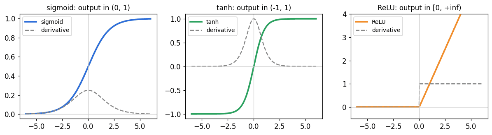
*Not in the labs: the dashed lines are the derivatives used by backpropagation. Sigmoid and tanh have derivative close to 0 for large $|a|$ (they
saturate, and the gradient vanishes); ReLU has derivative 1 for every positive input.*

**Cross-entropy.** For $N$ outputs with targets $y_i$ and predictions $\hat y_i$:

$$\text{binary: } L = -\frac{1}{N}\sum_{i=1}^{N} \left[ y_i \log \hat y_i + (1 - y_i)\log(1 - \hat y_i) \right] \qquad \text{categorical: } L = -\sum_{i=1}^{C} y_i \log \hat y_i$$

> [!TIP]
> **Not in the labs: what the numbers mean.** For one example with $y = 1$: if the network says $\hat y = 0.9$ the loss is $-\log 0.9 = 0.105$;
> if it says $\hat y = 0.1$ the loss is $-\log 0.1 = 2.303$. Being confident and wrong costs a lot. In the categorical case $y$ is one-hot, so only
> the term of the true class survives: the loss is $-\log$ of the probability given to the right class.

**Feature scaling.** Inputs on very different scales (a lot area of 10,000 square feet next to a number of bathrooms of 2) make training slow and
unstable (the long valley of L1.5). Two options:

$$\text{normalization (min-max): } x_{new} = \frac{x - x_{min}}{x_{max} - x_{min}} \in [0, 1] \qquad \text{standardization: } x' = \frac{x - \text{mean}}{\text{standard deviation}}$$

## L2.3 The workflow on the house price dataset

**The data.** `housepricedata.csv`: 1460 houses, 10 features (lot area, overall quality and condition from 1 to 10, basement area, full and half
bathrooms, bedrooms, total rooms, fireplaces, garage area) and the target `AboveMedianPrice` (1 if the price is above the median). The classes are
balanced (732 against 728). **Goal:** binary classification.

```python
import pandas as pd
df = pd.read_csv('housepricedata.csv')
df.describe(); df.isna().sum(); df.corr()       # statistics, missing values (none), correlations
dataset = df.values                             # DataFrame -> NumPy array
X = dataset[:, 0:10]                            # the 10 features
Y = dataset[:, 10]                              # the label

from sklearn.model_selection import train_test_split
X_train, X_test, Y_train, Y_test = train_test_split(X, Y, test_size=0.15)
# (1241, 10) (219, 10) (1241,) (219,)
```

**Question from the notebook:** is it right to normalize both `X_train` and `X_test`, and with which information? Yes, both must be scaled, but
**with the statistics of the training set only**: the test set stands for future data, which we do not know when we train.

```python
from sklearn.preprocessing import MinMaxScaler
min_max_scaler = MinMaxScaler()
min_max_scaler.fit(X_train)                     # learns min and max of each column, on the training set
X_train = min_max_scaler.transform(X_train)     # now every column is in [0, 1]
X_test = min_max_scaler.transform(X_test)       # same min and max: values can fall slightly outside [0, 1]
```

This is why `X_test.max(axis=0)` gives values like 0.24 and 0.74 and not exactly 1: the test houses are not the ones that defined the range.

**The network.** Two hidden layers of 30 ReLU units and one sigmoid output:

```python
from keras.models import Sequential
from keras.layers import Dense

model = Sequential([
    Dense(30, activation='relu', input_shape=(X_train.shape[1],)),   # X_train.shape[1] = 10 features
    Dense(30, activation='relu'),
    Dense(1, activation='sigmoid'),
])
model.compile(optimizer='adam',
              loss='binary_crossentropy',
              metrics=['accuracy'])
hist = model.fit(X_train, Y_train,
                 batch_size=32, epochs=100,
                 validation_split=0.3)
model.evaluate(X_test, Y_test)                  # [0.317, 0.886]: test loss and test accuracy
```

`fit` runs both the forward and the backward phase and returns a `History` object: `hist.history` is a dictionary with one list per metric,
`loss`, `accuracy`, `val_loss`, `val_accuracy`, one value per epoch. The plot of every lab:

```python
plt.plot(hist.history['loss'])
plt.plot(hist.history['val_loss'])
plt.title('Model loss'); plt.ylabel('Loss'); plt.xlabel('Epoch')
plt.legend(['Train', 'Val'], loc='upper right')
plt.show()
```

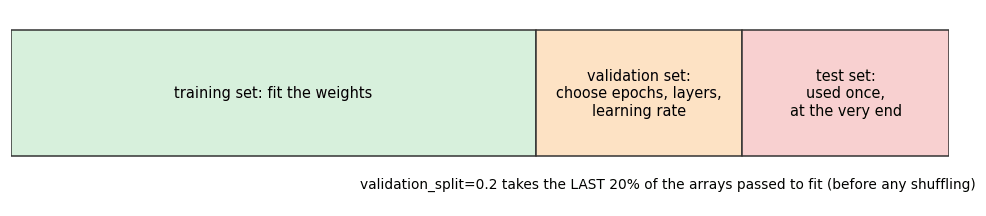
*Not in the labs: the three sets. `validation_split` carves the validation set out of the arrays given to `fit`; the test set was set aside before.*

> [!TIP]
> **Not in the labs: counting.** Parameters: $10 \cdot 30 + 30 = 330$, then $30 \cdot 30 + 30 = 930$, then $30 + 1 = 31$: **1291** weights in total.
> With `validation_split=0.3` about 868 of the 1241 rows are used for training; with `batch_size=32` that is 28 batches, so 28 weight updates
> per epoch and 2800 in 100 epochs. One **epoch** is one pass over the training data; one **step** is one batch.

> [!NOTE]
> **Not in the labs: two details of the notebook.** The text says "we'll use stochastic gradient descent", the code uses `'adam'`; and the
> comment `# 0.01` next to it is not Adam's default, which is `learning_rate=0.001`. To set it explicitly: `optimizer=keras.optimizers.Adam(learning_rate=0.01)`.

**Parameters recap.**

| Parameter | Value here | What it does |
|---|---|---|
| `Dense(30, ...)` | 30 units | number of neurons of the layer, so the size of its output |
| `activation` | `'relu'` hidden, `'sigmoid'` output | non-linearity; sigmoid turns the output into a probability |
| `input_shape` | `(10,)` | shape of **one** example, without the batch dimension; only on the first layer |
| `optimizer` | `'adam'` | how the weights are updated from the gradients |
| `loss` | `'binary_crossentropy'` | what is minimized; fits a sigmoid output and 0/1 labels |
| `metrics` | `['accuracy']` | what is printed and stored in `history`, not optimized |
| `batch_size` | 32 | examples per weight update |
| `epochs` | 100 | passes over the training data |
| `validation_split` | 0.3 | fraction of the training arrays (the **last** 30%) kept aside for validation |

## L2.4 Overfitting and regularization

**Model 2** is deliberately too big: four hidden layers of 1000 units, about **3 million** parameters ($11{,}000 + 3 \cdot 1{,}001{,}000 + 1001$)
for 1241 houses. **Model 3** is the same network with **L2 regularization** and **dropout**:

```python
from keras.layers import Dropout
from keras import regularizers

model_3 = Sequential([
    Dense(1000, activation='relu', kernel_regularizer=regularizers.l2(0.01), input_shape=(10,)),
    Dropout(0.3),
    Dense(1000, activation='relu', kernel_regularizer=regularizers.l2(0.01)),
    Dropout(0.3),
    Dense(1000, activation='relu', kernel_regularizer=regularizers.l2(0.01)),
    Dropout(0.3),
    Dense(1000, activation='relu', kernel_regularizer=regularizers.l2(0.01)),
    Dropout(0.3),
    Dense(1, activation='sigmoid', kernel_regularizer=regularizers.l2(0.01)),
])
```

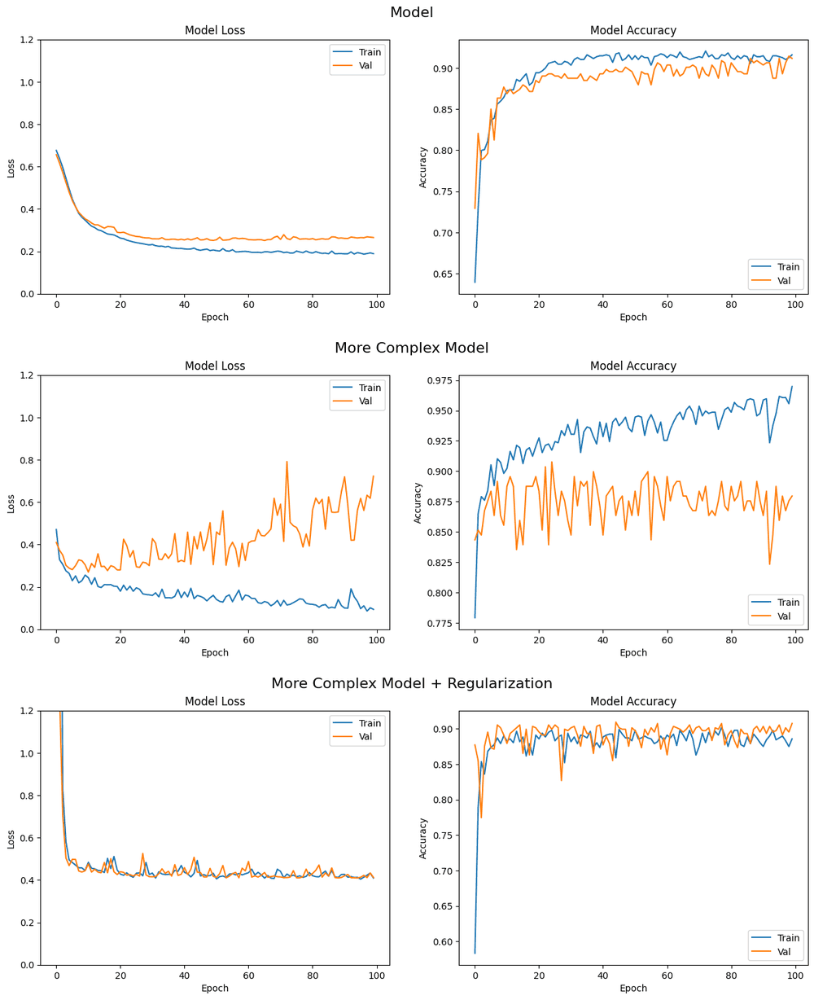
*From the labs: top, the first model; middle, the big model (training loss goes down, validation loss goes up and oscillates: overfitting);
bottom, the big model with L2 and dropout (the two curves stay together).*

- **L2 (`kernel_regularizer=regularizers.l2(0.01)`):** adds $0.01 \sum w^2$ to the loss, so large weights cost something. This is why the loss of
  model 3 starts much higher: it includes the penalty (summary, [4.2](summary.md#42-weight-regularization)).
- **Dropout(0.3):** during training, at every step, 30% of the outputs of the previous layer are set to 0 at random (the others are scaled up by
  $1/0.7$); at inference dropout does nothing (summary, [4.3](summary.md#43-dropout)).

> [!NOTE]
> **Not in the labs: a fair comparison.** The three models are trained with `validation_split` 0.3, 0.2 and 0.4: different amounts of training data
> and different validation rows. To compare models, keep the same split (and ideally the same seed) for all of them.

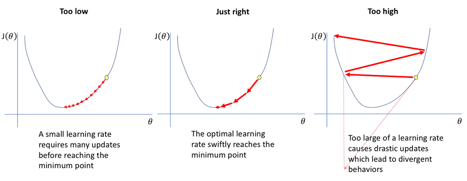
*From the labs: the learning rate decides the size of the steps; too small needs many updates, too large bounces and can diverge.*

**Parameters recap.**

| Parameter | Value here | What it does |
|---|---|---|
| `kernel_regularizer=regularizers.l2(0.01)` | 0.01 | weight of the penalty $\sum w^2$ added to the loss |
| `Dropout(0.3)` | rate 0.3 | fraction of outputs zeroed at each training step; inactive at test time |
| hidden units | 1000 × 4 | capacity: more units, more risk of overfitting |
| `validation_split` | 0.2 / 0.4 | see the note above |

## L2.5 Hands-on: the diabetes dataset and repeated splits

**The data.** Pima Indians diabetes: 768 patients, 8 inputs (pregnancies, glucose, blood pressure, skin thickness, insulin, BMI, diabetes pedigree
function, age) and the diagnosis (0 healthy, 1 diabetes). Classes: 500 healthy and 268 diabetic, so **always answering "healthy" already gives 65%
accuracy**: this is the baseline to beat.

The solution notebook tries a small grid of hyperparameters and, for each configuration, 5 random train/test splits:

```python
from keras.optimizers import Adam
from keras.callbacks import EarlyStopping

lrs = [0.01, 0.001]; layers = [2, 3]; neurons = [8, 16]
for lr in lrs:
  for layer in layers:
    for neuron in neurons:
      for cv in range(5):
        X_train, X_test, Y_train, Y_test = train_test_split(X, Y, test_size=0.1)
        min_max_scaler = MinMaxScaler(); min_max_scaler.fit(X_train)
        X_train = min_max_scaler.transform(X_train); X_test = min_max_scaler.transform(X_test)

        model = Sequential()
        model.add(Dense(neuron, activation='relu', input_shape=(X_train.shape[1],)))
        for l in range(layer):
          model.add(Dense(neuron, activation='relu'))
        model.add(Dense(1, activation='sigmoid'))

        early_stopping = EarlyStopping(monitor='val_loss', patience=6,
                                       restore_best_weights=True, verbose=1)
        model.compile(optimizer=Adam(lr), loss='binary_crossentropy', metrics=['accuracy'])
        hist = model.fit(X_train, Y_train, batch_size=32, epochs=10,
                         validation_split=0.1, verbose=0, callbacks=[early_stopping])
        print(model.evaluate(X_test, Y_test, verbose=1))
```

**EarlyStopping** is a **callback**, a function that Keras calls during `fit`: it watches `val_loss` and stops when it has not improved for
`patience` epochs; with `restore_best_weights=True` the model goes back to the weights of the best epoch.

Mean and standard deviation of the test accuracy over the 5 splits (computed from the notebook output):

| `lr` | `layer` | `neuron` | mean accuracy | std |
|---|---|---|---|---|
| 0.01 | 2 | 8 | 0.727 | 0.016 |
| 0.01 | 2 | 16 | **0.787** | 0.054 |
| 0.01 | 3 | 8 | 0.743 | 0.055 |
| 0.01 | 3 | 16 | 0.756 | 0.025 |
| 0.001 | 2 | 8 | 0.668 | 0.043 |
| 0.001 | 2 | 16 | 0.634 | 0.058 |
| 0.001 | 3 | 8 | 0.660 | 0.064 |
| 0.001 | 3 | 16 | 0.727 | 0.033 |

Then a final model with layers of 20 and 15 units, `epochs=100` and the same early stopping: it stops at epoch 67, restores epoch 61 and
reaches a test accuracy of **0.753** (loss 0.486).

> [!NOTE]
> **Not in the labs: what this experiment really says.**
>
> - **The learning rate 0.001 is not worse, it is not finished.** With `epochs=10`, almost every run prints "Restoring model weights from the end of
>   the best epoch: 10": the validation loss was still going down when training stopped. With lr 0.001 the steps are 10 times shorter, so after 10
>   epochs the network is close to the 65% baseline. The comparison is between a trained and an undertrained network.
> - **Five random splits are not K-fold.** Each run draws a new 10% test set (77 patients): the test sets overlap and some patients are never tested.
>   With 77 patients one error moves the accuracy by 1.3 points, which is why the standard deviations reach 0.06: differences like 0.743 against 0.756
>   are noise.
> - **`layer` counts the extra layers.** The first `Dense` is added before the loop, so `layer=2` gives 3 hidden layers.
> - **Choosing on the test set.** Picking the best configuration by its test accuracy and then reporting that accuracy is optimistic: choose with the
>   validation set (or cross-validation), then test once.
> - The last accuracy plot uses `hist` (the last run of the grid) instead of `hist_d` (the final model).

**Parameters recap.**

| Parameter | Value here | What it does |
|---|---|---|
| `Adam(lr)` | 0.01 or 0.001 | learning rate of Adam (first positional argument) |
| `EarlyStopping(monitor='val_loss')` | | the quantity watched at the end of each epoch |
| `patience` | 6 | epochs without improvement before stopping |
| `restore_best_weights` | `True` | at the end, go back to the weights of the best epoch |
| `epochs` | 10, then 100 | the maximum: early stopping can end before |
| `test_size` | 0.1 | fraction kept for the final test |
| `validation_split` | 0.1 | fraction of the training part used by early stopping |

## L2.6 K-fold cross-validation

With few data the validation set is small, and the validation score depends a lot on which examples ended up in it (**high variance**).
**K-fold cross-validation** splits the data into $K$ partitions, trains $K$ identical models, each on $K - 1$ partitions, evaluates each on the
partition left out, and averages the $K$ scores (summary, [3.3](summary.md#k-fold-validation)).

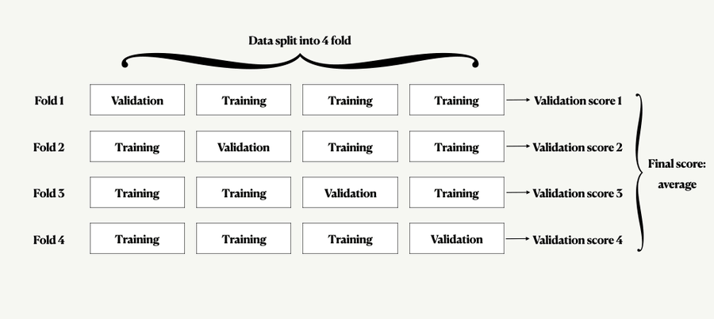
*From the labs.*

```python
def build_model(input_shape):
    model_d = Sequential([
        Dense(16, activation='relu', input_shape=(input_shape,)),
        Dense(8, activation='relu'),
        Dense(1, activation='sigmoid')])
    model_d.compile(optimizer='adam', loss='binary_crossentropy', metrics=['accuracy'])
    return model_d

num_epochs = 50
k = 8
num_val_samples = len(train_set) // k
for k in range(k):
    val_data = train_data[k * num_val_samples: (k + 1) * num_val_samples]
    val_targets = train_targets[k * num_val_samples: (k + 1) * num_val_samples]
    partial_train_data = np.concatenate([train_data[:k * num_val_samples], train_data[(k + 1) * num_val_samples:]], axis=0)
    partial_train_targets = np.concatenate([train_targets[:k * num_val_samples], train_targets[(k + 1) * num_val_samples:]], axis=0)
    model = build_model(input_shape)
    history = model.fit(partial_train_data, partial_train_targets, epochs=num_epochs, batch_size=1, verbose=1)
    all_scores.append(history.history['loss'])

average_history = [np.mean([x[i] for x in all_scores]) for i in range(num_epochs)]   # average curve over the folds
```

> [!WARNING]
> **Not in the labs: this cell does not do K-fold.**
>
> - `train_set = (train_data, train_targets)` is a **tuple of two arrays**, so `len(train_set)` is 2 and `num_val_samples = 2 // 8 = 0`.
>   Every validation slice is empty and every "fold" trains on all 768 rows. It should be `len(train_data) // k` (96 rows per fold).
> - It stores `history.history['loss']`, the **training** loss, and plots it as "Validation loss": the validation data are never given to `fit`.
> - `for k in range(k)` reuses the name of the number of folds as the loop variable. It works only because `range(k)` is evaluated once.
> - The features are not scaled and `batch_size=1` makes each epoch 768 updates long (672 with correct folds).
>
> A corrected version:
>
> ```python
> from sklearn.model_selection import KFold
> kf = KFold(n_splits=8, shuffle=True, random_state=42)
> all_val_loss = []
> for train_idx, val_idx in kf.split(train_data):
>     scaler = MinMaxScaler().fit(train_data[train_idx])          # scale with the training folds only
>     x_tr, x_val = scaler.transform(train_data[train_idx]), scaler.transform(train_data[val_idx])
>     model = build_model(input_shape)
>     h = model.fit(x_tr, train_targets[train_idx], epochs=num_epochs, batch_size=32, verbose=0,
>                   validation_data=(x_val, train_targets[val_idx]))
>     all_val_loss.append(h.history['val_loss'])
> average_history = np.mean(all_val_loss, axis=0)                 # mean validation loss per epoch
> best_epoch = np.argmin(average_history) + 1                     # then retrain on all the data for best_epoch epochs
> ```

**Parameters recap.**

| Parameter | Value here | What it does |
|---|---|---|
| `k` (`n_splits`) | 8 | number of folds: each model trains on 7/8 and validates on 1/8 |
| `num_val_samples` | should be 768 // 8 = 96 | size of each validation fold |
| `batch_size` | 1 | one update per example: slow and noisy; 16 to 64 is more usual |
| `epochs` | 50 | the average curve over the folds tells how many epochs to use in the final training |

## L2.7 Multi-class classification: Reuters newswires

**Single-label, multi-class**: each input belongs to exactly one of more than two classes (with several labels per input it would be multi-label).
The Reuters dataset has short newswires in **46 topics**, 8982 for training and 2246 for testing, already encoded as lists of word indices.

```python
from tensorflow.keras.datasets import reuters
(train_data, train_labels), (test_data, test_labels) = reuters.load_data(num_words=10000)   # keep the 10,000 most frequent words

x_train = vectorize_sequences(train_data)     # multi-hot vectors of length 10,000, as for IMDb
y_train = to_one_hot(train_labels)            # label 3 -> [0, 0, 0, 1, 0, ..., 0], length 46
# or: from tensorflow.keras.utils import to_categorical; y_train = to_categorical(train_labels)
```

```python
model = models.Sequential()
model.add(layers.Dense(64, activation='relu', input_shape=(10000,)))
model.add(layers.Dense(64, activation='relu'))
model.add(layers.Dense(46, activation='softmax'))
model.compile(optimizer='rmsprop', loss='categorical_crossentropy', metrics=['accuracy'])

x_val, partial_x_train = x_train[:1000], x_train[1000:]
y_val, partial_y_train = y_train[:1000], y_train[1000:]
history = model.fit(partial_x_train, partial_y_train, epochs=20, batch_size=512,
                    validation_data=(x_val, y_val))
```

Why 64 units and not 16 as for IMDb: a Dense layer only sees the output of the previous one, so a layer of 16 would be an **information
bottleneck** for 46 classes. **Softmax** gives 46 probabilities that sum to 1; for 3 classes, a target `[0, 0, 1]` and an output
`[0.1, 0.1, 0.8]` is a good prediction. **Categorical cross-entropy** measures the distance between the predicted distribution and the true one.

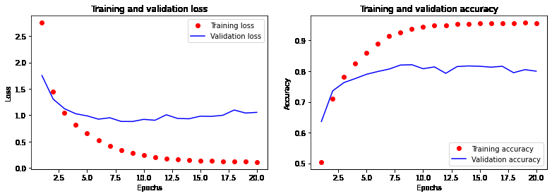
*From the labs: the validation accuracy peaks at about 0.82 around epoch 9, then the network overfits.*

After 20 epochs the test accuracy is **0.78** (loss 1.23). `model.predict(x_test)` returns one vector of 46 probabilities per newswire;
`np.argmax(predictions[0])` is the predicted topic (3 for the first one, with probability 0.915).

> [!TIP]
> **Not in the labs: two improvements.** Train for about 9 epochs instead of 20 (where the validation loss is lowest, as in the summary,
> [3.2](summary.md#32-multi-class-classification-reuters-newswires)). And keep the labels as integers with `loss='sparse_categorical_crossentropy'`:
> same loss, but no one-hot matrix in memory, which matters a lot in L5.5.

**Parameters recap.**

| Parameter | Value here | What it does |
|---|---|---|
| `num_words` | 10000 | vocabulary size: rarer words are dropped |
| `Dense(46, activation='softmax')` | 46 units | one output per class, probabilities summing to 1 |
| `loss` | `'categorical_crossentropy'` | for one-hot labels; `'sparse_categorical_crossentropy'` for integer labels |
| `optimizer` | `'rmsprop'` | adapts the step of each weight (L8.1) |
| `batch_size` | 512 | 16 updates per epoch on 7982 newswires |
| `epochs` | 20 | too many: the best is about 9 |

## L2.8 Multi-class classification: Fashion-MNIST

The TensorFlow tutorial *Basic classification*: 70,000 grayscale images of clothes, $28 \times 28$ pixels, 10 classes (T-shirt/top, trouser,
pullover, dress, coat, sandal, shirt, sneaker, bag, ankle boot); 60,000 for training and 10,000 for testing. The pixels go from 0 to 255 and are
divided by 255.

```python
model = tf.keras.Sequential([
    tf.keras.layers.Flatten(input_shape=(28, 28)),      # 28x28 image -> vector of 784 pixels, no weights
    tf.keras.layers.Dense(128, activation='relu'),
    tf.keras.layers.Dense(10)                           # no activation: 10 logits
])
model.compile(optimizer='adam',
              loss=tf.keras.losses.SparseCategoricalCrossentropy(from_logits=True),
              metrics=['accuracy'])
model.fit(train_images, train_labels, epochs=10)        # about 0.91 accuracy on the training data
test_loss, test_acc = model.evaluate(test_images, test_labels, verbose=2)   # 0.8789
```

**Logits and `from_logits=True`.** The last layer has no softmax, so it outputs **logits**, raw scores. `from_logits=True` tells the loss to
apply the softmax itself (it is also more stable numerically). The labels are integers 0 to 9, hence the **sparse** categorical cross-entropy.
To get probabilities after training, append a softmax layer:

```python
probability_model = tf.keras.Sequential([model, tf.keras.layers.Softmax()])
predictions = probability_model.predict(test_images)
np.argmax(predictions[0])          # 9: ankle boot, which is the right label

img = np.expand_dims(test_images[1], 0)   # Keras predicts on batches: (28, 28) -> (1, 28, 28)
probability_model.predict(img)            # class 2, pullover, with probability 0.997
```

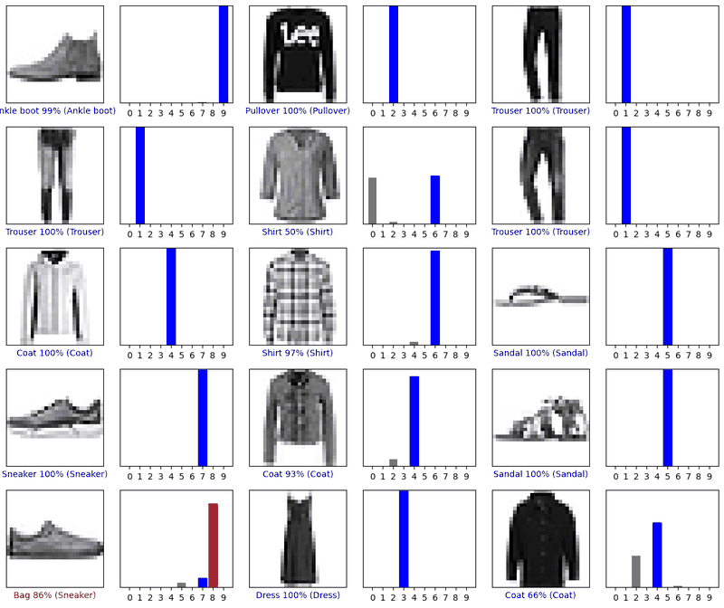
*From the labs: blue labels are right, red are wrong, with the confidence; the model can be wrong while being very confident.*

The test accuracy (0.88) is a bit lower than the training accuracy (0.91): a small amount of **overfitting**.

> [!TIP]
> **Not in the labs: counting.** `Flatten` has no parameters; the first `Dense` has $784 \cdot 128 + 128 = 100{,}480$, the second
> $128 \cdot 10 + 10 = 1290$: **101,770** in total.

**Parameters recap.**

| Parameter | Value here | What it does |
|---|---|---|
| `Flatten(input_shape=(28, 28))` | | turns each image into a vector; the batch dimension is untouched |
| `Dense(128, activation='relu')` | 128 units | the only hidden layer |
| `Dense(10)` | no activation | logits, one per class |
| `SparseCategoricalCrossentropy(from_logits=True)` | | integer labels and raw scores in input |
| `epochs` | 10 | no validation set here: the test set is used only at the end |

---

# Lab 3: a neural network from scratch

Before using Keras as a black box, the lab writes a feedforward network with NumPy only: forward pass, backpropagation and gradient descent.
The slides (*Building Neural Network from Scratch*, credits Angelica Liguori) follow the same structure as the summary,
section [2](summary.md#2-neural-networks-the-basic-ingredients).

## L3.1 The five ingredients

A neural network is a tuple $net = \{g, l, o, i, fpp\}$:

- **$g$, the graph:** a weighted, labeled, directed graph $g = \{N, E\}$. Each node $i$ (a **neuron**) has an **activation** $a_i$ and an
  **activation function** $f_i$ that produces the output $z_i = f_i(a_i)$, where $a_i = b_i + \sum_{j \to i} w_{ji} z_j$. Each edge $j \to i$ has a
  **weight** $w_{ji}$; the **bias** $b_i$ is the weight of an extra edge from a "ghost" node. Nodes that share the same inputs form a **layer**; for the
  input layer $z_i = x_i$. In compact form, for two consecutive layers $h \to k$: $\vec z_k = f_k(\vec b_k + W_k \vec z_h)$;
- **$l$, the loss function:** the network is a non-linear operator with unknown weights $W$ and biases $B$; training looks for
  $\arg\min_{W, B} \frac{1}{n}\sum_{i=1}^{n} loss[\vec y_i, g(\vec x_i \mid W, B)]$;
- **$o$, the optimizer:** setting the gradient to zero and solving is impossible with many noisy data and parameters, so we use a heuristic and
  accept a local optimum: **gradient descent**, $[W, B]_{t+1} = [W, B]_t - \eta \frac{1}{n}\sum_{i=1}^{n} \nabla_{W,B}\, loss[\vec y_i, g(\vec x_i \mid W, B)]$,
  where $\eta$ is the **learning rate**;
- **$i$, the initialization:** the starting values of weights and biases; since gradient descent is a local search, the starting point matters;
- **$fpp$, the fix point procedure:** the training loop, repeated for a number of epochs: forward, loss, backpropagation, update, record the loss.

```text
net = CustomNeuralNetwork(...)
initialize_weights_and_biases(net)
for epoch in range(epochs):
    loss = loss_function(out_target, net(input))
    back_propagation(loss, optimizer, net)
    history.append(loss)
```

**Backpropagation** uses the chain rule to propagate the error from the output layer back to the input layer.

## L3.2 SimpleNeuralNetwork: forward and backward

The first network has 2 inputs, one hidden layer of 3 neurons and 1 output, all with sigmoid activation.

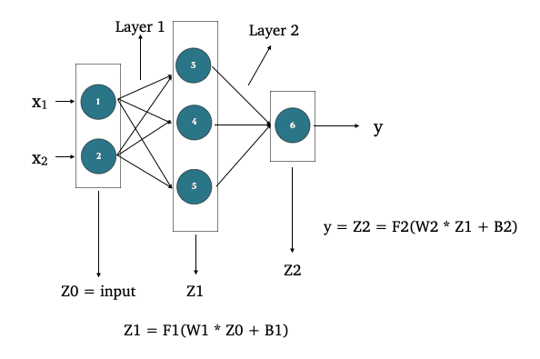
*From the labs: $Z_1 = F_1(W_1 Z_0 + B_1)$ and $y = Z_2 = F_2(W_2 Z_1 + B_2)$.*

```python
class SimpleNeuralNetwork:
  def __init__(self, n_input=2, n_hidden=3, n_output=1):
    self.W1 = np.random.rand(n_input, n_hidden)       # (2, 3), uniform in [0, 1)
    self.W2 = np.random.rand(n_hidden, n_output)      # (3, 1)
    self.B1 = np.zeros(n_hidden)                      # (3,)
    self.B2 = np.zeros(n_output)                      # (1,)

  def activationFunction(self, A):
    return 1. / (1. + np.exp(-A))                     # sigmoid

  def gradActFuction(self, out):
    return out * (1 - out)                            # sigmoid'(a), written with the OUTPUT z = sigmoid(a)

  def forward(self, input):
    self.Z0 = input                                   # (N, 2): one row per example
    self.A1 = np.dot(self.Z0, self.W1) + self.B1      # (N, 3)
    self.Z1 = self.activationFunction(self.A1)
    self.A2 = np.dot(self.Z1, self.W2) + self.B2      # (N, 1)
    self.Z2 = self.activationFunction(self.A2)
    return self.Z2

  def grad(self, input, output, output_pred, learning_rate):
    self.delta2 = (output_pred - output) * self.gradActFuction(output_pred)          # (N, 1)
    self.dW2 = np.matmul(self.Z1.T, self.delta2)                                     # (3, 1)
    self.dB2 = np.sum(self.delta2, axis=0)
    self.delta1 = np.matmul(self.delta2, self.W2.T) * self.gradActFuction(self.Z1)   # (N, 3)
    self.dW1 = np.matmul(self.Z0.T, self.delta1)                                     # (2, 3)
    self.dB1 = np.sum(self.delta1, axis=0)
    m = input.shape[1]
    self.W1 -= learning_rate * self.dW1 / m
    self.W2 -= learning_rate * self.dW2 / m
    self.B1 -= learning_rate * self.dB1 / m
    self.B2 -= learning_rate * self.dB2 / m

  def fit(self, input, output, epochs=1, learning_rate=0.05):
    for epoch in range(epochs):
      output_pred = self.forward(input)
      history.append(self.loss(output, output_pred))
      self.grad(input, output, output_pred, learning_rate)
```

**Reading the backward pass.** With the squared error $L = \frac{1}{2}\sum (z_2 - y)^2$:

| Quantity | Formula | Shape | Meaning |
|---|---|---|---|
| $\delta_2$ | $(z_2 - y) \odot \sigma'(a_2)$ | (N, 1) | error at the output, times the slope of the sigmoid |
| $\partial L / \partial W_2$ | $Z_1^\top \delta_2$ | (3, 1) | each weight gets (input it multiplies) × (error it caused), summed over the N examples |
| $\partial L / \partial B_2$ | $\sum_{rows} \delta_2$ | (1,) | the bias multiplies a constant 1 |
| $\delta_1$ | $(\delta_2 W_2^\top) \odot \sigma'(a_1)$ | (N, 3) | the error sent back through $W_2$ to the hidden neurons |
| $\partial L / \partial W_1$ | $Z_0^\top \delta_1$ | (2, 3) | same rule, one layer earlier |

The shape of each gradient is the shape of the weight it updates: a quick check that the matrix products are in the right order.

> [!TIP]
> **Not in the labs: one step by hand, with the numbers of the notebook.** The generic network of L3.4 (3 inputs, 2 hidden, 1 output, seed 42) starts with
> $W_1 = \begin{pmatrix} 0.375 & 0.951 \\ 0.732 & 0.599 \\ 0.156 & 0.156 \end{pmatrix}$, $W_2 = \begin{pmatrix} 0.058 \\ 0.866 \end{pmatrix}$, biases 0.
> Take the person $x = (0, 1, 0)$ (does not smoke, obese, no exercise), who is diabetic, $y = 1$.
>
> - **Forward.** $a_1 = x W_1$ = the second row of $W_1$ = $(0.732, 0.599)$; $z_1 = \sigma(a_1) = (0.675, 0.645)$;
>   $a_2 = 0.675 \cdot 0.058 + 0.645 \cdot 0.866 = 0.598$; $z_2 = \sigma(0.598) = 0.645$. These are the values printed by `net.A` and `net.Z`.
> - **Output error.** $\delta_2 = (0.645 - 1) \cdot 0.645 \cdot (1 - 0.645) = -0.355 \cdot 0.229 = -0.0812$.
> - **Output weights.** $\partial L/\partial W_2 = z_1^\top \delta_2 = (0.675, 0.645) \cdot (-0.0812) = (-0.0548, -0.0524)$: both negative, so the
>   update increases both weights and the output moves towards 1.
> - **Back to the hidden layer.** $\delta_1 = \delta_2 W_2^\top \odot z_1(1 - z_1) = (-0.0047, -0.0703) \odot (0.219, 0.229) = (-0.0010, -0.0161)$.
>   The second hidden neuron gets most of the blame because its weight towards the output (0.866) is larger.
> - **Input weights.** $\partial L/\partial W_1 = x^\top \delta_1$: only the row of the obesity input is non-zero, $(-0.0010, -0.0161)$. Inputs equal
>   to 0 do not change their weights.

> [!WARNING]
> **Not in the labs: two problems in the code.**
>
> - **The plotted loss is not the minimized one.** `loss()` returns `np.mean(np.sqrt(np.abs(out - out_pred)))`, the mean square **root** of the error,
>   and the plot labels it "Mean Squared Error"; the gradient in `grad()` is the one of the squared error. Training still minimizes the squared error,
>   but the curve shows another quantity. For an MSE curve: `np.mean((out - out_pred) ** 2)`.
> - **`m = input.shape[1]` is the number of features, not of examples.** The gradients are **sums** over the $N$ rows, so they should be divided by
>   $N$ = `input.shape[0]`. Dividing by 2 (the features) makes the effective learning rate $N/2$ times larger: with 750 training rows,
>   $0.05 \cdot 375 \approx 19$ on the mean gradient. This explains the jumps and oscillations of the loss curves below.
>
> Also, `np.random.rand` initializes all weights in $[0, 1)$, all positive: the usual choice is small values centered on 0 (Glorot or He, summary
> [2.6](summary.md#26-initialization)).

**Parameters recap.**

| Parameter | Value here | What it does |
|---|---|---|
| `n_input`, `n_hidden`, `n_output` | 2, 3, 1 | the graph: sizes of the three layers, so $W_1$ is (2, 3) and $W_2$ is (3, 1) |
| activation | sigmoid everywhere | output in (0, 1), read as a probability |
| `learning_rate` | 0.05 | $\eta$ of gradient descent |
| `epochs` | 2000 (toy), 6000 | number of forward and backward passes on the **whole** training set (full-batch gradient descent) |
| initialization | `np.random.rand`, biases 0 | the starting point $i$ |

## L3.3 The toy dataset and the accuracy trap

`toy_dataset.csv`: 1000 people with age, annual income and whether they are ill. **Goal:** predict the illness from age and income.

```python
df.Illness = pd.Categorical(df.Illness).codes          # 'No' -> 0, 'Yes' -> 1
data = np.array(df.drop(columns='Illness'))
labels = np.array(df['Illness']).reshape(-1, 1)        # column vector (1000, 1)
data = scale(data)                                     # standardization: mean 0, std 1 per column
x_train, x_val, y_train, y_val = train_test_split(data, labels, random_state=0)   # 750 / 250

net = SimpleNeuralNetwork()
net.fit(x_train, y_train, epochs=2000)
y_pred_bin_val = (net.predict(x_val) >= 0.5).astype("int")    # threshold 0.5
# Training accuracy 0.897, Validation accuracy 0.924
```

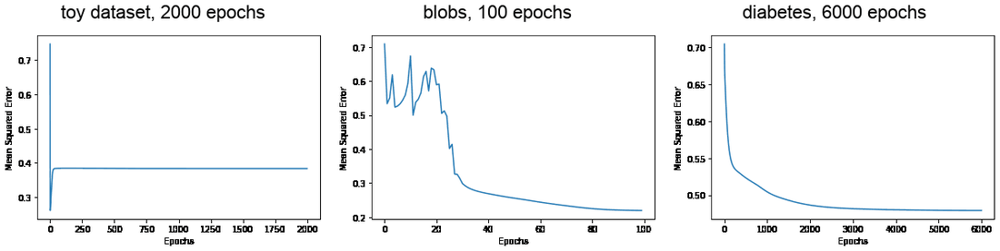
*From the labs: toy dataset (the curve drops, jumps up and stays flat), blobs (oscillations, then convergence), diabetes.*

> [!WARNING]
> **Not in the labs: 92% accuracy that means nothing.** In the dataset 904 people are healthy and 96 are ill: **90.4%** of negatives. Now
> $0.8973 \cdot 750 = 673$ and $0.924 \cdot 250 = 231$, and $673 + 231 = 904$: the correct answers are exactly the healthy people. The network
> answers "not ill" for everyone. The flat loss agrees: a constant output of about 0.1 for everyone gives
> $0.904\sqrt{0.1} + 0.096\sqrt{0.9} \approx 0.38$, the level where the curve stops.
>
> Lessons: compare accuracy with the **majority baseline**; look at the confusion matrix and at recall on the rare class; with unbalanced classes
> use balancing (oversampling, `class_weight`) or metrics like F1 (summary, [1.5](summary.md#15-classification-and-evaluation-metrics)).

## L3.4 A generic feedforward network

`myNeuralNetwork(n_inputs, n_hiddens=[2], n_outputs=1)` generalizes the class to any list of hidden layers. The weights live in dictionaries
indexed by layer, and forward and backward become loops:

```python
self.shape = [self.n_inputs] + self.n_hiddens + [self.n_outputs]     # e.g. [3, 2, 1]
for i in range(len(self.n_hiddens) + 1):
    self.W[i+1] = np.random.rand(self.shape[i], self.shape[i+1])
    self.B[i+1] = np.zeros(self.shape[i+1])

# forward
self.Z[0] = input
for i in range(len(self.n_hiddens) + 1):
    self.A[i+1] = np.dot(self.Z[i], self.W[i+1]) + self.B[i+1]
    self.Z[i+1] = self.activationFunction(self.A[i+1])

# backward: from the last layer L down to 1
self.delta[L] = (output_pred - output) * self.grad_activationFunction(output_pred)
for k in range(L, 0, -1):
    self.dW[k] = np.matmul(self.Z[k-1].T, self.delta[k])
    self.dB[k] = np.sum(self.delta[k], axis=0)
    self.delta[k-1] = np.matmul(self.delta[k], self.W[k].T) * self.grad_activationFunction(self.Z[k-1])
```

Three experiments:

| Data | Setting | Result |
|---|---|---|
| 9 people: smoking, obesity, exercise → diabetic (the label equals the obesity column) | `[2]` hidden, 6000 epochs | train 1.0, validation 1.0 |
| `make_blobs`: 5000 points in 2 clusters, split with `stratify=labels` | `[2]` hidden, 100 epochs | train 0.967, validation 0.970 |
| Pima diabetes (L3.5) | `[2]` hidden, 6000 epochs | train 0.797, validation 0.766 |

> [!NOTE]
> **Not in the labs.** The first validation set has 3 people, all non-diabetic: 100% on 3 examples of one class says very little.
> `stratify=labels` in the second split keeps the same class proportions in training and validation.

## L3.5 Diabetes and the confusion matrix

The same Pima dataset of Lab 2 (768 patients), standardized with `scale` and split 576 / 192:

```python
net = myNeuralNetwork(n_input)                 # 8 inputs, 2 hidden, 1 output
net.fit(x_train, y_train, epochs=6000)          # train 0.797, validation 0.766

from sklearn.metrics import confusion_matrix
cf = confusion_matrix(y_pred_bin_val, y_val)    # [[113, 28], [17, 34]]
import seaborn as sn
sn.heatmap(cf, annot=True, fmt='g')
```

> [!WARNING]
> **Not in the labs: the arguments are swapped.** scikit-learn's signature is `confusion_matrix(y_true, y_pred)`, rows = true class. Here the
> predictions come first, so the **rows are the predictions** and the columns the true classes:
>
> | | true 0 (healthy) | true 1 (diabetic) |
> |---|---|---|
> | **predicted 0** | 113 | 28 |
> | **predicted 1** | 17 | 34 |
>
> Accuracy $= (113 + 34)/192 = 0.766$, against a baseline of $130/192 = 0.677$ (always "healthy"). **Recall** on diabetics $= 34/62 = 0.55$:
> almost half of the sick patients are missed. **Precision** $= 34/51 = 0.67$. For a medical screening the recall matters more than the accuracy.

**Parameters recap.**

| Parameter | Value here | What it does |
|---|---|---|
| `n_hiddens` | `[2]` | list of hidden layer sizes: `[16, 8]` would give two hidden layers |
| threshold | 0.5 | from probability to class: `(y_pred >= 0.5)`; lowering it raises recall |
| `scale(data)` | | standardization, so age and income get comparable ranges |
| `random_state` | 0 | fixes the split, for reproducible results |
| `stratify` | `labels` | same class proportions in the two sets |

---

# Lab 4: convolutional neural networks

Convolution, padding and strides; a CNN trained on photos loaded from folders; data augmentation; two hands-on projects (cats and dogs, faces)
with feature maps and transfer learning. Theory: summary, sections [5](summary.md#5-convolutional-networks) and
[6](summary.md#6-pre-trained-convnets-and-advanced-keras).

## L4.1 Conv2D: filters, padding, strides

A convolution works on 3D tensors called **feature maps**: height, width and **channels** (depth). An RGB image has 3 channels, a grayscale one 1.
The layer slides small windows (**patches**) over the input and applies the **same** transformation (a filter of weights) to each patch.
The output is again a feature map: its depth is the **number of filters**, a parameter of the layer, and its channels no longer mean colors but
the presence of the pattern each filter has learned.

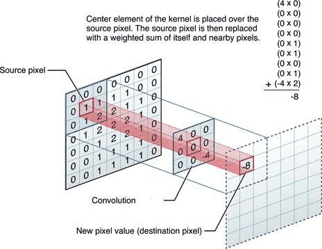
*From the labs: the kernel is placed on a pixel and its neighbors, the products are summed and the sum becomes the output pixel (here $-8$).*

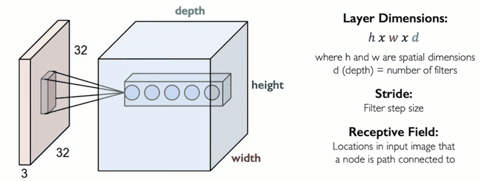
*From my MIT 6.S191 notes: a layer has dimensions $h \times w \times d$, where $d$ is the number of filters; the stride is the step of the filter,
the receptive field the part of the input a neuron sees.*

Output width and height can differ from the input for two reasons:

- **border effects**, countered by **padding**: `padding='valid'` (the default) means no padding, only windows fully inside the input;
  `padding='same'` adds zeros around the input so that the output has the same width and height (with stride 1);
- **strides**: how many pixels the window moves at each step.

$$W_{out} = \frac{W_{in} - W_{kernel} + 2 \cdot \text{PADDING}}{\text{STRIDE}} + 1 \qquad H_{out} = \frac{H_{in} - H_{kernel} + 2 \cdot \text{PADDING}}{\text{STRIDE}} + 1$$

(rounded down when the division is not exact).

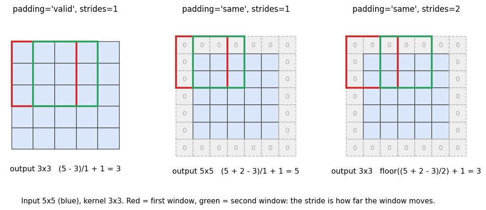
*Not in the labs: the same 5×5 input with a 3×3 kernel. `same` pads with one ring of zeros.*

**Pooling** reduces width and height: `MaxPooling2D((2, 2))` keeps the maximum of each 2×2 window and, by default, moves by 2, so it halves both
dimensions. It has no weights.

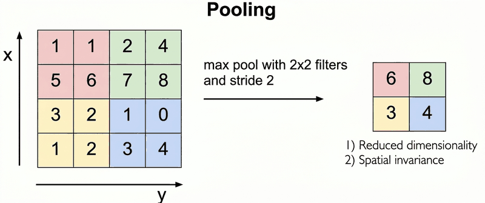
*From my MIT 6.S191 notes: each colored 2×2 block becomes its maximum.*

> [!TIP]
> **Not in the labs: counting the parameters of a Conv2D.** Each filter has $k_h \cdot k_w \cdot C_{in}$ weights plus one bias, so the layer has
> $(k_h \cdot k_w \cdot C_{in} + 1) \cdot \text{filters}$. Example: `Conv2D(32, (5, 5))` on an RGB image: $(5 \cdot 5 \cdot 3 + 1) \cdot 32 = 2432$.
> The number does **not** depend on the image size: this is weight sharing.

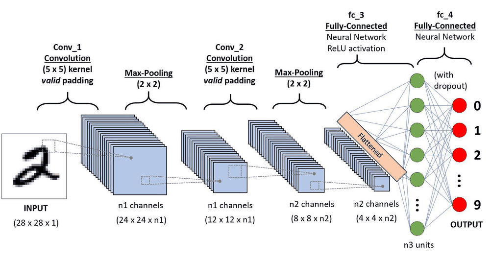
*From the labs: convolution and pooling blocks extract features, the flattened result goes to fully connected layers that classify.*

## L4.2 Flowers: a CNN on images read from folders

3670 photos of flowers in 5 sub-directories, one per class (daisy, dandelion, roses, sunflowers, tulips). Keras reads them directly from disk into a
`tf.data.Dataset` of batches:

```python
batch_size = 32
img_height = img_width = 180
train_set = tf.keras.preprocessing.image_dataset_from_directory(
    data_dir, validation_split=0.2, subset='training', seed=42,
    image_size=(img_height, img_width), batch_size=batch_size)      # 2936 files for training
val_set = tf.keras.preprocessing.image_dataset_from_directory(
    data_dir, validation_split=0.2, subset='validation', seed=42,
    image_size=(img_height, img_width), batch_size=batch_size)      # 734 files for validation
train_set.class_names          # ['daisy', 'dandelion', 'roses', 'sunflowers', 'tulips']: the folder names
```

Each batch is a pair: images `(32, 180, 180, 3)` and integer labels `(32,)`. The **same seed** in the two calls makes the training and validation
subsets complementary. The pixel values are in $[0, 255]$: a `Rescaling(1./255)` layer brings them to $[0, 1]$, either with
`train_set.map(lambda x, y: (norm_layer(x), y))` or, better, as the first layer of the model.

```python
model = Sequential()
model.add(layers.Input(shape=(img_height, img_width, 3)))
model.add(layers.experimental.preprocessing.Rescaling(1. / 255.))
model.add(layers.Conv2D(32, (5, 5), activation='relu'))
model.add(layers.MaxPooling2D((2, 2)))
model.add(layers.Conv2D(64, (5, 5), activation='relu'))
model.add(layers.MaxPooling2D((2, 2)))
model.add(layers.Conv2D(128, (5, 5), activation='relu'))
model.add(layers.MaxPooling2D((2, 2)))
model.add(layers.Flatten())
model.add(layers.Dense(128, activation='relu'))
model.add(layers.Dense(num_classes, activation='softmax'))          # num_classes = 5
model.compile(optimizer='adam',
              loss=tf.keras.losses.SparseCategoricalCrossentropy(),  # integer labels, softmax output
              metrics=['accuracy'])
history = model.fit(train_set, validation_data=val_set, epochs=5)
```

| Layer | Output shape | Parameters | How |
|---|---|---|---|
| Rescaling | (180, 180, 3) | 0 | |
| Conv2D 32, 5×5 | (176, 176, 32) | 2,432 | $180 - 5 + 1 = 176$; $(25 \cdot 3 + 1) \cdot 32$ |
| MaxPooling 2×2 | (88, 88, 32) | 0 | halves |
| Conv2D 64, 5×5 | (84, 84, 64) | 51,264 | $(25 \cdot 32 + 1) \cdot 64$ |
| MaxPooling | (42, 42, 64) | 0 | |
| Conv2D 128, 5×5 | (38, 38, 128) | 204,928 | $(25 \cdot 64 + 1) \cdot 128$ |
| MaxPooling | (19, 19, 128) | 0 | |
| Flatten | (46,208) | 0 | $19 \cdot 19 \cdot 128$ |
| Dense 128 | (128) | 5,914,752 | $46{,}208 \cdot 128 + 128$ |
| Dense 5 | (5) | 645 | |
| **Total** | | **6,174,021** | |

Width and height shrink layer after layer, the number of channels grows: the network trades spatial detail for more abstract features.

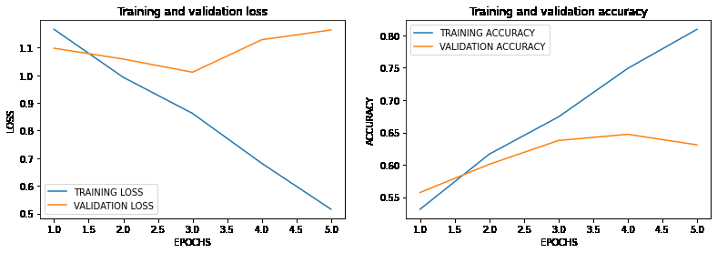
*From the labs: after 5 epochs the training accuracy is 0.81, the validation accuracy stops at about 0.65 and the validation loss grows from epoch 3:
overfitting on 2936 images.*

> [!TIP]
> **Not in the labs: where the parameters are.** 96% of the 6.2 million weights are in the single Dense layer after `Flatten`. This is why the next
> model uses smaller filters and more pooling, and why many real networks replace `Flatten` with `GlobalAveragePooling2D`.

**Parameters recap.**

| Parameter | Value here | What it does |
|---|---|---|
| `Conv2D(32, (5, 5))` | 32 filters, kernel 5×5 | number of output channels and size of the window |
| `activation='relu'` | | non-linearity after each convolution |
| `padding` | default `'valid'` | no zeros added: the output shrinks by $k - 1$ |
| `strides` | default 1 | the window moves by 1 pixel |
| `MaxPooling2D((2, 2))` | pool 2×2, stride 2 | halves width and height |
| `image_size` | (180, 180) | every image is resized on loading |
| `validation_split`, `subset`, `seed` | 0.2, training/validation, 42 | the split is done on the file list; same seed in both calls |
| `SparseCategoricalCrossentropy()` | `from_logits=False` | integer labels; the output already has a softmax |

## L4.3 Data augmentation and dropout

With few images, **data augmentation** creates realistic variations of the training images (flips, rotations, zooms), so the network never sees
exactly the same picture twice:

```python
data_augmentation = tf.keras.Sequential([
    layers.RandomFlip("horizontal", input_shape=(img_height, img_width, 3)),
    layers.RandomRotation(0.1),
    layers.RandomZoom(0.1),
])
```

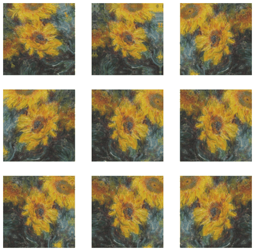
*From the labs.*

```python
model = Sequential([
    data_augmentation,
    layers.Rescaling(1./255),
    layers.Conv2D(16, 3, padding='same', activation='relu'),
    layers.MaxPooling2D(),
    layers.Conv2D(32, 3, padding='same', activation='relu'),
    layers.MaxPooling2D(),
    layers.Conv2D(64, 3, padding='same', activation='relu'),
    layers.MaxPooling2D(),
    layers.Dropout(0.2),
    layers.Flatten(),
    layers.Dense(128, activation='relu'),
    layers.Dense(num_classes, activation='softmax')
])
history = model.fit(train_set, validation_data=val_set, epochs=15)
```

With `padding='same'` the convolutions keep the size and only pooling halves it: $180 \to 90 \to 45 \to 22$, then `Flatten` gives
$22 \cdot 22 \cdot 64 = 30{,}976$ values. After 15 epochs the training accuracy is 0.80 and the validation accuracy 0.72 (best 0.73): lower training
accuracy than before, but the two curves stay close and the validation accuracy is 8 points higher.

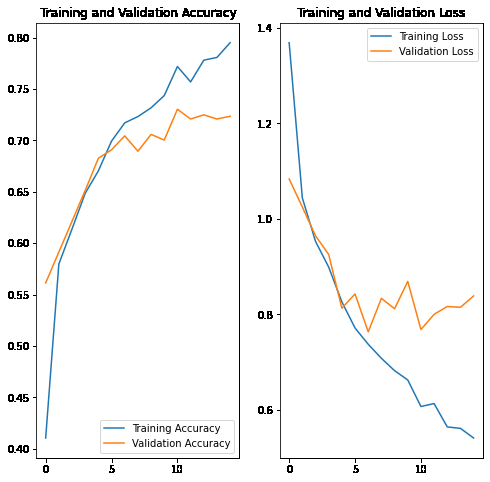
*From the labs.*

**Prediction on a new image.** The model wants a batch, so one image must get a batch dimension:

```python
img = tf.keras.preprocessing.image.load_img(sunflower_path, target_size=(img_height, img_width))
img_array = tf.keras.preprocessing.image.img_to_array(img)       # (180, 180, 3)
img_array = tf.expand_dims(img_array, axis=0)                    # (1, 180, 180, 3)
predictions = model.predict(img_array)
class_names[np.argmax(predictions)], 100 * np.max(predictions)  # 'sunflowers', 99.99
```

> [!TIP]
> **Not in the labs: what the numbers in the augmentation layers mean.** `RandomRotation(0.1)` rotates by a random fraction of a full turn in
> $[-0.1, 0.1]$, so up to $\pm 36°$; `RandomZoom(0.1)` zooms in or out by up to 10%. The augmentation layers and `Dropout` are active only during
> training (`fit`); in `predict` and `evaluate` they let the image through unchanged.

**Parameters recap.**

| Parameter | Value here | What it does |
|---|---|---|
| `RandomFlip("horizontal")` | | mirrors left and right at random |
| `RandomRotation(0.1)` | 0.1 of a turn | random rotation up to ±36° |
| `RandomZoom(0.1)` | 10% | random zoom in or out |
| `Conv2D(16, 3, padding='same')` | 16 filters 3×3 | `3` is short for `(3, 3)`; `same` keeps 180×180 |
| `MaxPooling2D()` | default (2, 2) | halves |
| `Dropout(0.2)` | 20% | regularization before the dense part |
| `epochs` | 15 | more epochs are possible because overfitting is slower |

## L4.4 Hands-on: cats versus dogs

The notebook is the Keras example *Image classification from scratch* (François Chollet) with the model cells left empty. The data: the Kaggle
Cats vs Dogs archive (786 MB), two folders `Cat` and `Dog`.

```python
# remove corrupted files: a valid JPEG has the string "JFIF" in its first bytes
for folder_name in ("Cat", "Dog"):
    for fname in os.listdir(os.path.join("PetImages", folder_name)):
        fpath = os.path.join("PetImages", folder_name, fname)
        with open(fpath, "rb") as fobj:
            is_jfif = tf.compat.as_bytes("JFIF") in fobj.peek(10)
        if not is_jfif:
            os.remove(fpath)                       # 1590 images deleted

train_ds = tf.keras.preprocessing.image_dataset_from_directory(
    "PetImages", validation_split=0.2, subset="training", seed=1337,
    image_size=(180, 180), batch_size=128)          # 23,410 files: 18,728 training, 4,682 validation
```

Labels: 0 = cat, 1 = dog (alphabetical order of the folders). The steps to complete: augmentation, standardization with `Rescaling`, a model with a
`Dropout` before the last layer, training (connected to TensorBoard, see Lab 9), inference. The notebook says that the full model gets over 90%
validation accuracy after 25 epochs.

> [!NOTE]
> **Not in the labs: a possible solution**, with the blocks of L4.3 and a binary output:
>
> ```python
> data_augmentation = keras.Sequential([layers.RandomFlip("horizontal"), layers.RandomRotation(0.1)])
>
> inputs = keras.Input(shape=(180, 180, 3))
> x = data_augmentation(inputs)
> x = layers.Rescaling(1./255)(x)
> for filters in [32, 64, 128, 256]:
>     x = layers.Conv2D(filters, 3, padding="same", activation="relu")(x)
>     x = layers.MaxPooling2D()(x)
> x = layers.GlobalAveragePooling2D()(x)             # (None, 256) instead of a huge Flatten
> x = layers.Dropout(0.5)(x)
> outputs = layers.Dense(1, activation="sigmoid")(x) # probability of "dog"
> model = keras.Model(inputs, outputs)
>
> model.compile(optimizer=keras.optimizers.Adam(1e-3), loss="binary_crossentropy", metrics=["accuracy"])
> model.fit(train_ds, validation_data=val_ds, epochs=25,
>           callbacks=[keras.callbacks.TensorBoard(log_dir="logs/catsdogs")])
>
> img = keras.utils.load_img("PetImages/Cat/6779.jpg", target_size=(180, 180))
> score = float(model.predict(keras.ops.expand_dims(keras.utils.img_to_array(img), 0))[0][0])
> print(f"{100 * (1 - score):.1f}% cat, {100 * score:.1f}% dog")
> ```
>
> With two classes, one sigmoid unit and `binary_crossentropy` is equivalent to two softmax units and categorical cross-entropy.

**Parameters recap.**

| Parameter | Value here | What it does |
|---|---|---|
| `image_size` | (180, 180) | photos of any size are resized |
| `batch_size` | 128 | 147 batches per epoch on 18,728 images |
| `seed` | 1337 | same split in the two calls |
| `Dense(1, activation="sigmoid")` + `binary_crossentropy` | | binary output: probability of class 1 (dog) |
| `GlobalAveragePooling2D` | | average of each channel: one number per filter, no weights |

## L4.5 UTKFace: predicting gender and age from a face

**The data.** UTKFace, cropped version: 23,708 face images of $200 \times 200$ pixels; the labels are in the file name,
`[age]_[gender]_[race]_[date&time].jpg`. The lab keeps only ages 18 to 25 (3404 images), resizes them to $50 \times 50$ and divides by 255.

```python
for img in os.listdir(path):
    ages = img.split("_")[0]
    if int(ages) < 18 or int(ages) > 25:
        continue
    genders = img.split("_")[1]
    img = cv2.imread(path + "/" + img)
    img = cv2.cvtColor(img, cv2.COLOR_BGR2RGB)          # OpenCV reads BGR
    img = cv2.resize(img, (50, 50), interpolation=cv2.INTER_AREA)
    images.append(np.array(img)); age.append(np.array(ages)); gender.append(np.array(genders))
```

**Class balance.** Gender: 1162 of class 0 and 2242 of class 1. Ages: from 98 people of 19 to 859 of 24. The minority gender is **augmented**
(flip, rotation, zoom) until both classes have 2242 images, 4484 in total:

```python
img_seeds = images[gender == minor_class]
n_augment = gender_class_counts[major_class] - gender_class_counts[minor_class]    # 1080 new images
idx_to_aug = np.random.randint(img_seeds.shape[0], size=n_augment)
new_images = [data_augmentation(img_seeds[i]) for i in idx_to_aug]
balanced_images = np.append(images, new_images, axis=0)

x_train_gender, x_test_gender, y_train_gender, y_test_gender = train_test_split(balanced_images, balanced_gender, random_state=42)
x_train_age, x_test_age, y_train_age, y_test_age = train_test_split(images, age, random_state=42)
```

**The gender model** (binary classification):

```python
gender_model = Sequential()
gender_model.add(Conv2D(32, kernel_size=3, activation='relu', input_shape=(50, 50, 3)))
gender_model.add(MaxPool2D(pool_size=3, strides=2))
gender_model.add(Conv2D(64, kernel_size=3, activation='relu'))
gender_model.add(MaxPool2D(pool_size=3, strides=2))
gender_model.add(Conv2D(128, kernel_size=3, activation='relu'))
gender_model.add(MaxPool2D(pool_size=3, strides=2))
gender_model.add(Flatten())
gender_model.add(Dropout(0.2))
gender_model.add(Dense(128, activation='relu'))
gender_model.add(Dense(1, activation='sigmoid', name='gender'))
gender_model.compile(optimizer='adam', loss='binary_crossentropy', metrics=['accuracy'])
history_gender = gender_model.fit(x_train_gender, y_train_gender,
                                  validation_data=(x_test_gender, y_test_gender), epochs=10)
gender_model.save(save_model_path + 'gender_model.h5')     # reused in L4.7
```

Shapes: $50 \to 48$ (conv 3×3) $\to 23$ (pool 3, stride 2: $\lfloor (48 - 3)/2 \rfloor + 1$) $\to 21 \to 10 \to 8 \to 3$, and `Flatten` gives
$3 \cdot 3 \cdot 128 = 1152$. Parameters: $896 + 18{,}496 + 73{,}856 + 147{,}584 + 129 = 240{,}961$. Validation accuracy after 10 epochs: about **0.93**.

**The age model** is the same network with a **regression** head, trained on the original (unbalanced) images:

```python
age_model.add(Dense(1, activation='linear', name='age'))
age_model.compile(optimizer='adam', loss='mse', metrics=['mae'])
```

The validation MAE goes from 2.68 years after the first epoch to **2.27** after the tenth (best 2.01, at epochs 4 and 7).

> [!WARNING]
> **Not in the labs: two things to check before trusting these numbers.**
>
> - **Leakage.** The augmented copies are created **before** `train_test_split`. A flipped photo of a person can end up in the training set and the
>   original in the test set, so the network is tested on faces it has already seen: the 0.93 is optimistic. Split first, then augment only the training set.
> - **A baseline for the age.** The ages go from 18 to 25 and their median is 23. A "model" that always answers 23 has an MAE of **1.75** years, and
>   always answering the mean (22.6) gives an MSE of **4.62**; the network ends with MAE 2.27 and MSE 6.47. It does not beat a constant. Age from a
>   50×50 face within an 8-year range is a hard task: a wider range of ages, larger images and more epochs would make the comparison meaningful.
>
> Minor: the cell title says "Rebalancing Age Classes" but the code rebalances gender; in `sns.heatmap(cm, annot=True)` add `fmt='d'` to see
> 500 instead of `5e+02`.

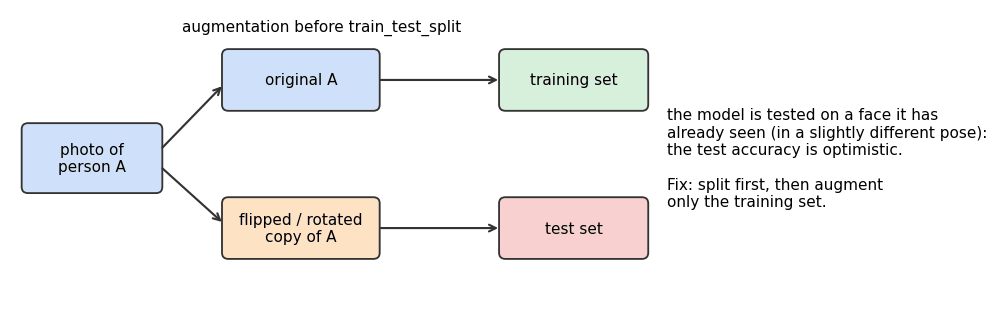
*Not in the labs.*

**Parameters recap.**

| Parameter | Value here | What it does |
|---|---|---|
| `Conv2D(32, kernel_size=3)` | 32 filters 3×3, `valid` | 50 → 48 |
| `MaxPool2D(pool_size=3, strides=2)` | window 3, step 2 | overlapping pooling: 48 → 23 |
| `Dropout(0.2)` | 20% | after `Flatten` |
| `Dense(1, 'sigmoid')` + `binary_crossentropy` | gender | classification |
| `Dense(1, 'linear')` + `mse`, metric `mae` | age | regression: MSE is minimized, MAE is easier to read (years) |
| `train_test_split(random_state=42)` | default `test_size=0.25` | 3363 / 1121 for gender, 2553 / 851 for age |
| `epochs` | 10 | |

## L4.6 Looking inside: feature maps

A trained model can be "opened": a new `Model` with the same input and, as outputs, the outputs of **all** its layers returns every intermediate
activation for one image.

```python
layer_outputs = [layer.output for layer in gender_model.layers]
activation_model = tf.keras.models.Model(inputs=gender_model.input, outputs=layer_outputs)
activations = activation_model.predict(np.reshape(x_test_gender[6], (-1, 50, 50, 3)))   # a batch of 1 image
# shapes: (1, 48, 48, 32), (1, 23, 23, 32), (1, 21, 21, 64), (1, 10, 10, 64), (1, 8, 8, 128), (1, 3, 3, 128),
#         (1, 1152), (1, 1152), (1, 128), (1, 1)
plt.matshow(activations[0][0, :, :, 4], cmap='viridis')     # channel 4 of the first convolution
```

The notebook then draws the first 10 channels of the first 6 layers. The first convolution responds to edges and color contrasts and still looks like
the face; deeper layers are smaller and more abstract, and some channels are empty (the ReLU outputs 0 where the pattern is absent).

## L4.7 Transfer learning: facial landmarks

**New task:** find 68 **landmarks** on a face (points on chin, eyebrows, nose, eyes and lips), each a pair $(x, y)$: a regression with 136 outputs.
**Idea:** reuse the convolutional part of the gender model, which already knows how to look at faces, and train only a new head.

The landmark files have one line per image, `filename x0 y0 x1 y1 ... x67 y67`. The lab keeps ages 25 to 35, 3000 images resized to $70 \times 70$, and
rescales the coordinates from the 200-pixel originals: `points[:, 0] //= (200 / 70)`.

```python
x_train, x_test, y_train, y_test = train_test_split(images, landmarks, test_size=0.2, random_state=42)   # landmarks: (3000, 136)

source_model = load_model(model_saved_path + 'gender_model.h5', compile=False)

new_model = Sequential()
new_model.add(Input(shape=(70, 70, 3)))
new_model.add(Resizing(50, 50))                                        # the source model saw 50x50 images
new_model.add(Conv2D(3, kernel_size=3, activation='relu', name='conv2d_new'))   # new name: names must be unique
for layer in source_model.layers[:-3]:                                 # all but Dropout, Dense 128, Dense 1
    layer.trainable = False                                            # freeze
    new_model.add(layer)
new_model.add(Dense(128, activation='relu'))
new_model.add(Dense(y_train.shape[1], activation='linear'))            # 136 coordinates
new_model.compile(optimizer='adam', loss='mae')
history = new_model.fit(x_train, y_train, validation_split=0.2, batch_size=10, epochs=10)
```

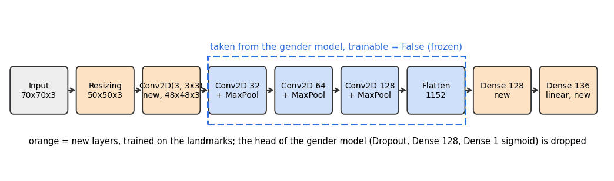
*Not in the labs: blue layers come from the gender model and are frozen, orange layers are new and trained.*

Both `Model` and `Layer` have the attribute `trainable` (default `True`): with `False` the weights are not updated by `fit`. The validation MAE goes
from 4.89 to about 3.1 pixels (3.71 at the last epoch) on images 70 pixels wide.

> [!TIP]
> **Not in the labs: why the frozen layers accept the new input.** A convolution does not care about width and height, only about the number of input
> channels: the frozen first `Conv2D` expects 3 channels, and `conv2d_new` outputs 3 (but learned ones, not RGB). The shapes become
> $48 \to 46 \to 22 \to 20 \to 9 \to 7 \to 3$, so `Flatten` still gives 1152. Even with another size nothing would break, because the `Dense` layer
> after `Flatten` is new. What is reused is the knowledge in the convolution filters.
>
> This is **feature extraction**. Real **fine-tuning** (summary, [6.2](summary.md#62-transfer-learning)) would then unfreeze the last convolutional
> block and train again with a small learning rate.

> [!NOTE]
> **Not in the labs: the landmark indices.** In the standard 68-point scheme the groups are: jaw 0 to 16, eyebrows 17 to 21 and 22 to 26,
> nose 27 to 35, eyes 36 to 41 and 42 to 47, mouth 48 to 67. The notebook lists `[42:47]` as a second "Left Eye" and the lips from 47.

**Parameters recap.**

| Parameter | Value here | What it does |
|---|---|---|
| `layer.trainable = False` | conv and pooling layers | frozen: their weights do not change |
| `source_model.layers[:-3]` | | drops the old head (Dropout, Dense 128, Dense 1) |
| `Resizing(50, 50)` | | adapts the 70×70 input to the size the filters were trained on |
| `Dense(136, activation='linear')` | 68 × 2 | regression output: one value per coordinate |
| `loss='mae'` | | mean absolute error in pixels |
| `batch_size` | 10 | 192 updates per epoch on 1920 images |
| `validation_split` | 0.2 | 480 of the 2400 training images |

---

# Lab 5: recurrent networks and NLP

Sequences (audio, text, video), recurrent networks and LSTM, text turned into numbers, a sentiment classifier on IMDb and a next word predictor.
Theory: summary, sections [11](summary.md#11-time-series-and-recurrent-networks), [12](summary.md#12-word-embeddings) and
[13](summary.md#13-language-modeling).

## L5.1 Recurrent networks and LSTM

A **recurrent neural network** accepts inputs and produces outputs of variable length: at each step of the sequence the cell takes the current input
**and its own output from the previous step**, so a state is carried along the sequence.

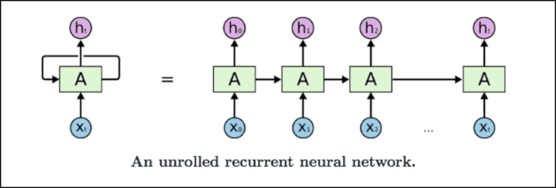
*From the labs: the loop on the left is the same cell $A$ applied at every time step, with the same weights.*

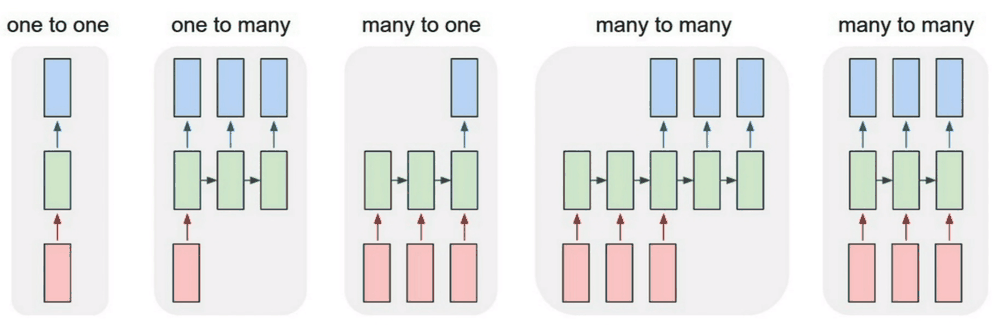
*From the labs: one to one (a plain feedforward network), one to many (image captioning: one image, a sentence), many to one (sentiment
classification: a review, one score), many to many (translation: a sentence, a sentence of another length; or one output per frame of a video).*

**LSTM** (Long Short-Term Memory) cells carry two states: a **long-term memory** (the cell state $c_t$) and a **short-term memory** (the hidden state
$h_t$, which is also the output). Three gates decide what flows:

- **forget gate:** decides which information of the long-term memory is kept or discarded, multiplying it by a forget vector computed from the
  current input and the short-term memory;
- **input gate:** decides what new information is stored in the long-term memory, from the current input and the previous short-term memory;
- **output gate:** from the current input, the previous short-term memory and the new long-term memory, produces the new short-term memory, passed to
  the next step and used as output.

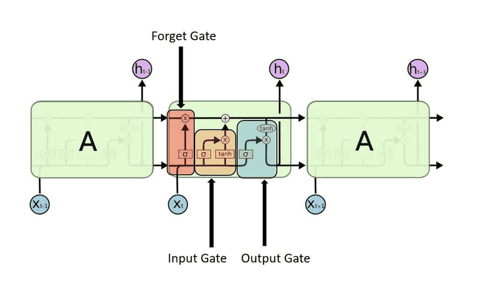
*From the labs.*

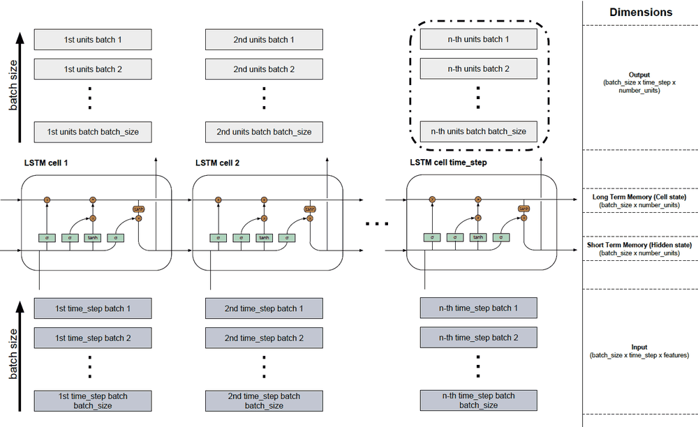
*From the labs: the input is `(batch_size, time_step, features)`; both memories are `(batch_size, number_units)`; the output is
`(batch_size, time_step, number_units)` when all the steps are returned, otherwise only the last one.*

> [!TIP]
> **Not in the labs: counting the parameters of an LSTM.** Each of the 4 internal layers (forget, input, candidate, output) is a Dense layer on the
> concatenation $[h_{t-1}, x_t]$: $\text{units} \cdot (\text{features} + \text{units}) + \text{units}$ weights. So an LSTM has
> $4 \cdot (\text{units} \cdot (\text{features} + \text{units}) + \text{units})$ parameters, independent of the sequence length.
> Example from L5.5: `LSTM(512)` on embeddings of 100: $4 \cdot (512 \cdot 612 + 512) = 1{,}255{,}424$.

## L5.2 From text to numbers: TextVectorization and Embedding

A model needs vectors. Three ways to turn words into numbers, for the sentence "The cat sat on the mat" (vocabulary: cat, mat, on, sat, the):

| Encoding | Example | Problem |
|---|---|---|
| **one-hot** | "cat" = `[1, 0, 0, 0, 0]` | sparse and huge: with 10,000 words, 99.99% zeros |
| **one integer per word** | sentence = `[5, 1, 4, 3, 5, 2]` | arbitrary: 1 and 2 are close numbers, "cat" and "mat" are not close words |
| **embedding** | "cat" = `[1.2, -0.1, 4.3, 3.2]` | none of the above: dense, and **learned** so that similar words get similar vectors |

**TextVectorization** builds the vocabulary from the data and turns strings into sequences of indices:

```python
VOCAB_SIZE = 1000
encoder = tf.keras.layers.TextVectorization(max_tokens=VOCAB_SIZE)
encoder.adapt(train_dataset.map(lambda text, label: text))    # learn the vocabulary from the training texts only
vocab = np.array(encoder.get_vocabulary())
vocab[:20]     # ['', '[UNK]', 'the', 'and', 'a', 'of', 'to', 'is', 'in', 'it', 'i', 'this', 'that', 'br', 'was', ...]
encoder(example)[:3].numpy()     # [[11, 7, 402, ..., 0, 0, 0], ...]: 0-padded to the longest text of the batch
```

Index 0 is the padding, index 1 the unknown word `[UNK]`, then the words by decreasing frequency (only the 998 most frequent). The encoding is not
fully reversible: by default the text is lowercased and punctuation is stripped (`standardize="lower_and_strip_punctuation"`), and rare words become
`[UNK]` ("Dreadful acting" → "[UNK] acting").

The **Embedding** layer is a trainable lookup table from indices to dense vectors:

```python
embedding_layer = tf.keras.layers.Embedding(1000, 5)          # 1000 words, vectors of 5 numbers: a 1000 x 5 matrix
embedding_layer(tf.constant([1, 2, 3])).shape                 # (3, 5): one row per index
embedding_layer(tf.constant([[0, 1, 2], [3, 4, 5]])).shape    # (2, 3, 5): (samples, sequence_length, embedding_dim)
```

The weights start random and are adjusted by backpropagation like any other layer; after training, words used in similar ways get similar vectors
(they can be explored in the Embedding Projector, projector.tensorflow.org).

## L5.3 IMDb with a bidirectional LSTM

The IMDb reviews (25,000 for training, 25,000 for testing, positive or negative) are loaded as raw text with TensorFlow Datasets:

```python
dataset, info = tfds.load('imdb_reviews', with_info=True, as_supervised=True)   # pairs (text, label)
train_dataset, test_dataset = dataset['train'], dataset['test']

BUFFER_SIZE, BATCH_SIZE = 10000, 64
train_dataset = train_dataset.shuffle(BUFFER_SIZE).batch(BATCH_SIZE).prefetch(tf.data.AUTOTUNE)
test_dataset = test_dataset.batch(BATCH_SIZE).prefetch(tf.data.AUTOTUNE)
```

`shuffle` mixes the examples using a buffer of 10,000, `batch` groups them by 64, `prefetch` prepares the next batch while the model trains on the
current one (L8.6).

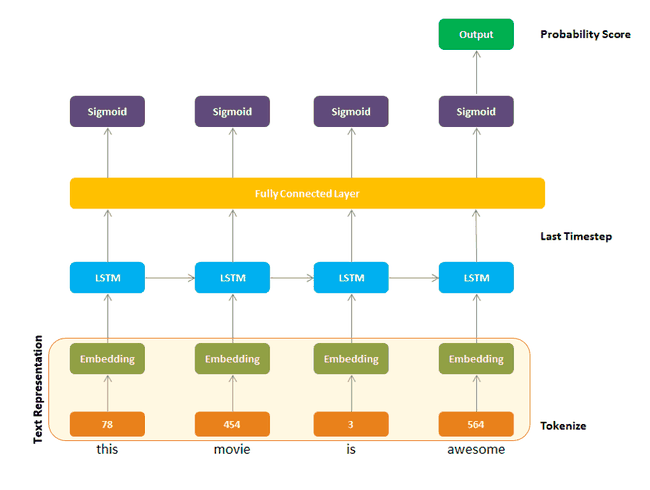
*From the labs: tokens → embeddings → LSTM over time → the last time step goes to a fully connected layer → probability.*

```python
model = tf.keras.Sequential([
    encoder,                                                    # text -> indices
    tf.keras.layers.Embedding(input_dim=len(encoder.get_vocabulary()),
                              output_dim=3,
                              mask_zero=True),                  # ignore the padding zeros
    tf.keras.layers.Bidirectional(tf.keras.layers.LSTM(64)),    # reads the sequence in both directions
    tf.keras.layers.Dense(64, activation='relu'),
    tf.keras.layers.Dense(1)                                    # one logit
])
model.compile(loss=tf.keras.losses.BinaryCrossentropy(from_logits=True),
              optimizer=tf.keras.optimizers.Adam(1e-4),
              metrics=['accuracy'])
history = model.fit(train_dataset, epochs=10, validation_data=test_dataset, validation_steps=30)
model.evaluate(test_dataset)                                    # test accuracy 0.861
model.predict(np.array(['The movie was cool. The animation and the graphics were out of this world. I would recommend this movie.']))
# [[0.94]]: a logit >= 0 means positive
```

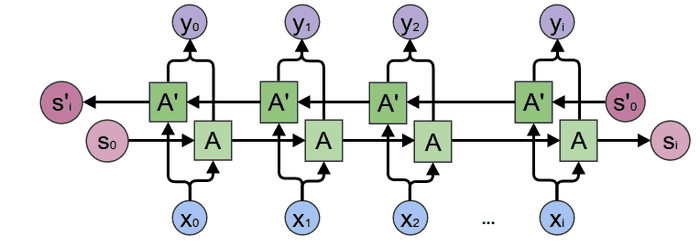
*From the labs: one RNN reads left to right ($A$), another right to left ($A'$), and their outputs are concatenated.*

`Bidirectional` runs the LSTM forward and backward and concatenates the two final outputs: 64 + 64 = 128 values. **Advantage:** the beginning of the
text does not need to travel through every step to affect the output. **Disadvantage:** the whole sequence is needed, so predictions cannot be
streamed while words arrive.

> [!NOTE]
> **Not in the labs: three remarks on the notebook.**
>
> - **The test set is used for validation.** `validation_data=test_dataset` drives the choices made while watching the curves, and then the same set
>   gives the "test" accuracy, which is no longer independent. A validation split can be taken from the training data, for example with
>   `tfds.load('imdb_reviews', split=['train[:80%]', 'train[80%:]', 'test'], as_supervised=True)`.
> - The text before the model says "This tutorial uses pooling because it's the simplest": it comes from another TensorFlow tutorial (word embeddings
>   with `GlobalAveragePooling1D`); this model uses an LSTM. Also, the comment `# default 0.01` next to `Adam(1e-4)` is wrong: Adam's default is 0.001.
> - The output is a logit $z$, so 0.94 means a probability $\sigma(0.94) = 0.72$; the threshold 0.5 on the probability is the threshold 0 on the logit.
>
> Parameters: embedding $1000 \cdot 3 = 3000$; bidirectional LSTM $2 \cdot 4 \cdot (64 \cdot (3 + 64) + 64) = 34{,}816$; Dense $128 \cdot 64 + 64 = 8256$;
> output 65. An embedding of only 3 numbers per word is very small: the stacked model below uses 64.

**Parameters recap.**

| Parameter | Value here | What it does |
|---|---|---|
| `TextVectorization(max_tokens=1000)` | 1000 | vocabulary size, including padding and `[UNK]` |
| `Embedding(input_dim, output_dim=3)` | vocabulary × 3 | one trainable vector of 3 numbers per word |
| `mask_zero=True` | | index 0 is padding: the following layers skip it |
| `LSTM(64)` | 64 units | size of the hidden and cell state |
| `Bidirectional(...)` | | doubles the output: 128 |
| `Dense(1)` + `BinaryCrossentropy(from_logits=True)` | | binary output as a logit |
| `Adam(1e-4)` | 0.0001 | learning rate |
| `shuffle(10000)`, `batch(64)` | | buffer for shuffling, batch size |
| `validation_steps=30` | 30 batches | only 30 × 64 = 1920 examples are used to validate, to save time |

## L5.4 Stacking LSTMs: return_sequences

Keras recurrent layers have two output modes, chosen by `return_sequences`:

- `False` (default): only the **last** output, a 2D tensor `(batch_size, units)`;
- `True`: the output of **every** time step, a 3D tensor `(batch_size, timesteps, units)`. Since it still has a time axis, it can feed another RNN.

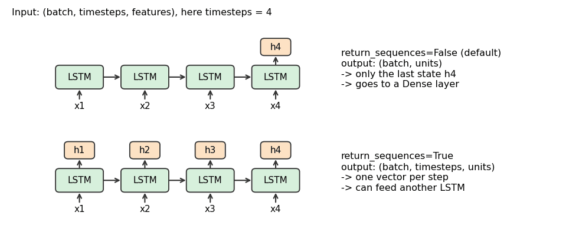
*Not in the labs.*

From the slides of the lab, with a batch of 32 sequences of 10 steps and 8 features:

```python
inputs = tf.random.normal([32, 10, 8])
lstm = tf.keras.layers.LSTM(4)
lstm(inputs).shape                       # (32, 4)
lstm = tf.keras.layers.LSTM(4, return_sequences=True, return_state=True)
whole_seq_output, final_memory_state, final_carry_state = lstm(inputs)
whole_seq_output.shape                   # (32, 10, 4)
final_memory_state.shape                 # (32, 4): the last hidden state h
final_carry_state.shape                  # (32, 4): the last cell state c
```

```python
model = tf.keras.Sequential([
    encoder,
    tf.keras.layers.Embedding(len(encoder.get_vocabulary()), 64, mask_zero=True),
    tf.keras.layers.Bidirectional(tf.keras.layers.LSTM(64, return_sequences=True)),   # (batch, timesteps, 128)
    tf.keras.layers.Bidirectional(tf.keras.layers.LSTM(32)),                          # (batch, 64)
    tf.keras.layers.Dense(64, activation='relu'),
    tf.keras.layers.Dropout(0.5),
    tf.keras.layers.Dense(1)
])
```

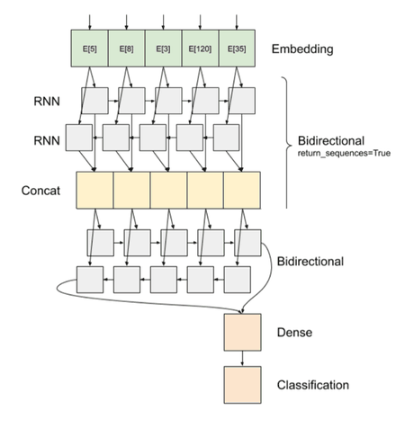
*From the labs.*

Test accuracy **0.861**, the same as the single layer, but with fewer epochs to get there (0.855 of validation accuracy already at epoch 2). On the
negative sentence "The movie was not good. The animation and the graphics were terrible. I would not recommend this movie." the output is $-2.10$:
negative.

**Parameters recap.**

| Parameter | Value here | What it does |
|---|---|---|
| `return_sequences=True` | first LSTM | output for every step, needed to stack another recurrent layer |
| `return_state=True` | | also returns the final hidden state $h$ and cell state $c$ |
| `LSTM(64)`, then `LSTM(32)` | | units of each layer |
| `Embedding(..., 64)` | 64 | richer word vectors than before |
| `Dropout(0.5)` | 50% | regularization of the dense head |

## L5.5 Next word prediction

**The data.** The text of *The Adventures of Sherlock Holmes*, one line per row. **Goal:** given the beginning of a sentence, predict the next word,
then repeat to generate text (a language model, summary [13](summary.md#13-language-modeling)).

```python
text = [t.strip() for t in raw_text.split('\n') if t.strip()]     # non-empty lines
VOCAB_SIZE = 8200
tokenizer = tf.keras.layers.TextVectorization(max_tokens=VOCAB_SIZE, output_sequence_length=None)
tokenizer.adapt(text)
tokenizer("The pen is on the table").numpy()       # [2, 1387, 15, 45, 2, 258]

# every prefix of every line becomes a training example
input_sequences = []
for line in text:
    token_list = tokenizer(line).numpy()
    for i in range(1, len(token_list)):
        input_sequences.append(token_list[:i+1])   # [2, 1739], [2, 1739, 6], [2, 1739, 6, 130], ...

max_sequence_len = max(len(seq) for seq in input_sequences)       # 18
input_sequences = np.array(pad_sequences(input_sequences, maxlen=max_sequence_len, padding='pre'))
X = input_sequences[:, :-1]          # the first 17 tokens (zeros on the left)
y = input_sequences[:, -1]           # the token to predict
y = np.array(tf.keras.utils.to_categorical(y, num_classes=VOCAB_SIZE))   # (94956, 8200)
```

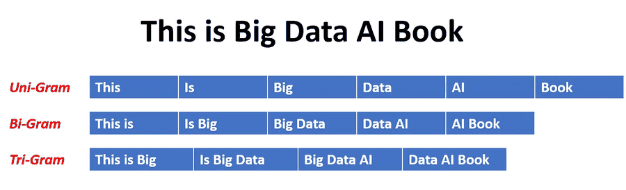
*From the labs.*

For the line "the adventures of sherlock holmes" the examples are: "the" → "adventures", "the adventures" → "of", "the adventures of" → "sherlock",
"the adventures of sherlock" → "holmes". **Pre-padding** puts the zeros on the left, so the last position always holds the word just before the one
to predict.

```python
model = Sequential()
model.add(Input(shape=(max_sequence_len - 1,)))                  # 17 tokens
model.add(Embedding(VOCAB_SIZE, 100))                            # 820,000 parameters
model.add(LSTM(512))                                             # 1,255,424
model.add(Dense(VOCAB_SIZE, activation='softmax'))               # 4,206,600: a probability for each word
model.compile(loss='categorical_crossentropy',
              optimizer=tf.keras.optimizers.Adam(learning_rate=0.01), metrics=['accuracy'])

reduce_lr = ReduceLROnPlateau(monitor='val_loss', factor=0.2, patience=3, min_lr=0.0001)
early_stopping = EarlyStopping(monitor='val_loss', patience=5, restore_best_weights=True, verbose=1)
history = model.fit(X, y, validation_split=0.3, epochs=20, batch_size=512, callbacks=[reduce_lr, early_stopping])
```

**ReduceLROnPlateau** multiplies the learning rate by `factor` (0.2) when `val_loss` has not improved for `patience` (3) epochs, never going below
`min_lr`. **Generation** is a loop: tokenize the text so far, pad it to 17, predict, take the most probable word (`argmax`), append it, repeat:

```python
seed_text = "I will close the door if"
for _ in range(10):
    token_list = pad_sequences(tokenizer([seed_text]), maxlen=max_sequence_len - 1, padding='pre')
    predicted = np.argmax(model.predict(token_list), axis=-1)
    seed_text += " " + vocab[predicted[0]]          # the notebook searches word_index for the same index
```

**Hands-on.** (1) Make it fit in the RAM of a basic Colab machine: which variables and parameters affect memory the most? (2) Run it locally.

> [!WARNING]
> **Not in the labs: the answer to the hands-on.** The culprit is `y`. One-hot labels are a float32 matrix of
> $94{,}956 \times 8200 \times 4$ bytes $\approx$ **3.1 GB**, while `X` is only $94{,}956 \times 17 \times 4 \approx 6.5$ MB. Keep the labels as
> integers and change the loss:
>
> ```python
> y = input_sequences[:, -1]                          # (94956,) integers: about 380 KB
> model.compile(loss='sparse_categorical_crossentropy', optimizer=..., metrics=['accuracy'])
> ```
>
> Same loss value, 8200 times less memory. Then: `VOCAB_SIZE` (it sizes the labels, the embedding and the output layer), `batch_size` (the softmax
> output is `batch_size × 8200` per step), the LSTM units, and `max_sequence_len`. Two more remarks: `validation_split=0.3` takes the **last** 30% of
> the sequences, which here are the last stories of the book; and always taking the `argmax` (greedy decoding) tends to repeat itself, while sampling
> with a temperature gives more varied text (summary, [13.4](summary.md#134-generation-strategies)).

**Parameters recap.**

| Parameter | Value here | What it does |
|---|---|---|
| `max_tokens` | 8200 | vocabulary: words beyond it become `[UNK]` |
| `padding='pre'` | | zeros on the left of each sequence |
| `Embedding(VOCAB_SIZE, 100)` | 100 | size of each word vector |
| `LSTM(512)` | 512 units | memory of the model; most of the parameters with the output layer |
| `Dense(VOCAB_SIZE, 'softmax')` | 8200 | one probability per word of the vocabulary |
| `Adam(learning_rate=0.01)` | 0.01 | high start, lowered by `ReduceLROnPlateau` |
| `factor`, `patience`, `min_lr` | 0.2, 3, 0.0001 | how much, after how long, down to where the learning rate is reduced |
| `batch_size` | 512 | 130 updates per epoch on 66,469 training sequences |

---

# Lab 6: autoencoders

An **autoencoder** is trained to output a copy of its input. It has two parts: an **encoder** that maps the input $x$ into a **code** $z = f(x)$ in a
latent space, and a **decoder** that produces a reconstruction $r = g(z)$. The loss is $L(x, g(f(x)))$: the goal is $r \approx x$. If the code is
smaller than the input the autoencoder is **under-complete** and must learn to compress; if it is bigger it is **over-complete**.
Theory: summary, section [7](summary.md#7-autoencoders).

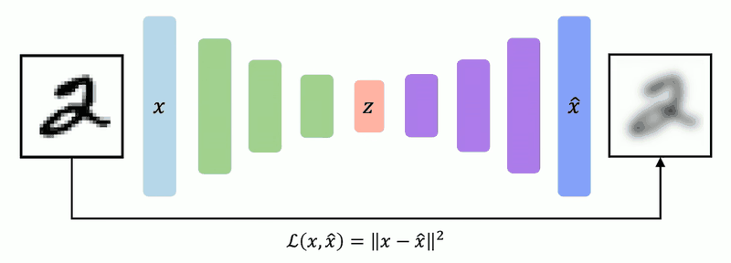
*From my MIT 6.S191 notes: the encoder compresses the image $x$ into $z$, the decoder rebuilds $\hat x$, the loss compares them pixel by pixel.*

All the experiments use Fashion-MNIST **without the labels**: the input is also the target. The images are scaled to $[0, 1]$, flattened to 784 values,
and the training set is split 45,000 / 15,000 with `train_test_split`.

## L6.1 A one-layer autoencoder

```python
from tensorflow.keras.layers import Input, Dense
from tensorflow.keras.models import Model

encoding_dim = 32                                          # 784 / 32 = 24.5: compression factor
input_img = Input(shape=(784,))
code = Dense(encoding_dim, activation='relu')(input_img)   # encoder: 784 -> 32
decoded = Dense(784, activation='sigmoid')(code)           # decoder: 32 -> 784, pixels in (0, 1)
autoencoder = Model(input_img, decoded, name='simple_autoencoder')
autoencoder.compile(optimizer='rmsprop', loss='mse')
history = autoencoder.fit(x_train, x_train, epochs=20, batch_size=256,
                          validation_data=(x_val, x_val))   # input = target
```

This is the **functional API**: each layer is called on the output of the previous one, and `Model(inputs, outputs)` collects the graph
(summary, [6.3](summary.md#63-functional-api-and-subclassing)). Parameters: $784 \cdot 32 + 32 = 25{,}120$ for the encoder and
$32 \cdot 784 + 784 = 25{,}872$ for the decoder.

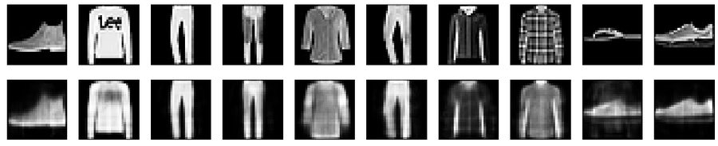
*From the labs: top, test images; bottom, their reconstructions from 32 numbers. Shapes are right, details (the "Lee" logo, the pattern of the
shirt) are lost.*

## L6.2 Deeper and convolutional autoencoders

**Deeper:** $784 \to 64 \to 32 \to 64 \to 784$ (105,392 parameters).

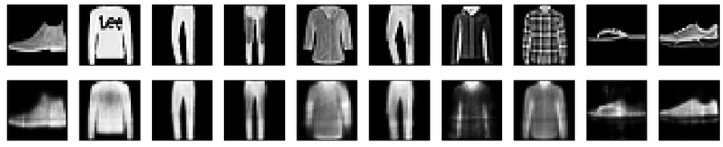
*From the labs: still 32 numbers in the code, with one more layer on each side; the reconstructions are similar to the simple autoencoder.*

**Convolutional:** the images go back to `(28, 28, 1)`:

```python
input_img = Input(shape=(28, 28, 1))
conv1 = Conv2D(8, (3, 3), activation='relu', padding='same')(input_img)    # 28 x 28 x 8
pool1 = MaxPooling2D((2, 2))(conv1)                                         # 14 x 14 x 8
conv2 = Conv2D(16, (3, 3), activation='relu', padding='same')(pool1)        # 14 x 14 x 16: the code
conv5 = Conv2D(16, (3, 3), activation='relu', padding='same')(conv2)        # 14 x 14 x 16
up2 = UpSampling2D((2, 2))(conv5)                                           # 28 x 28 x 16: repeats each pixel 2x2
decoded = Conv2D(1, (3, 3), activation='sigmoid', padding='same')(up2)      # 28 x 28 x 1
```

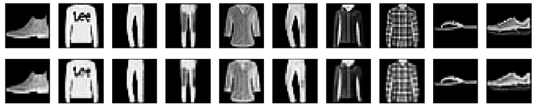
*From the labs: the reconstructions are almost perfect, with only 3713 parameters.*

> [!WARNING]
> **Not in the labs: the convolutional autoencoder does not compress.** Its code is $14 \times 14 \times 16 = 3136$ numbers, four times the 784 pixels
> of the input: it is **over-complete**. The near-perfect reconstructions are not a sign of a better model, the network can almost copy its input.
> To get a real bottleneck, pool once more and use fewer filters, for example $7 \times 7 \times 8 = 392$, or end the encoder with a small Dense layer.

**Parameters recap.**

| Parameter | Value here | What it does |
|---|---|---|
| `encoding_dim` | 32 | size of the code: the compression |
| code activation | `'relu'` | the code values are $\geq 0$ |
| output activation | `'sigmoid'` | pixels in (0, 1), like the scaled input |
| `loss` | `'mse'` | pixel by pixel reconstruction error |
| `fit(x_train, x_train)` | | the input is the target: no labels needed |
| `UpSampling2D((2, 2))` | | the opposite of pooling: doubles height and width, no weights |
| `padding='same'` | | keeps 28×28 and 14×14, so the decoder can mirror the encoder |

## L6.3 Sparse autoencoder

A **regularized** autoencoder changes the loss so that the network cannot simply learn the identity and must capture useful structure. A **sparse**
autoencoder adds a penalty on the code: $L(x, g(f(x))) + \Omega(z)$, where $\Omega(z)$ grows when many code units are active, so each unit learns to
fire only for certain inputs. In Keras it is an **activity regularizer** (on the outputs of the layer, not on its weights):

```python
from tensorflow.keras import regularizers
code = Dense(32, activation='relu', activity_regularizer=regularizers.l1(10e-5))(input_img)
decoded = Dense(784, activation='sigmoid')(code)
```

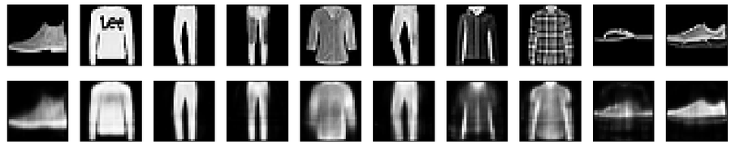
*From the labs.*

> [!TIP]
> **Not in the labs.** `10e-5` is $10 \cdot 10^{-5} = 10^{-4}$, not $10^{-5}$ (which would be `1e-5`). `kernel_regularizer` (L2.4) penalizes the
> weights; `activity_regularizer` penalizes the activations, here $10^{-4} \sum |z_i|$.

## L6.4 Denoising autoencoder

A **denoising** autoencoder receives a corrupted input $\tilde x$ and is trained to output the clean $x$: the loss becomes $L(x, g(f(\tilde x)))$.
It cannot just copy, it has to learn what a clean image looks like.

```python
noise_factor = 0.2
x_train_noisy = x_train + noise_factor * tf.random.normal(shape=x_train.shape)    # Gaussian noise, std 0.2
x_train_noisy = tf.clip_by_value(x_train_noisy, clip_value_min=0., clip_value_max=1.)   # stay in [0, 1]
# same for x_val and x_test

autoencoder.fit(x_train_noisy, x_train,                 # noisy input, clean target
                epochs=EPOCHS, batch_size=BATCH_SIZE,
                validation_data=(x_val_noisy, x_val))
```

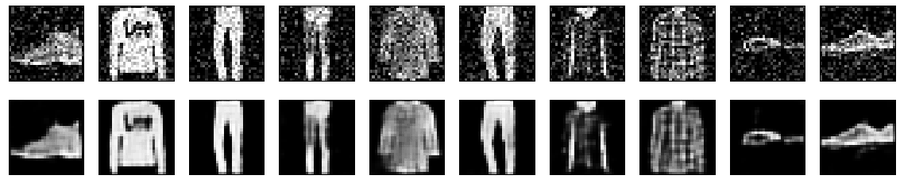
*From the labs: the noise is removed; the model is the convolutional autoencoder of L6.2.*

> [!WARNING]
> **Not in the labs: the loss plot after denoising is the wrong one.** `autoencoder.fit(...)` is not assigned to `history`, so the following
> `plot_loss(history)` draws the curves of the **previous** experiment, the sparse autoencoder. The two plots are identical:
>
> 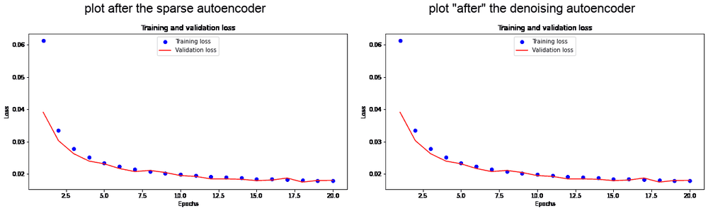
>
> Fix: `history = autoencoder.fit(...)`. The same convolutional model is also over-complete here (L6.2), which makes denoising easier than it looks.

**Parameters recap.**

| Parameter | Value here | What it does |
|---|---|---|
| `noise_factor` | 0.2 | standard deviation of the added Gaussian noise |
| `tf.clip_by_value(..., 0., 1.)` | | keeps the noisy pixels in the valid range |
| input / target | noisy / clean | what makes it a denoising autoencoder |

## L6.5 Outlier detection

An autoencoder reconstructs well what looks like its training data and badly what is unusual: the **reconstruction error** is an anomaly score.

```python
encoding_dim = 64
input_img = Input(shape=(784,))
encoded = Dense(encoding_dim, activation='relu')(input_img)
decoded = Dense(784, activation='sigmoid')(encoded)
autoencoder = Model(input_img, decoded)
encoder = Model(input_img, encoded)                                   # the first half alone
encoded_input = Input(shape=(encoding_dim,))
decoder_layer = autoencoder.layers[-1]
decoder = Model(encoded_input, decoder_layer(encoded_input))          # the second half
autoencoder.compile(optimizer='adam', loss='binary_crossentropy')
autoencoder.fit(x_train, x_train, epochs=50, batch_size=256, shuffle=True, validation_data=(x_test, x_test))

reconstructions = autoencoder.predict(x_test)
reconstruction_errors = np.mean(np.power(x_test - reconstructions, 2), axis=1)   # MSE per image
threshold = np.percentile(reconstruction_errors, 95)                             # 0.0213
outliers = reconstruction_errors > threshold
```

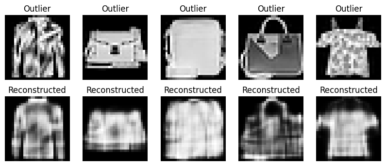
*From the labs: detailed patterns (a printed shirt, bags) are the hardest to rebuild.*

The `encoder` and `decoder` models share the layers of the autoencoder: after training, `encoder.predict(x)` gives the 64-number codes.
Binary cross-entropy works as a reconstruction loss because the pixels are in $[0, 1]$.

> [!NOTE]
> **Not in the labs.** With the threshold at the 95th percentile, exactly 5% of the test images are called outliers by construction: the threshold
> decides how many, the error decides which. In a real case the threshold comes from the errors on **normal** validation data (for example, the error
> that 99% of normal images stay under) and the test set is not used for validation.

**Hands-on.** Find outliers in the cats and dogs dataset of L4.4 (the notebook downloads and cleans it, then stops).

> [!NOTE]
> **Not in the labs: one way to do it.** Train a convolutional autoencoder on the images (with a real bottleneck), compute the reconstruction error of
> every image and look at the top 1%: wrong files, drawings, photos with people in front, extreme crops. The labels are not needed.
>
> ```python
> train_x = train_ds.map(lambda x, y: (x / 255., x / 255.))       # input = target, labels dropped
> inputs = keras.Input(shape=(180, 180, 3))
> x = inputs
> for f in [32, 64, 16]:
>     x = layers.Conv2D(f, 3, strides=2, padding='same', activation='relu')(x)        # 180 -> 90 -> 45 -> 23
> # code: 23 x 23 x 16 = 8464 numbers, about 9% of the 97,200 input values
> for f in [64, 32, 32]:
>     x = layers.Conv2DTranspose(f, 3, strides=2, padding='same', activation='relu')(x)   # 23 -> 46 -> 92 -> 184
> x = layers.Cropping2D(2)(x)                                                         # 184 -> 180
> outputs = layers.Conv2D(3, 3, padding='same', activation='sigmoid')(x)
> autoencoder = keras.Model(inputs, outputs)
> autoencoder.compile(optimizer='adam', loss='mse')
> autoencoder.fit(train_x, epochs=10)
> ```

**Parameters recap.**

| Parameter | Value here | What it does |
|---|---|---|
| `encoding_dim` | 64 | size of the code |
| `loss` | `'binary_crossentropy'` | per-pixel loss for values in [0, 1] |
| `epochs`, `batch_size`, `shuffle` | 50, 256, `True` | `shuffle=True` (the default) reshuffles the training data at each epoch |
| `np.percentile(errors, 95)` | 95 | the threshold: the top 5% become outliers |

---

# Lab 7: attention and Transformers

Attention written from scratch, then the Transformer of the TensorFlow tutorial *Neural machine translation with a Transformer and Keras*
(Portuguese to English), explained with the lab slides *Transformer Implementation*. Theory: summary, section
[14](summary.md#14-sequence-to-sequence-attention-and-the-transformer).

## L7.1 Scaled dot-product attention from scratch

Attention lets a model focus on different parts of a sequence when it produces each output. Three ingredients:

- **queries** $Q$: the elements we are producing an output for (what we are looking for);
- **keys** $K$ and **values** $V$: the elements we compare the queries with, and what we take from them.

Example: translating the source $X_s$ = "the cat sat on the mat" into the target $X_t$ = "il gatto siede sul tappeto". The sequences of embeddings are
projected by learnable matrices $W_Q, W_K, W_V \in \mathbb{R}^{d \times d_k}$:

$$Q = X_t W_Q \in \mathbb{R}^{N_t \times d_k}, \quad K = X_s W_K \in \mathbb{R}^{N_s \times d_k}, \quad V = X_s W_V \in \mathbb{R}^{N_s \times d_k}, \qquad \text{Attention}(Q, K, V) = \text{softmax}\left(\frac{Q K^\top}{\sqrt{d_k}}\right) V$$

$QK^\top$ is an $N_t \times N_s$ matrix of scores: how much each target word "matches" each source word. The softmax turns each row into weights that
sum to 1, and the output for each target word is the weighted average of the values.

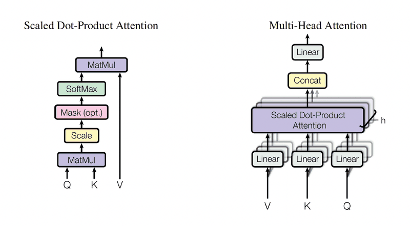
*From the labs (the figures of the original paper, Vaswani et al. 2017).*

> [!TIP]
> **Not in the labs: a tiny example by hand.** One query $q = (1, 0)$, two keys $k_1 = (1, 0)$, $k_2 = (0, 1)$, values $v_1 = (1, 2)$, $v_2 = (3, 4)$,
> $d_k = 2$. Scores: $q \cdot k_1 / \sqrt 2 = 0.707$ and $q \cdot k_2 / \sqrt 2 = 0$. Softmax: $e^{0.707} / (e^{0.707} + e^0) = 0.67$ and $0.33$.
> Output: $0.67 \cdot (1, 2) + 0.33 \cdot (3, 4) = (1.66, 2.66)$, closer to $v_1$ because $k_1$ matches the query better.
>
> **Why divide by $\sqrt{d_k}$:** a dot product of two vectors of $d_k$ random components with variance 1 has variance $d_k$. With $d_k = 64$ the
> scores would be around $\pm 8$ and the softmax would put almost all the weight on one key, with almost zero gradient for the others.

**Self-attention versus cross-attention.**

| | Self-attention | Cross-attention |
|---|---|---|
| Where Q comes from | the same sequence as K and V | a different sequence (the target) |
| What it captures | relationships **inside** one sequence ("cat" with "sat") | relationships **between** two sequences (each target word with the source) |
| Where | encoder; decoder (masked) | decoder, looking at the encoder output |

The from-scratch layer:

```python
from tensorflow import matmul, math, cast, float32
from tensorflow.keras.layers import Layer
from tensorflow.nn import softmax

class DotProductAttention(Layer):
    def __init__(self, d, d_k):
        super(DotProductAttention, self).__init__()
        self.d, self.d_k = d, d_k
        self.Wshape = (1, int(self.d), int(self.d_k))      # the leading 1 broadcasts over the batch
        self.Q = self.add_weight(name="W_Q", shape=self.Wshape, initializer="random_normal", trainable=True)
        self.K = self.add_weight(name="W_K", shape=self.Wshape, initializer="random_normal", trainable=True)
        self.V = self.add_weight(name="W_V", shape=self.Wshape, initializer="random_normal", trainable=True)

    def call(self, queries, keys, values, mask=None):
        Q = matmul(queries, self.Q)                       # (batch, N_q, d_k)
        K = matmul(keys, self.K)                          # (batch, N_k, d_k)
        V = matmul(values, self.V)                        # (batch, N_k, d_k)
        scores = matmul(Q, K, transpose_b=True) / math.sqrt(cast(self.d_k, float32))   # (batch, N_q, N_k)
        if mask is not None:
            scores += -1e9 * mask                         # masked positions: -infinity, so weight 0 after softmax
        weights = softmax(scores)
        return matmul(weights, V)                         # (batch, N_q, d_k)
```

With a batch of 32 sequences of 5 tokens, $d = 3$ and $d_k = 64$: $Q, K, V$ are `(32, 5, 64)`, the scores `(32, 5, 5)` and the output `(32, 5, 64)`.
`add_weight` is how a custom layer declares trainable weights; `matmul` multiplies the last two dimensions and treats the others as batch dimensions.

## L7.2 Cross-attention on a toy translation

```python
tokenizer = keras.preprocessing.text.Tokenizer(num_words=12)
tokenizer.fit_on_texts(["the cat sat on the mat", "il gatto siede sul tappeto"])
sequences = tokenizer.texts_to_sequences(sentences)   # [[1, 2, 3, 4, 1, 5], [6, 7, 8, 9, 10]]

embedding_layer = Embedding(input_dim=12, output_dim=16)
source, target = [embedding_layer(np.array(s)) for s in sequences]    # (6, 16) and (5, 16)

attention = DotProductAttention(16, 32)
encoding = attention(target, source, source)           # query = target, key = value = source
# Q (1, 5, 32), K (1, 6, 32), V (1, 6, 32), scores (1, 5, 6), output (1, 5, 32)
```

The scores are a $5 \times 6$ table: one row per Italian word, one column per English word. The output has the length of the **query** (5): one new
vector per target word, built from the source words. (The embeddings and projections are untrained here: the example shows the shapes, not a translation.)

**Parameters recap.**

| Parameter | Value here | What it does |
|---|---|---|
| `d` | 3, then 16 | size of the input vectors (the embedding dimension) |
| `d_k` | 64, then 32 | size of queries, keys and values after the projection |
| `mask` | `None` | 1 where attention is forbidden (padding, future tokens) |
| `num_words` | 12 | vocabulary of the toy tokenizer |
| `output_dim` | 16 | embedding size |

## L7.3 Multi-head attention

Instead of one attention, $h$ attentions in parallel, each with its own projections, so that different heads can look at different relationships
(position, long-range dependencies, syntax):

$$\text{MultiHead}(Q, K, V) = \text{Concat}(\text{head}_1, \ldots, \text{head}_h)\, W^O, \qquad \text{head}_i = \text{Attention}(Q W_i^Q, K W_i^K, V W_i^V)$$

In the lab's version each head works in $d_{head} = d_k / h$ dimensions, the concatenation is back to $d_k$ and $W^O \in \mathbb{R}^{d_k \times d_k}$.
Example: $d_k = 512$ and 8 heads give heads of 64; concatenated, $(batch, seq, 512)$; $W^O$ is $512 \times 512$.

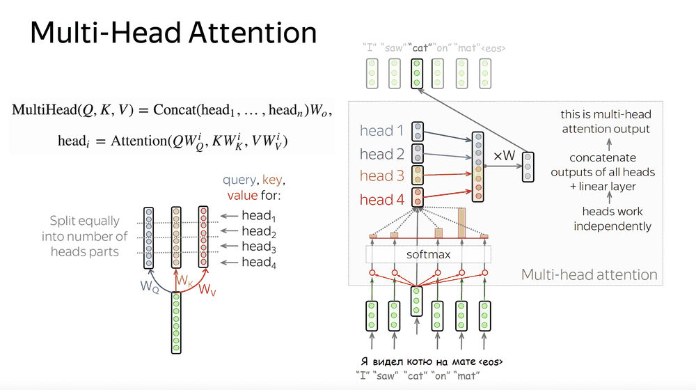
*From the labs: queries, keys and values are split among the heads, each head computes its attention independently, the outputs are concatenated and
mixed by a final linear layer.*

The exercise leaves `call` empty:

```python
class MultiHeadAttention(Layer):
    def __init__(self, num_heads, d, d_k):
        super(MultiHeadAttention, self).__init__()
        assert d_k % num_heads == 0
        self.head_list = [DotProductAttention(d, d_k // num_heads) for i in range(num_heads)]
        # add weights W^O

    def call(self, v, k, q, mask):
        # Apply Heads, Concat, Multiply W^O
        return output
```

> [!NOTE]
> **Not in the labs: a solution.**
>
> ```python
> class MultiHeadAttention(Layer):
>     def __init__(self, num_heads, d, d_k):
>         super().__init__()
>         assert d_k % num_heads == 0
>         self.head_list = [DotProductAttention(d, d_k // num_heads) for _ in range(num_heads)]
>         self.W_O = self.add_weight(name="W_O", shape=(d_k, d_k), initializer="random_normal", trainable=True)
>
>     def call(self, v, k, q, mask=None):
>         heads = [head(q, k, v, mask) for head in self.head_list]   # careful: DotProductAttention wants (queries, keys, values)
>         concat = tf.concat(heads, axis=-1)                          # (batch, N_q, d_k)
>         return tf.matmul(concat, self.W_O)                          # (batch, N_q, d_k)
>
> MultiHeadAttention(num_heads=4, d=3, d_k=64)(values, keys, queries).shape   # (32, 5, 64)
> ```
>
> Each head has its own $W_Q, W_K, W_V$ of shape $(d, d_k/h)$, so the total number of projection weights is the same as one head of size $d_k$:
> multi-head attention costs no more, it just splits the work.

**The Keras layer.** `tf.keras.layers.MultiHeadAttention` does the same:

```python
mha = MultiHeadAttention(num_heads=4, key_dim=32)
query = key = value = tf.random.normal((2, 10, 16))       # batch 2, 10 tokens, d = 16
_ = mha(query=query, key=key, value=value)
for w in mha.trainable_weights: print(w.name, w.shape)
# query kernel (16, 4, 32), bias (4, 32); key kernel (16, 4, 32), bias (4, 32);
# value kernel (16, 4, 32), bias (4, 32); output kernel (4, 32, 16), bias (16,)
```

> [!TIP]
> **Not in the labs: two differences from the lab's class.** In Keras **`key_dim` is the size of each head**: 4 heads of 32, so 128 dimensions in
> total, not $32/4$. And the output projection goes back to the size of the **query** ($d = 16$), not to `key_dim`: $W^O$ is $(4 \cdot 32) \times 16$,
> as in the paper ($h d_v \times d_{model}$). This is what makes it possible to add the output to the input in the residual connections of the
> Transformer. Parameters: $3 \cdot (16 \cdot 4 \cdot 32 + 4 \cdot 32) + (4 \cdot 32 \cdot 16 + 16) = 8592$.

**Parameters recap.**

| Parameter | Value here | What it does |
|---|---|---|
| `num_heads` | 4 | attentions in parallel |
| `key_dim` (Keras) | 32 | size of queries and keys **per head** |
| `d_k` (lab class) | 64 | **total** size, split as `d_k // num_heads` per head |
| $W^O$ | $(h \cdot d_{head}) \times d_{out}$ | mixes the heads after the concatenation |
| `return_attention_scores=True` | | also returns the weights `(batch, heads, N_q, N_k)`, for plots |

## L7.4 Ways to train a Transformer

The slides start from the shapes: the encoder receives `(batch_size, seq_length_vk, embedding_dim)`, the decoder `(batch_size, seq_len_query,
embedding_dim)`, and the output is `(batch_size, seq_len_query, vocab_size)`: for every position of the target, a score for every word of the vocabulary.
Three ways to train it for text generation:

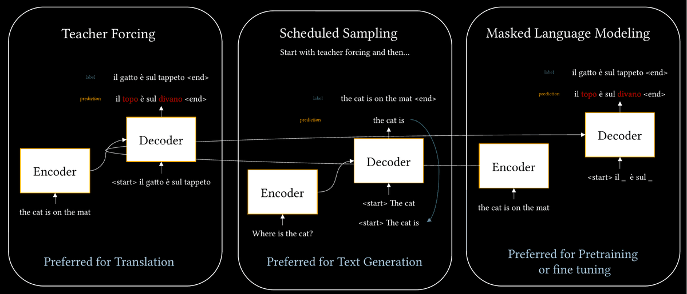
*From the labs.*

- **Teacher forcing** (preferred for translation): the decoder input is the **true** target shifted by one, `<start> il gatto è sul tappeto`, and the
  label is `il gatto è sul tappeto <end>`. Even if the model predicts "il **topo** è sul **divano**", at the next position it receives the true word.
  All positions are trained in one pass.
- **Scheduled sampling** (preferred for text generation): start with teacher forcing, then progressively feed the model **its own predictions**
  ("the cat is" is fed back to predict what follows), so it learns to recover from its mistakes.
- **Masked language modeling** (preferred for pretraining or fine-tuning): some tokens are hidden (`<start> il _ è sul _`) and the model predicts them.

> [!TIP]
> **Not in the labs: why scheduled sampling exists.** With pure teacher forcing the model never sees its own errors during training, but at inference
> it only has its own outputs: a mismatch called **exposure bias**. Masked language modeling is the objective of BERT.

## L7.5 The Transformer step by step

**The data.** TED talk transcripts, Portuguese → English (`tfds.load('ted_hrlr_translate/pt_to_en')`), with a pretrained **subword** tokenizer per
language. Common words have their own token, rare words are split into pieces: "searchability" → `search`, `##ability`; the tokenized text includes
`[START]` and `[END]`.

```python
MAX_TOKENS = 128
def prepare_batch(pt, en):
    pt = tokenizers.pt.tokenize(pt)[:, :MAX_TOKENS].to_tensor()     # 0-padded dense tensor
    en = tokenizers.en.tokenize(en)[:, :(MAX_TOKENS + 1)]
    en_inputs = en[:, :-1].to_tensor()     # drop [END]: the decoder input
    en_labels = en[:, 1:].to_tensor()      # drop [START]: the target, shifted by one
    return (pt, en_inputs), en_labels

def make_batches(ds):
    return ds.shuffle(20000).batch(128).map(prepare_batch, tf.data.AUTOTUNE).prefetch(buffer_size=tf.data.AUTOTUNE)
```

`en_inputs` and `en_labels` are the same sentence shifted by one position: this is teacher forcing. `fit` expects `(inputs, labels)` pairs, and here
the inputs are themselves a pair `(pt, en)`.

**Positional encoding.** Attention sees its input as a **set**: without help, "the cat sat" and "sat the cat" would look the same.

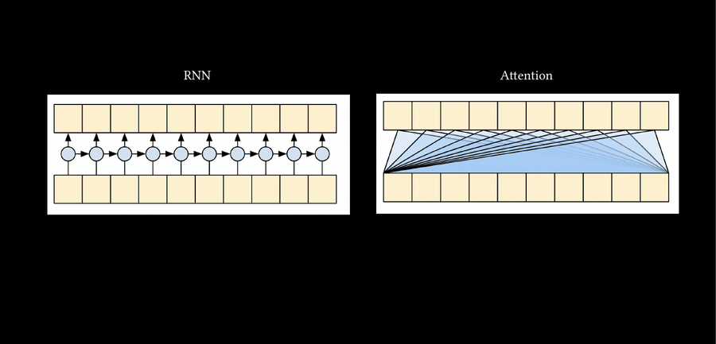
*From the labs: an RNN reads in order, attention connects every position to every other at once, so order must be added explicitly.*

$$PE_{(pos, 2i)} = \sin\left(\frac{pos}{10000^{2i/d_{model}}}\right), \qquad PE_{(pos, 2i+1)} = \cos\left(\frac{pos}{10000^{2i/d_{model}}}\right)$$

```python
def positional_encoding(length, depth):
    depth = depth / 2                                    # half sines, half cosines
    positions = np.arange(length)[:, np.newaxis]         # (length, 1): 0, 1, 2, ...
    depths = np.arange(depth)[np.newaxis, :] / depth     # (1, depth/2): 0, 1/(depth/2), ...
    angle_rates = 1 / (10000 ** depths)                  # from 1 down to almost 1/10000
    angle_rads = positions * angle_rates                 # (length, depth/2)
    pos_encoding = np.concatenate([np.sin(angle_rads), np.cos(angle_rads)], axis=-1)
    return tf.cast(pos_encoding, dtype=tf.float32)
```

The code concatenates all the sines and then all the cosines instead of interleaving them: it is a permutation of the dimensions, equivalent for the
model.

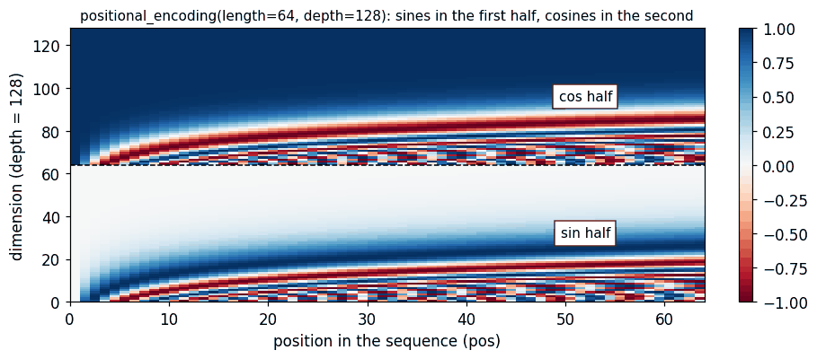
*Not in the labs: each row of the matrix (a dimension) is a wave over the positions; the first dimensions oscillate fast, the last ones slowly, so
every position gets a different pattern, and nearby positions similar patterns.*

> [!NOTE]
> **Not in the labs: a wrong number in the notebook's explanation.** With `depths = [0, 0.25, 0.5, 0.75]` the notebook writes
> `angle_rates = [1.0, 0.1778, 0.0316, 0.0056]`, but $10000^{0.25} = 10$, so the right values are $[1, 0.1, 0.01, 0.001]$, and the rows of
> `angle_rads` become $[0, 0, 0, 0]$, $[1, 0.1, 0.01, 0.001]$, $[2, 0.2, 0.02, 0.002]$, $[3, 0.3, 0.03, 0.003]$.

```python
class PositionalEmbedding(tf.keras.layers.Layer):
  def __init__(self, vocab_size, d_model):
    super().__init__()
    self.d_model = d_model
    self.embedding = tf.keras.layers.Embedding(vocab_size, d_model, mask_zero=True)
    self.pos_encoding = positional_encoding(length=256, depth=d_model)

  def compute_mask(self, *args, **kwargs):
    return self.embedding.compute_mask(*args, **kwargs)          # pass the padding mask on

  def call(self, x):
    length = tf.shape(x)[1]
    x = self.embedding(x)
    x *= tf.math.sqrt(tf.cast(self.d_model, tf.float32))         # relative scale of embedding and position
    return x + self.pos_encoding[tf.newaxis, :length, :]
```

**Add & Norm.** After each attention or feed-forward block: a **residual connection** (the input is added to the output) and a `LayerNormalization`.
The residual gives the gradient a direct path and makes each block **update** the vectors instead of replacing them. The code uses the `Add` layer
instead of `+` because `Add` propagates the Keras masks.

**The three attention layers** share a base class that only holds the components:

```python
class BaseAttention(tf.keras.layers.Layer):
  def __init__(self, **kwargs):
    super().__init__()
    self.mha = tf.keras.layers.MultiHeadAttention(**kwargs)
    self.layernorm = tf.keras.layers.LayerNormalization()
    self.add = tf.keras.layers.Add()

class CrossAttention(BaseAttention):            # decoder: target looks at the source
  def call(self, x, context):
    attn_output, attn_scores = self.mha(query=x, key=context, value=context, return_attention_scores=True)
    self.last_attn_scores = attn_scores         # kept for the plots
    return self.layernorm(self.add([x, attn_output]))

class GlobalSelfAttention(BaseAttention):       # encoder: every token sees every token
  def call(self, x):
    return self.layernorm(self.add([x, self.mha(query=x, value=x, key=x)]))

class CausalSelfAttention(BaseAttention):       # decoder: every token sees only the previous ones
  def call(self, x):
    return self.layernorm(self.add([x, self.mha(query=x, value=x, key=x, use_causal_mask=True)]))
```

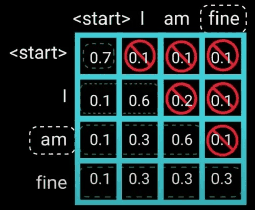
*From the labs: in the decoder, "I" can attend to `<start>` and itself, not to "am" and "fine"; the crossed weights are set to zero.*

The output of cross-attention has the length of the **query** (the target), whatever the length of the source. The causal mask can be checked:
`sample_csa(embed_en(en[:, :3]))` and `sample_csa(embed_en(en))[:, :3]` are equal, because the first 3 outputs do not depend on later tokens.

**Feed-forward, encoder and decoder.**

```python
class FeedForward(tf.keras.layers.Layer):
  def __init__(self, d_model, dff, dropout_rate=0.1):
    super().__init__()
    self.seq = tf.keras.Sequential([tf.keras.layers.Dense(dff, activation='relu'),   # expand to dff
                                    tf.keras.layers.Dense(d_model),                   # back to d_model
                                    tf.keras.layers.Dropout(dropout_rate)])
    self.add = tf.keras.layers.Add(); self.layer_norm = tf.keras.layers.LayerNormalization()
  def call(self, x):
    return self.layer_norm(self.add([x, self.seq(x)]))

class EncoderLayer(tf.keras.layers.Layer):        # self-attention + feed-forward
  def __init__(self, *, d_model, num_heads, dff, dropout_rate=0.1):
    super().__init__()
    self.self_attention = GlobalSelfAttention(num_heads=num_heads, key_dim=d_model, dropout=dropout_rate)
    self.ffn = FeedForward(d_model, dff)
  def call(self, x):
    return self.ffn(self.self_attention(x))

class DecoderLayer(tf.keras.layers.Layer):        # causal self-attention + cross-attention + feed-forward
  def __init__(self, *, d_model, num_heads, dff, dropout_rate=0.1):
    super().__init__()
    self.causal_self_attention = CausalSelfAttention(num_heads=num_heads, key_dim=d_model, dropout=dropout_rate)
    self.cross_attention = CrossAttention(num_heads=num_heads, key_dim=d_model, dropout=dropout_rate)
    self.ffn = FeedForward(d_model, dff)
  def call(self, x, context):
    x = self.causal_self_attention(x=x)
    x = self.cross_attention(x=x, context=context)
    self.last_attn_scores = self.cross_attention.last_attn_scores
    return self.ffn(x)
```

`Encoder` = `PositionalEmbedding` + `Dropout` + `num_layers` encoder layers; `Decoder` = `PositionalEmbedding` + `Dropout` + `num_layers` decoder layers.
The full model adds a final `Dense(target_vocab_size)` that gives the logits:

```python
class Transformer(tf.keras.Model):
  def __init__(self, *, num_layers, d_model, num_heads, dff, input_vocab_size, target_vocab_size, dropout_rate=0.1):
    super().__init__()
    self.encoder = Encoder(num_layers=num_layers, d_model=d_model, num_heads=num_heads, dff=dff,
                           vocab_size=input_vocab_size, dropout_rate=dropout_rate)
    self.decoder = Decoder(num_layers=num_layers, d_model=d_model, num_heads=num_heads, dff=dff,
                           vocab_size=target_vocab_size, dropout_rate=dropout_rate)
    self.final_layer = tf.keras.layers.Dense(target_vocab_size)

  def call(self, inputs):
    context, x = inputs                      # Keras fit passes all the inputs in the first argument
    context = self.encoder(context)          # (batch, context_len, d_model)
    x = self.decoder(x, context)             # (batch, target_len, d_model)
    return self.final_layer(x)               # (batch, target_len, target_vocab_size)
```

| Tensor | Shape |
|---|---|
| `pt` (Portuguese token ids) | (batch, pt_len) |
| encoder output | (batch, pt_len, d_model) |
| `en` (English input ids) | (batch, en_len) |
| decoder output | (batch, en_len, d_model) |
| logits | (batch, en_len, en_vocab) |
| `last_attn_scores` | (batch, heads, en_len, pt_len) |

The lab uses a tiny model, so that it trains in minutes: `num_layers=1`, `d_model=8`, `dff=128`, `num_heads=2`, `dropout_rate=0.1` (the text above it
still says "a 4-layer Transformer", from the original tutorial). For comparison, the paper's base model has 6 layers, $d_{model} = 512$,
$d_{ff} = 2048$ and 8 heads.

> [!TIP]
> **Not in the labs.** Here `key_dim=d_model`, so each of the 2 heads works in all $d_{model}$ dimensions; in the paper each head has
> $d_{model}/h$. It works, with more parameters; it is the same `key_dim` per head of L7.3.

**Inference.** The `Translator` tokenizes the Portuguese sentence, starts the English output with `[START]` and repeats: run the transformer on
(sentence, output so far), take the **last** position of the logits, `argmax` (greedy), append; stop at `[END]` or after `MAX_TOKENS`. The attention
scores of the last decoder layer can be plotted head by head as a heatmap of English tokens against Portuguese tokens. Finally the translator is
exported with `tf.saved_model.save` and reloaded.

## L7.6 Training: learning rate schedule, masked loss and accuracy

```python
class CustomSchedule(tf.keras.optimizers.schedules.LearningRateSchedule):
  def __init__(self, d_model, warmup_steps=4000):
    super().__init__()
    self.d_model = tf.cast(d_model, tf.float32)
    self.warmup_steps = warmup_steps
  def __call__(self, step):
    step = tf.cast(step, dtype=tf.float32)
    return tf.math.rsqrt(self.d_model) * tf.math.minimum(tf.math.rsqrt(step), step * (self.warmup_steps ** -1.5))

optimizer = tf.keras.optimizers.Adam(CustomSchedule(d_model), beta_1=0.9, beta_2=0.98, epsilon=1e-9)
```

$$lrate = d_{model}^{-0.5} \cdot \min\left(step^{-0.5},\ step \cdot warmup\_steps^{-1.5}\right)$$

The learning rate grows linearly for the first 4000 steps (**warm-up**), then decreases as $1/\sqrt{step}$.

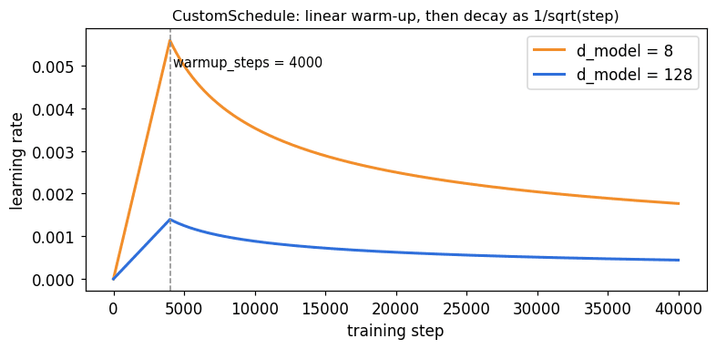
*Not in the labs: with $d_{model} = 8$ the peak at step 4000 is 0.0056; with 128 it is 0.0014.*

**Masked loss and accuracy.** The batches are padded with 0, and the padding must not count:

```python
def masked_loss(label, pred):
  mask = label != 0
  loss_object = tf.keras.losses.SparseCategoricalCrossentropy(from_logits=True, reduction='none')
  loss = loss_object(label, pred)                     # one value per token
  mask = tf.cast(mask, dtype=loss.dtype)
  loss *= mask                                        # zero on padding
  return tf.reduce_sum(loss) / tf.reduce_sum(mask)    # mean over the real tokens only

def masked_accuracy(label, pred):
  pred = tf.argmax(pred, axis=2)
  label = tf.cast(label, pred.dtype)
  match = (label == pred) & (label != 0)
  return tf.reduce_sum(tf.cast(match, tf.float32)) / tf.reduce_sum(tf.cast(label != 0, tf.float32))

transformer.compile(loss=masked_loss, optimizer=optimizer, metrics=[masked_accuracy])
transformer.fit(train_batches, epochs=5, validation_data=val_batches)
```

`reduction='none'` makes the loss return one value per token instead of the mean, so that the mask can be applied before averaging.

**Parameters recap.**

| Parameter | Value here | What it does |
|---|---|---|
| `num_layers` | 1 | encoder and decoder layers ($N\times$ in the diagram) |
| `d_model` | 8 | size of every token vector throughout the model |
| `dff` | 128 | hidden size of the feed-forward block |
| `num_heads` | 2 | attention heads per attention layer |
| `dropout_rate` | 0.1 | dropout after embeddings, in attention and in the feed-forward block |
| `MAX_TOKENS` | 128 | longer sentences are cut |
| `warmup_steps` | 4000 | length of the warm-up of the learning rate |
| `beta_1`, `beta_2`, `epsilon` | 0.9, 0.98, 1e-9 | Adam's settings from the paper (L8.1) |
| `mask_zero=True` | | padding mask from the embedding, used by attention and loss |
| `use_causal_mask=True` | | the decoder cannot look ahead |

---

# Lab 8: optimization and hyperparameter tuning

Four topics: how gradient-based optimizers work (slides *Neural Networks and Gradient Descent Based Optimization*), how to choose hyperparameters
(TensorBoard HParams and Keras Tuner), how to make a trained network smaller (slides *Neural Networks Optimization*, with the Stanford lecture by
Song Han as reference) and how to feed data fast (slides *Input Pipeline Optimization*).

## L8.1 Optimizers: SGD, momentum, RMSprop, Adam

Recap from the slides: a perceptron computes $\hat y = f(w_0 + \sum_i w_i x_i)$; training tunes the weights to minimize a loss $J(W)$, for example
$J = \frac{1}{m}\sum_i (y_i - \hat y_i)^2$; **backpropagation** has a forward phase (predictions) and a backward phase (gradients), and gradient
descent updates

$$w_i \leftarrow w_i - \eta \frac{\partial J(W)}{\partial w_i}$$

The gradient at a point is the direction in which the function grows fastest; the negative gradient points where it decreases fastest. On the
irregular loss landscape of a network, finding the global minimum is hard: gradient descent finds a good local minimum.

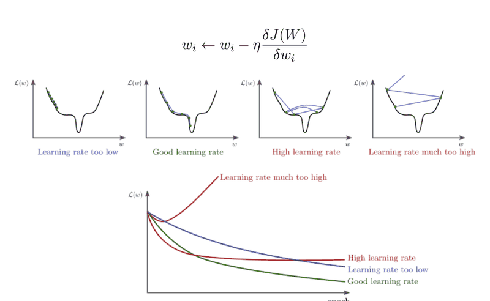
*From the labs: too low, it takes forever; good, it reaches the minimum; high, it bounces and settles in a worse place; much too high, the loss explodes.*

**Momentum** adds a fraction $\gamma$ of the previous update:

$$v_t = \gamma\, v_{t-1} + \eta\, \nabla_W J(W), \qquad W_{t+1} = W_t - v_t$$

Updates grow in directions where the gradient keeps the same sign and shrink in directions where it oscillates; it also helps to roll out of small
local minima. $\gamma$ is the momentum coefficient, typically 0.9.

**RMSprop** (Root Mean Square Propagation) adapts the learning rate of each weight with a decaying average of its squared gradients:

$$g_t = \nabla_W J(W_t), \qquad E[g^2]_t = \gamma\, E[g^2]_{t-1} + (1 - \gamma)\, g_t^2, \qquad W_{t+1} = W_t - \frac{\eta}{\sqrt{E[g^2]_t + \epsilon}}\, g_t$$

The higher the slope, the smaller the step; the lower the slope, the wider the step.

**Adam** (Adaptive moment estimation, Kingma and Ba 2014) combines the two: a momentum term $m_t$ (mean of the gradients) and an RMSprop term $v_t$
(uncentered variance):

$$m_t = \beta_1 m_{t-1} + (1 - \beta_1) g_t, \qquad v_t = \beta_2 v_{t-1} + (1 - \beta_2) g_t^2$$

Since $m$ and $v$ start at 0 they are biased towards 0 in the first steps, so Adam uses bias-corrected versions:

$$\hat m_t = \frac{m_t}{1 - \beta_1^t}, \qquad \hat v_t = \frac{v_t}{1 - \beta_2^t}, \qquad W_{t+1} = W_t - \frac{\eta}{\sqrt{\hat v_t} + \epsilon}\, \hat m_t$$

with default values $\beta_1 = 0.9$ and $\beta_2 = 0.999$. If momentum is a ball rolling down a slope, Adam behaves like a **heavy ball with friction**,
which prefers flat minima.

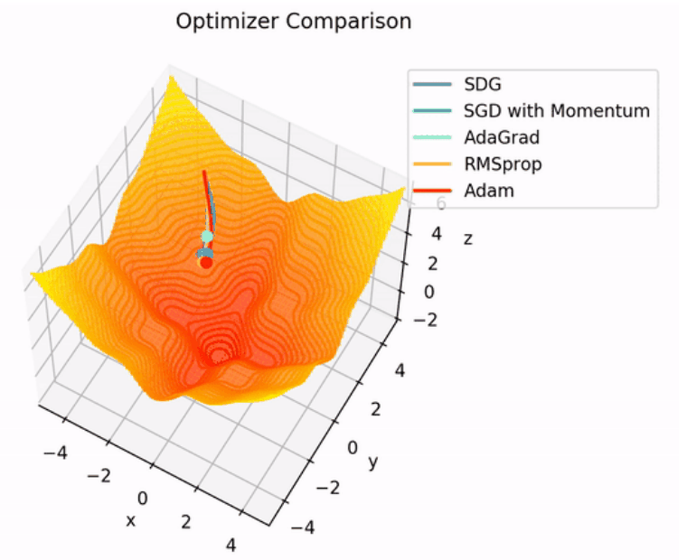
*From the labs.*

**A use case from the slides: inverse design.** Given a desired optical response, generate the metamaterial (nanostructures for protein sequencing
and biosensing) that produces it. The design space is high-dimensional and non-convex, with many local optima, and the solution is not unique: Adam
is the most suitable optimizer for this kind of problem (see also GIDnets, summary [16.2](summary.md#162-gidnets-generative-inverse-design)).

> [!TIP]
> **Not in the labs: what the bias correction does at the first step.** With $m_0 = v_0 = 0$: $m_1 = 0.1\, g_1$ and $v_1 = 0.001\, g_1^2$, both much
> smaller than the gradient. After correction $\hat m_1 = g_1$ and $\hat v_1 = g_1^2$, so the first update is $\eta\, g_1 / |g_1| = \pm\eta$: a step of
> size $\eta$ whatever the scale of the gradient. This is the cure for the problem of L1.5, where $m$ and $b$ had gradients of very different sizes
> and one learning rate for both.

**In Keras.**

```python
keras.optimizers.SGD(learning_rate=0.01, momentum=0.9)                          # SGD default lr 0.01, momentum 0
keras.optimizers.RMSprop(learning_rate=0.001, rho=0.9)                          # rho is the gamma of the formula
keras.optimizers.Adam(learning_rate=0.001, beta_1=0.9, beta_2=0.999, epsilon=1e-7)   # Keras defaults
```

**Parameters recap.**

| Parameter | Typical value | What it does |
|---|---|---|
| `learning_rate` ($\eta$) | 0.01 SGD, 0.001 Adam and RMSprop | size of the steps |
| `momentum` ($\gamma$) | 0.9 | how much of the previous update is kept |
| `rho` ($\gamma$ of RMSprop) | 0.9 | memory of the average of squared gradients |
| `beta_1`, `beta_2` | 0.9, 0.999 | memories of the mean and of the squared gradients in Adam |
| `epsilon` | 1e-7 (Keras), 1e-8 (paper) | avoids division by zero |

## L8.2 Hyperparameters and search strategies

**Hyperparameters** are the variables that govern the training process and the topology of a model. They stay constant during training and directly
affect performance. Two kinds:

- **model hyperparameters**, which define the model: number and width of hidden layers;
- **algorithm hyperparameters**, which affect speed and quality of learning: the learning rate of SGD, the number of neighbors of k-NN.


*From the labs: each dot is a trained model; the curves on the axes show how the loss depends on each hyperparameter.*

| Strategy | How it works | Pros and cons |
|---|---|---|
| **Grid search** | tries every combination of the given values | exhaustive, but the number of runs grows exponentially with the number of hyperparameters |
| **Random search** | samples combinations at random | explores more of the space in the same time; near-optimal, not guaranteed optimal |
| **Hyperband** | samples many combinations, trains them for a few epochs, keeps the best and trains them longer, repeatedly | does not waste full trainings on obviously bad values |
| **Bayesian optimization** | picks the first combinations at random, then chooses each next one from the results so far | uses the history: fewer runs for the same quality |

> [!TIP]
> **Not in the labs: why random beats grid.** Often only one or two hyperparameters really matter. With 9 runs on two hyperparameters, a 3×3 grid
> tests only 3 values of each; 9 random points test 9 different values of each (Bergstra and Bengio, 2012). The figure above shows the same idea:
> the grid's dots line up on 4 columns, the random ones spread out.

## L8.3 Hyperparameter tuning with TensorBoard HParams

On MNIST, three hyperparameters: the units of the dense layer, the dropout rate, the optimizer.

```python
from tensorboard.plugins.hparams import api as hp

HP_NUM_UNITS = hp.HParam('num_units', hp.Discrete([300, 200, 512]))
HP_DROPOUT = hp.HParam('dropout', hp.RealInterval(0.1, 0.5))
HP_OPTIMIZER = hp.HParam('optimizer', hp.Discrete(['adam', 'sgd', 'rmsprop']))
METRIC_ACCURACY = 'accuracy'

with tf.summary.create_file_writer('logs/hparam_tuning').as_default():
    hp.hparams_config(hparams=[HP_NUM_UNITS, HP_DROPOUT, HP_OPTIMIZER],
                      metrics=[hp.Metric(METRIC_ACCURACY, display_name='Accuracy')])

def create_and_fit_model(hparams):
    model = tf.keras.models.Sequential([
        tf.keras.layers.Flatten(input_shape=(28, 28)),
        tf.keras.layers.Dense(hparams[HP_NUM_UNITS], activation='relu'),
        tf.keras.layers.Dropout(hparams[HP_DROPOUT]),
        tf.keras.layers.Dense(10, activation='softmax')])
    model.compile(optimizer=hparams[HP_OPTIMIZER], loss='sparse_categorical_crossentropy', metrics=['accuracy'])
    model.fit(X_train, y_train, epochs=5)
    _, accuracy = model.evaluate(X_test, y_test)
    return accuracy

def experiment(experiment_dir, hparams):
    with tf.summary.create_file_writer(experiment_dir).as_default():
        hp.hparams(hparams)                                   # record the values of this run
        accuracy = create_and_fit_model(hparams)
        tf.summary.scalar(METRIC_ACCURACY, accuracy, step=1)  # record the result

experiment_no = 0
for num_units in HP_NUM_UNITS.domain.values:
    for dropout_rate in (HP_DROPOUT.domain.min_value, HP_DROPOUT.domain.max_value):
        for optimizer in HP_OPTIMIZER.domain.values:
            hparams = {HP_NUM_UNITS: num_units, HP_DROPOUT: dropout_rate, HP_OPTIMIZER: optimizer}
            experiment('logs/hparam_tuning/' + f'Experiment {experiment_no}', hparams)
            experiment_no += 1
```

$3 \times 2 \times 3 = 18$ experiments, each in its own folder. `%tensorboard --logdir logs/hparam_tuning` opens the **HPARAMS** tab: the **Table
View** lists every run with its hyperparameters and accuracy; the **Parallel Coordinates View** draws each run as a line crossing one axis per
hyperparameter and one for the accuracy, so the good regions stand out.

> [!NOTE]
> **Not in the labs.** This is a grid search, and the dropout interval is tried only at its two ends (0.1 and 0.5): `HP_DROPOUT.domain.sample_uniform()`
> would sample inside it, as a random search. The accuracy used to compare the runs is measured on the **test** set: for a fair final number, compare
> on a validation split and test only the chosen model.

## L8.4 Keras Tuner and Hyperband

The model to tune is a **hypermodel**: a function (or a subclass of `HyperModel`) that builds the model and declares the search space inline.
Keras Tuner also ships ready-made hypermodels for vision, `HyperXception` and `HyperResNet`.

```python
import keras_tuner as kt          # !pip install -q -U keras-tuner

def model_builder(hp):
    model = keras.Sequential()
    model.add(keras.layers.Flatten(input_shape=(28, 28)))
    hp_units = hp.Int('units', min_value=32, max_value=512, step=32)           # 32, 64, ..., 512
    model.add(keras.layers.Dense(units=hp_units, activation='relu'))
    model.add(keras.layers.Dense(10))                                         # logits
    hp_learning_rate = hp.Choice('learning_rate', values=[1e-2, 1e-3, 1e-4])
    model.compile(optimizer=keras.optimizers.Adam(learning_rate=hp_learning_rate),
                  loss=keras.losses.SparseCategoricalCrossentropy(from_logits=True),
                  metrics=['accuracy'])
    return model

tuner = kt.Hyperband(model_builder, objective='val_accuracy', max_epochs=10, factor=3,
                     directory='my_dir', project_name='intro_to_kt')
stop_early = tf.keras.callbacks.EarlyStopping(monitor='val_loss', patience=5)
tuner.search(img_train, label_train, epochs=50, validation_split=0.2, callbacks=[stop_early])
best_hps = tuner.get_best_hyperparameters(num_trials=1)[0]
best_hps.get('units'), best_hps.get('learning_rate')
```

Four tuners are available: `RandomSearch`, `Hyperband`, `BayesianOptimization` and `Sklearn`. **Hyperband** uses adaptive resource allocation and
early stopping, like a sports tournament: it trains many models for a few epochs and carries forward only the best ones to the next round. The number of
models in a bracket is $1 + \log_{factor}(max\_epochs)$, rounded up: here $\lceil 1 + \log_3 10 \rceil = 4$.


*Not in the labs: with `factor=3`, each round keeps the best third and gives them three times the epochs.*

After the search:

```python
model = tuner.hypermodel.build(best_hps)                          # 1. find the best number of epochs
history = model.fit(img_train, label_train, epochs=50, validation_split=0.2)
val_acc_per_epoch = history.history['val_accuracy']
best_epoch = val_acc_per_epoch.index(max(val_acc_per_epoch)) + 1  # +1: epochs are counted from 1

hypermodel = tuner.hypermodel.build(best_hps)                     # 2. retrain from scratch for best_epoch epochs
hypermodel.fit(img_train, label_train, epochs=best_epoch, validation_split=0.2)
hypermodel.evaluate(img_test, label_test)                         # [test loss, test accuracy]: [0.602, 0.887]
```

The folder `my_dir/intro_to_kt` keeps the logs and checkpoints of every trial: running the search again **resumes** from there; to start over pass
`overwrite=True` to the tuner.

> [!NOTE]
> **Not in the labs.** The notebook's text says Hyperband carries forward "the top-performing half"; with `factor=3` it is the top third (the factor is
> the reduction rate). The search space here has $16 \times 3 = 48$ combinations.

**Parameters recap.**

| Parameter | Value here | What it does |
|---|---|---|
| `hp.Int('units', 32, 512, step=32)` | 16 values | integer hyperparameter with its range |
| `hp.Choice('learning_rate', [...])` | 3 values | categorical hyperparameter |
| `objective` | `'val_accuracy'` | what the tuner maximizes |
| `max_epochs` | 10 | the most epochs a single model gets in Hyperband |
| `factor` | 3 | reduction rate: keep 1/3, give 3× the epochs |
| `directory`, `project_name` | `'my_dir'`, `'intro_to_kt'` | where trials are saved (and resumed from) |
| `EarlyStopping(patience=5)` | | stops bad trials early |

## L8.5 Making networks smaller: quantization, pruning, clustering

**Why.** Networks are growing fast (16× larger models for image recognition from AlexNet to ResNet, 10× more training operations for Baidu's speech
recognition in one year) and we want to deploy them on small devices and distribute training. A larger model means more memory references, and
memory is what costs energy: in the slide's table, a 32-bit DRAM access costs **640 pJ**, against 0.9 pJ for a float addition and 3.7 pJ for a float
multiplication. Three main approaches: **quantization**, **clustering** (weight sharing), **sparsity and pruning**.

**Quantization** constrains values from a continuous (or large) set to a discrete set: here, the parameters of a network from float32 to int8.
The question is how much accuracy is lost.


*From the labs: the range actually used by the weights, $[f_{min}, f_{max}]$, is mapped onto the 256 integers of int8, $[q_{min}, q_{max}]$.*

The formulas of the slide:

$$\text{zero point} = \frac{f_{min} + f_{max}}{2}, \qquad \text{scale factor} = \frac{f_{max} - f_{min}}{q_{max} - q_{min}}, \qquad Q(x) = \text{floor}\left(\frac{x}{\text{scale factor}} + \text{zero point}\right)$$

> [!TIP]
> **Not in the labs: a worked example, and how to read the zero point.** The zero point of the slide is the **float** value that ends up on the
> integer 0 (the middle of the range), so it must be subtracted before dividing by the scale: $Q(x) = \text{floor}\left(\frac{x - \text{zero point}}{\text{scale}}\right)$
> (in the slide's form, the zero point must first be converted to integer steps). Weights in $[-0.5, 1.5]$, int8 in $[-128, 127]$:
>
> - zero point $= (-0.5 + 1.5)/2 = 0.5$, scale $= 2/255 = 0.00784$;
> - $Q(1.5) = \lfloor 1.0/0.00784 \rfloor = \lfloor 127.5 \rfloor = 127$, $Q(-0.5) = \lfloor -127.5 \rfloor = -128$, $Q(0.3) = \lfloor -25.5 \rfloor = -26$;
> - back to float: $0.5 + (-26) \cdot 0.00784 = 0.296$, an error of 0.004, never more than one scale step.
>
> Libraries such as TensorFlow Lite write the same map as $q = \text{round}(x / \text{scale}) + z$ with an **integer** zero point $z$. Memory goes from
> 4 bytes to 1 per weight: the 6.2 million weights of the flowers CNN of L4.2 drop from 24.7 MB to 6.2 MB.

TensorFlow supports:

- **post-training quantization**, on a fully trained model. Easy for the parameters, but what about the activations?
  - **dynamic**: the activation ranges are adjusted on the fly during inference, from the data fed to the model at runtime;
  - **static**: an extra calibration step runs a **representative dataset** through the model to estimate the activation ranges;
- **quantization-aware training**: in the forward pass weights and activations are "fake quantized", while loss and backpropagation stay in high
  precision. The weights are adjusted knowing that the model will be quantized.

| Quantization mode | Data needed | Inference latency | Accuracy |
|---|---|---|---|
| Dynamic | no data | faster (about 2×) | smaller accuracy loss |
| Static | unlabelled data | fastest (about 3 to 4×) | small accuracy loss |
| Quantization-aware training | labelled data | fastest (about 3 to 4×) | smallest accuracy loss |

> [!NOTE]
> **Not in the labs: in code, and the other two approaches** (from the TensorFlow Model Optimization guide and the Stanford lecture).
>
> ```python
> converter = tf.lite.TFLiteConverter.from_keras_model(model)
> converter.optimizations = [tf.lite.Optimize.DEFAULT]         # dynamic range quantization
> converter.representative_dataset = representative_data_gen   # add this for static (full integer) quantization
> tflite_model = converter.convert()
>
> import tensorflow_model_optimization as tfmot
> qat_model = tfmot.quantization.keras.quantize_model(model)            # quantization-aware training, then fit
> pruned = tfmot.sparsity.keras.prune_low_magnitude(model)              # pruning
> clustered = tfmot.clustering.keras.cluster_weights(model, number_of_clusters=16)   # clustering
> ```
>
> **Pruning** removes the connections with the smallest weights and retrains the rest: Song Han's pruning of AlexNet goes from 60 million to 6 million
> connections (10× fewer) without accuracy loss, with iterative pruning and retraining. **Clustering** (weight sharing, "trained quantization") groups
> the weights into a few clusters and stores, for each weight, only the index of its cluster. Pruning, trained quantization and Huffman coding
> together (Deep Compression) shrink networks 35 to 49 times.

## L8.6 Input pipeline optimization with tf.data

The building blocks of machine learning are **data** and **computation**, running on hardware (CPU, GPU, TPU). In TensorFlow: `tf.data` for the data,
Keras (or Estimator) for the computation, `tf.distribute` to spread them over the hardware. The data may not fit in memory and may need (randomized)
preprocessing. The input pipeline is an **ETL**:

1. **Extract:** read and parse the data from storage;
2. **Transform:** text vectorization, image transformations, video sampling, shuffling, batching;
3. **Load:** transfer the data to the accelerator.

```python
dataset = tf.data.TFRecordDataset(".../*.tfrecord")
dataset = dataset.map(preprocess, num_parallel_calls=Y)   # parallel map
dataset = dataset.batch(batch_size=32)
dataset = dataset.prefetch(buffer_size=X)                 # prepare the next batches during training
model.fit(dataset, epochs=10)
```


*From the labs: top, without prefetch the CPU and the GPU take turns and each is idle half of the time; middle, with `prefetch` the CPU prepares batch
N+1 while the GPU trains on batch N; bottom, with `num_parallel_calls` the map runs on several CPU cores and the preparation gets shorter.*

This is what the labs already did: `.shuffle(BUFFER_SIZE).batch(BATCH_SIZE).prefetch(tf.data.AUTOTUNE)` for IMDb (L5.3) and
`.map(prepare_batch, tf.data.AUTOTUNE).prefetch(buffer_size=tf.data.AUTOTUNE)` for the Transformer (L7.5). `tf.data.AUTOTUNE` lets TensorFlow choose
the buffer size and the number of parallel calls at runtime.

> [!TIP]
> **Not in the labs.** `dataset.cache()` after an expensive but deterministic step keeps the result in memory (or in a file) after the first epoch;
> random augmentation must come **after** the cache, otherwise every epoch would see the same "random" images. A common order is
> `map(load) → cache() → shuffle() → map(augment) → batch() → prefetch()`.

**Parameters recap.**

| Parameter | Value here | What it does |
|---|---|---|
| `num_parallel_calls` | `Y` or `tf.data.AUTOTUNE` | how many elements are transformed in parallel |
| `batch_size` | 32 | examples per batch |
| `prefetch(buffer_size)` | `X` or `tf.data.AUTOTUNE` | how many batches are prepared in advance |
| `shuffle(buffer_size)` | 10,000 in L5.3 | size of the buffer the random order is drawn from |

---

# Lab 9: TensorBoard

TensorBoard tracks metrics (accuracy and loss on training and validation), shows the model structure and how the weights change during training.

```python
%load_ext tensorboard
import datetime
log_folder = './logs/' + datetime.datetime.now().strftime("%Y%m%d-%H%M%S")   # one timestamped folder per run, to compare runs

model = tf.keras.models.Sequential([
    tf.keras.layers.Flatten(input_shape=(28, 28)),
    tf.keras.layers.Dense(512, activation='relu'),
    tf.keras.layers.Dropout(0.2),
    tf.keras.layers.Dense(10, activation='softmax')])
model.compile(optimizer='sgd', loss='sparse_categorical_crossentropy', metrics=['accuracy'])

from keras.callbacks import TensorBoard
callbacks = [TensorBoard(log_dir=log_folder, histogram_freq=4, write_graph=True, write_images=False, update_freq='epoch')]
model.fit(X_train, y_train, epochs=10, validation_split=0.2, callbacks=callbacks, batch_size=32)

%tensorboard --logdir={log_folder}
```

**Callbacks** are functions that Keras calls during `fit` (at the start and end of training, of each epoch, of each batch): `TensorBoard`,
`EarlyStopping`, `ReduceLROnPlateau`, `LambdaCallback` are all callbacks, and `fit` takes a list of them.

| Argument of `TensorBoard` | What it does |
|---|---|
| `log_dir` | folder where the logs are written |
| `histogram_freq` | every how many epochs to compute histograms of weights and activations (0 = never); needs validation data |
| `write_graph` | show the graph of the model |
| `write_images` | show the weights as images |
| `update_freq` | `'epoch'`, `'batch'`, or an integer $N$: write losses and metrics every $N$ batches |
| `profile_batch` | which batches to profile (default the second; `'5,10'` for batches 5 to 10; 0 disables) |
| `embeddings_freq` | every how many epochs to visualize the embedding layers (0 = never) |

**Images.** `tf.summary` writes anything to the logs through a file writer:

```python
file_writer = tf.summary.create_file_writer("logs/train_data/")
with file_writer.as_default():
    images = np.reshape(X_train[10:30], (-1, 28, 28, 1))      # 20 images; channel 1 because they are grayscale
    tf.summary.image("20 Digits", images, max_outputs=25, step=0)
```

**Matplotlib figures** must be converted to an image tensor first:

```python
import io
def plot_to_image(figure):
    buf = io.BytesIO()
    plt.savefig(buf, format='png')                        # draw the figure into memory as a PNG
    plt.close(figure)
    buf.seek(0)
    digit = tf.image.decode_png(buf.getvalue(), channels=4)   # PNG -> tensor (height, width, 4)
    return tf.expand_dims(digit, 0)                       # add the batch dimension
```


*From the labs.*

**A confusion matrix at every epoch** with a `LambdaCallback`, a callback built from plain functions:

```python
def log_confusion_matrix(epoch, logs):
    predictions = np.argmax(model.predict(X_test), axis=1)
    cm = metrics.confusion_matrix(y_test, predictions)          # (y_true, y_pred): rows = true classes
    cm_image = plot_to_image(plot_confusion_matrix(cm, class_names=class_names))
    with file_writer_cm.as_default():
        tf.summary.image("Confusion Matrix", cm_image, step=epoch)

callbacks = [TensorBoard(log_dir=log_folder, histogram_freq=1, write_graph=True, write_images=True, update_freq='epoch'),
             keras.callbacks.LambdaCallback(on_epoch_end=log_confusion_matrix)]
model.fit(X_train, y_train, epochs=10, validation_split=0.2, callbacks=callbacks)
```

`LambdaCallback` expects positional arguments: `on_epoch_begin` and `on_epoch_end` receive `(epoch, logs)`, `on_batch_begin` and `on_batch_end`
receive `(batch, logs)`, `on_train_begin` and `on_train_end` receive `(logs)`. The notebook suggests restarting the runtime before this last `fit`, so
that the model is trained only once. Hyperparameter tuning in TensorBoard is in L8.3.

**Parameters recap.**

| Parameter | Value here | What it does |
|---|---|---|
| `log_dir` | timestamped folder | one folder per run, so runs can be compared |
| `histogram_freq` | 4, then 1 | how often to log weight histograms |
| `update_freq` | `'epoch'` | granularity of the scalar logs |
| `step` in `tf.summary.*` | 0, or `epoch` | the x axis of the logged value |
| `max_outputs` | 25 | maximum number of images shown |

---

# Lab cheat sheet

**Output layer, loss and metric.**

| Task | Last layer | Loss | Labels |
|---|---|---|---|
| binary classification | `Dense(1, 'sigmoid')` | `binary_crossentropy` | 0 / 1 |
| binary, with logits | `Dense(1)` | `BinaryCrossentropy(from_logits=True)` | 0 / 1 |
| multi-class, one-hot labels | `Dense(C, 'softmax')` | `categorical_crossentropy` | `[0, 0, 1, 0]` |
| multi-class, integer labels | `Dense(C, 'softmax')` | `sparse_categorical_crossentropy` | `2` |
| multi-class, logits | `Dense(C)` | `SparseCategoricalCrossentropy(from_logits=True)` | `2` |
| multi-label | `Dense(C, 'sigmoid')` | `binary_crossentropy` | `[1, 0, 1, 0]` |
| regression | `Dense(1)` (linear) | `mse` (metric `mae`) | real numbers |
| autoencoder on pixels in [0, 1] | `sigmoid` | `mse` or `binary_crossentropy` | the input itself |
| sequence to sequence | `Dense(vocab)` per position | masked sparse categorical cross-entropy | next tokens |

**Shapes** (the first dimension is always the batch, `None` in `summary()`).

| Layer | Input | Output |
|---|---|---|
| `Dense(units)` | (batch, features) | (batch, units) |
| `Flatten` | (batch, h, w, c) | (batch, h·w·c) |
| `Conv2D(filters, k)` | (batch, h, w, c) | (batch, h', w', filters) |
| `MaxPooling2D(p)` | (batch, h, w, c) | (batch, h/p, w/p, c) |
| `Embedding(vocab, dim)` | (batch, seq) integers | (batch, seq, dim) |
| `LSTM(units)` | (batch, timesteps, features) | (batch, units), or (batch, timesteps, units) with `return_sequences=True` |
| `Bidirectional(LSTM(units))` | same | twice the units |
| `MultiHeadAttention` | query (batch, Nq, d), key/value (batch, Nk, d) | (batch, Nq, d) |

**Counting parameters.**

| Layer | Parameters |
|---|---|
| `Dense` | $\text{inputs} \cdot \text{units} + \text{units}$ |
| `Conv2D` | $(k_h \cdot k_w \cdot C_{in} + 1) \cdot \text{filters}$ |
| `Embedding` | $\text{vocab} \cdot \text{dim}$ |
| `LSTM` | $4 \cdot (\text{units} \cdot (\text{features} + \text{units}) + \text{units})$ |
| `MultiHeadAttention` | $3 \cdot (d \cdot h \cdot k + h \cdot k) + (h \cdot k \cdot d + d)$, with $k$ = `key_dim` |
| `Flatten`, pooling, `Dropout`, `Rescaling` | 0 |

**Output size of a convolution or pooling:** $\left\lfloor \frac{W_{in} - K + 2P}{S} \right\rfloor + 1$; with `padding='same'` it is
$\lceil W_{in} / S \rceil$.

**The parameters that come back in every lab.**

| Parameter | Where | Meaning |
|---|---|---|
| `units` | Dense, LSTM | number of neurons, size of the output |
| `activation` | every layer | `relu` hidden; `sigmoid`, `softmax` or none at the output |
| `input_shape` / `Input(shape=...)` | first layer | shape of one example, without the batch |
| `filters`, `kernel_size` | Conv2D | number of output channels, window size |
| `strides`, `padding` | Conv2D, pooling | step of the window; `valid` (shrinks) or `same` (keeps the size) |
| `pool_size` | pooling | window of the pooling, default (2, 2) |
| `rate` | Dropout | fraction of outputs set to 0 during training |
| `kernel_regularizer`, `activity_regularizer` | Dense, Conv2D | penalty on the weights, penalty on the outputs |
| `return_sequences`, `return_state` | RNN layers | all steps instead of the last; also the final states |
| `mask_zero` | Embedding | treat index 0 as padding |
| `from_logits` | losses | the model outputs raw scores, the loss applies sigmoid or softmax |
| `optimizer`, `learning_rate` | compile | update rule and step size |
| `loss`, `metrics` | compile | what is minimized, what is reported |
| `epochs`, `batch_size` | fit | passes over the data, examples per update |
| `validation_split`, `validation_data` | fit | last fraction of the arrays, or an explicit validation set |
| `callbacks` | fit | `EarlyStopping(monitor, patience, restore_best_weights)`, `ReduceLROnPlateau(factor, patience, min_lr)`, `TensorBoard(log_dir, ...)` |

**Checklist: the mistakes met in the labs.**

- Fit scalers and vocabularies on the **training** set only, then apply them to validation and test (L2.3, L5.2).
- **Augment after splitting**, never before (L4.5).
- Compare every accuracy with the **majority baseline** and every regression error with a constant prediction (L3.3, L2.5, L4.5).
- Do not choose hyperparameters or epochs on the **test** set (L2.5, L5.3, L8.3).
- `confusion_matrix(y_true, y_pred)`: true values first (L3.5).
- Print `.shape` and `len()` of what you split: `len` of a tuple is not the number of examples (L2.6).
- Assign `history = model.fit(...)` before plotting it (L6.4).
- With many classes use integer labels and `sparse_categorical_crossentropy`, not one-hot (L5.5).
- The plotted loss must be the minimized loss; average gradients over the **examples** (L3.2).
- When comparing settings, train each long enough: "best epoch = last epoch" means not finished (L2.5).
- In Keras `MultiHeadAttention`, `key_dim` is per head (L7.3).
- An over-complete autoencoder can copy its input: check the size of the code (L6.2).
