# Agile Software Development, part 2: labs on CI/CD and testing

Second part of the [Agile Software Development](summary.md) module of [Research and Development Methodologies](../README.md).
Based on the slides of the two lab lectures by Antonio Ielo: **Lab 1, Introduction and overview on CI/CD pipelines**, and **Lab 2, Software testing**.
The sections follow the order of the slides.

Explanations and examples that are not in the slides are marked **Not in the slides**. Figures marked *From the slides* are taken from the lab material;
figures marked *Not in the slides* were drawn for this summary.

**Practice:** [exam simulator](https://salvo27.github.io/artificial-intelligence-and-computer-science/courses/research-and-development-methodologies/agile-software-development/quiz/)
(topics "Lab 1: CI/CD" and "Lab 2: Testing") and [visual map](https://salvo27.github.io/artificial-intelligence-and-computer-science/courses/research-and-development-methodologies/agile-software-development/quiz/map.html), sections 8 and 9.

## Contents

- **Lab 1: CI/CD pipelines**
  - [L1.1 Why pipelines](#l11-why-pipelines)
  - [L1.2 Continuous delivery and the deployment pipeline](#l12-continuous-delivery-and-the-deployment-pipeline)
  - [L1.3 Git 101](#l13-git-101)
  - [L1.4 How a CI system works](#l14-how-a-ci-system-works)
  - [L1.5 GitHub Actions](#l15-github-actions)
  - [L1.6 Do not program in YAML: the Makefile](#l16-do-not-program-in-yaml-the-makefile)
  - [L1.7 Trunk-based development](#l17-trunk-based-development)
  - [L1.8 Building a feature with continuous integration](#l18-building-a-feature-with-continuous-integration)
  - [L1.9 Developer's discipline and git hooks](#l19-developers-discipline-and-git-hooks)
  - [L1.10 Development patterns: feature flags and branch by abstraction](#l110-development-patterns-feature-flags-and-branch-by-abstraction)
- **Lab 2: Software testing**
  - [L2.1 Testing in Scrum](#l21-testing-in-scrum)
  - [L2.2 Kinds of tests](#l22-kinds-of-tests)
  - [L2.3 Who runs the tests: the agile testing quadrants](#l23-who-runs-the-tests-the-agile-testing-quadrants)
  - [L2.4 Where tests sit in the pipeline](#l24-where-tests-sit-in-the-pipeline)
  - [L2.5 Tests in open source projects](#l25-tests-in-open-source-projects)
  - [L2.6 Unit testing frameworks](#l26-unit-testing-frameworks)
  - [L2.7 Tests that test something](#l27-tests-that-test-something)
  - [L2.8 Test-driven development](#l28-test-driven-development)
- [Lab exercises](#lab-exercises)
- [Cheat sheet](#cheat-sheet-of-the-labs)

---

# Lab 1: CI/CD pipelines

## L1.1 Why pipelines

The lab starts from the **Agile Manifesto**: individuals and interactions over processes and tools, **working software** over comprehensive documentation,
customer collaboration over contract negotiation, responding to change over following a plan. Scrum says *how* to organize the work;
the labs show the **engineering practices** that let a team deliver working software every sprint. The core practices are:

- **trunk-based development / continuous integration**;
- **continuous delivery**;
- **deployment pipelines**.

Together they form what the slides call **Minimum Viable Continuous Delivery**: the minimum set of practices a team needs to deliver continuously.

**Why does this still matter if LLMs write the code?** Coding agents made big progress, but they are not completely autonomous. There is a cultural shift:
some engineers no longer "code" but "manage agents that code", and it is becoming common not to know 100% of the code in your own contributions.
You are still responsible for what you use these tools for. **LLMs increase the throughput of code**, so being sure that the code is "OK" is even more important.
This has to do with testing, but **tests are useless unless they are run systematically and bad versions are detected**:

> This is the role of the pipeline: to run the tests on every version of the code, and to discard the bad ones.

**Objectives of the labs:** experience Scrum by doing sprints in a team; focus on workflows rather than flavor-of-the-month tools; practice working within a CI/CD pipeline;
understand the role of testing within iterative development cycles.

## L1.2 Continuous delivery and the deployment pipeline

### Traditional software delivery

In traditional software engineering, the **integration** of sub-systems is delayed towards the end of the development cycle, and the system is not guaranteed to work
"in between" releases (a **release** is the distribution of a deployable unit of software). Releases are where "the rubber meets the road": users start using the system and
discover bugs, unintended behavior, missing features, misunderstood features.

Two principles of the Agile Manifesto point the other way:

- **1st principle:** "Our highest priority is to satisfy the customer through **early and continuous delivery** of valuable software."
- **3rd principle:** "Deliver working software **frequently**, from a couple of weeks to a couple of months, with a preference to the shorter timescale."

### Continuous delivery

**Continuous Delivery (CD)** is a development practice where software systems are built incrementally:

- favor **small, frequent integrations** rather than big, abrupt integration steps;
- favor **incremental** development of features;
- **once the system becomes releasable, it should always remain releasable**, all the way to the last feature.

CD is **not a set of tools**: it requires teamwork, collaboration and discipline as well as technical skills. It fits the agile values (it is even in the Manifesto) because
it supports iterative development and fast feedback.

### The deployment pipeline

The **deployment pipeline** (or just pipeline) is the **infrastructure counterpart** of continuous delivery. It contains all the steps needed to deliver the software,
should run **as quickly as possible** to give fast feedback, and should **fail fast**.

All code that "survives" the pipeline is considered **releasable**: correct, fit for the user needs, fast, secure, and everything else the **definition of done** includes.
So **the role of the pipeline is to discard the software versions that are not fit for our needs and those of the customer**.

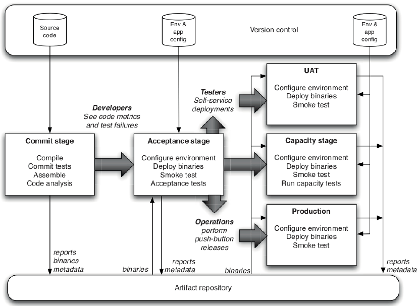
*From the slides: the full pipeline, with commit stage, acceptance stage, further stages (UAT, capacity, production) and the artifact repository at the bottom.*

> [!TIP]
> **Not in the slides: the link with Scrum.** In the first part of the module, an item is done only if it meets the definition of done, and the increment must be
> potentially shippable at the end of every sprint. The pipeline is how a team makes that *automatic*: every commit is checked against (a large part of) the DoD,
> so at any moment the team knows which version is releasable.

### The basic stages

| Stage | What it does | Output |
|---|---|---|
| **Commit stage** | fast feedback to developers on their work: builds and runs (mostly unit) tests on each commit | **candidate releases** |
| **Artifact repository** | stores the output of the commit stage | the stored candidate releases |
| **Acceptance stage** | prunes unfit candidate releases and **promotes** the others | **releases** |
| **Deployment** | deploys a release to production or a production-like environment | the running system |

All the stages, except possibly the last one, should be **automated**, for reproducibility and consistency.

**Continuous delivery vs continuous deployment.** If the team also automates the deployment step, it practices **continuous deployment**. **Continuous delivery is a
prerequisite for continuous deployment**: first every version must be releasable, then you can decide to release all of them automatically.

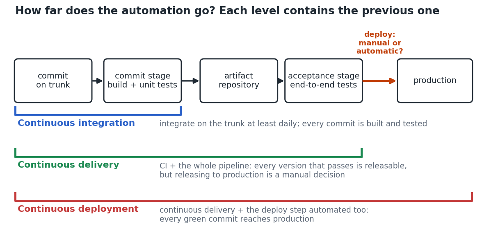
*Not in the slides: how far each practice automates the path from a commit to production. Each level contains the previous one.*

### Implementing a pipeline, stage by stage

A pipeline is a complex object, best built **incrementally**, stage by stage. A good practice is to grow it on top of a **walking skeleton**: a small system that performs
an **end-to-end function** and **can be deployed**, maybe a single feature of the full system. Once the walking skeleton exists, answer three questions:

1. How do we run **unit tests** for it?
2. How do we run **acceptance tests** for it?
3. How do we **deploy** it in a production-like environment?

Then implement each stage.

**1. Commit stage.** Unit tests run automatically on **each commit**. Typical steps:

- compile and build the project;
- build something **deployable** (a jar, a Python package, a Docker image, an .exe…): this is the **candidate release**;
- run the tests (mostly unit tests) and archive their output;
- upload the successful candidate releases to the artifact repository and discard the others.

**2. Artifact repository.** Each candidate release (artifact) needs a **unique identifier**: the **hash of the commit** it was built from is a good one.
The simplest artifact repository is a folder with some scripts to find the most recent candidate; real systems also label artifacts and run queries, and prune unused candidates.
From now on, **every stage that needs a candidate release must go through the artifact repository**.

**3. Acceptance stage.** The commit stage tests the software from the **developer's** perspective (mostly unit tests); the acceptance stage tests it from the **final users'**
perspective. To implement it:

- configure a **production-like environment**;
- retrieve a candidate release from the artifact repository;
- deploy it in that environment and check that it is correctly deployed;
- run a suite of **acceptance tests**.

Not every candidate release brings features testable from the acceptance point of view, so the acceptance stage can be scheduled to pull the latest candidate **every few minutes,
or even once a day**. Candidates that pass are **promoted**: they become **releases** (a tag in the artifact repository, or a move to another folder, is enough).

**4. Deployment.** The core principle of CD is that everything that survives the pipeline is releasable. The last step is a script that takes the **most recent release** from the
artifact repository and deploys it to a production-like environment. Automated: **continuous deployment**; left to manual approval: **continuous delivery**.
From this point, **every developer's commit goes through the whole pipeline**.

It looks easy, but implementing these elements and making them interact correctly can take days or weeks. Other **gates** can be added: manual testing,
security testing, performance and other non-functional testing.

> [!NOTE]
> **Not in the slides: why the artifact is built only once.** If the acceptance stage rebuilt the code from source, it would test a *different* binary from the one the
> commit stage tested (different time, dependencies, machine). Building once and promoting the *same* artifact guarantees that what goes to production is exactly what was
> tested. The scikit-learn example in Lab 2 does exactly this.

**Straight into production?** Being a developer in a team that practices CD means that every commit you make **could end up in a release**, and might be **deployed in hours,
if not minutes**.

## L1.3 Git 101

**What Git records.** Each node of the graph is a **commit**: the state of the whole codebase at a point in time. Between two nodes people write code, and nothing is recorded.

- `git commit` freezes the codebase and stores it as a **new node**, with a message, an author and a pointer to the node it was built on, its **parent**;
- stored nodes **never change**, so you can always go back to any of them;
- a **branch** (for example `main`) is just a **label pointing at a node**;
- `git add` chooses which changes go into the next commit; nodes are only added, the graph grows and is not rewritten.

**The daily loop:**

```bash
git status                    # what did I change?
git add cart.py               # goes in the next commit
git commit -m "Fix total"     # record the snapshot
git log --oneline --graph     # the history, as a tree
```

`HEAD` is where you are: the commit your files currently reflect.

**Branches and merges.** `git checkout -b discount` creates a new label on the same commit: nothing is copied. A commit made on `discount` moves only that label; meanwhile someone
commits on `main`, and the graph has two paths. `git checkout main` then `git merge discount` creates a node with **two parents** that joins the paths: `main` now contains both.

**Conflicts.** If the two paths changed **the same line**, Git cannot choose. The merge stops and the file is marked:

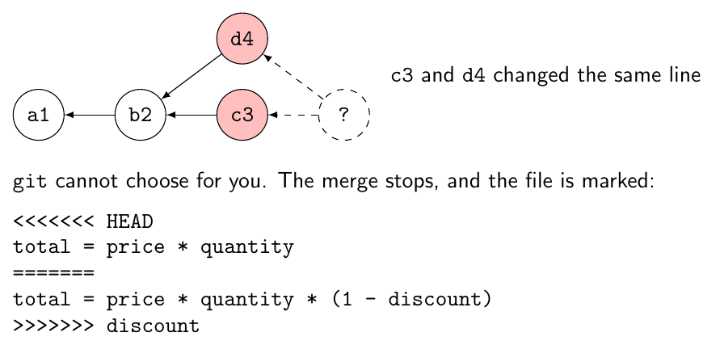
*From the slides.*

Edit the file into what it should be and remove the markers, then `git add` the file and `git commit`: this creates the merge node.
**A conflict is not an error: Git is asking you a question.**

**Many people, one server.** Everybody has a full copy of the graph: Alice, Bob and the server (GitHub, called `origin`).

- **commit**: save, on my machine (nobody else sees it);
- **push**: publish my commits to the server;
- **pull**: get the commits the others have published. If I had committed too, it is a merge.

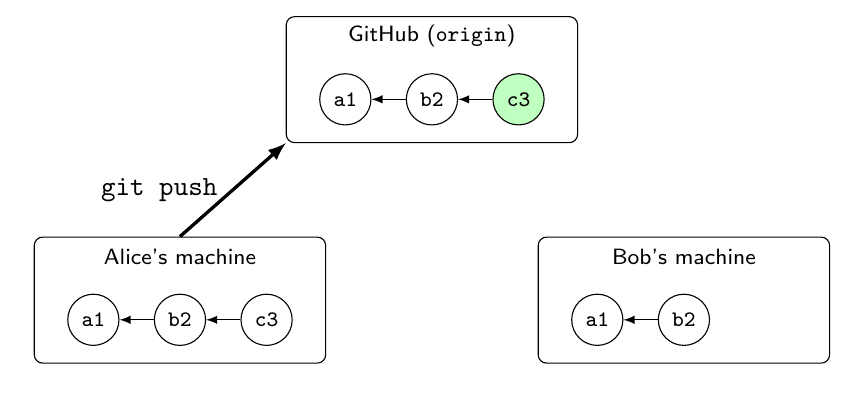
*From the slides.*

After `git clone`, `origin/main` marks where `main` is on the server. The slides suggest *Learn Git Branching*, an interactive tutorial that draws the graph as you type.

**Git is not GitHub.**

| Git | GitHub |
|---|---|
| a program on your machine: records the graph, works offline, needs no account | a website that hosts Git repositories and adds what a team needs around them |
| commits, branches, merges, clone, push, pull | pull requests and reviews, branch protection, issues, GitHub Actions |

A **pull request is not a Git concept**: it is GitHub's way to discuss a merge before doing it. GitLab, Bitbucket and Codeberg host the same Git repositories with their own version of these features.

## L1.4 How a CI system works

From *A Continuous Integration System* in the book *500 Lines or Less*. The system must "fetch the new changes, run the tests and report its results":

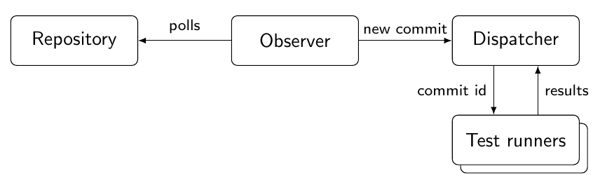
*From the slides.*

- the **observer** notices that the repository changed: it **polls**, asking again every few seconds;
- the **dispatcher** hands the commit to a free runner, collects the results, and notices when a runner dies;
- a **test runner** checks out exactly that commit in its own copy of the repository, runs the tests and reports.

## L1.5 GitHub Actions

**GitHub Actions** is a GitHub feature that runs **user-defined workflows** triggered by **Git-related events**. It makes it easy to define a commit stage, and it is
rich enough to implement a whole CD pipeline.

**Workflows, jobs, steps.** A **workflow** is a sequence of **jobs**, executed on **runners**. Jobs are made of **steps**, which are either shell commands or third-party
functionalities called **actions**.

- **Workflows** are triggered by Git-related events: pushes on a branch, creation of pull requests, manual triggers (`workflow_dispatch`), schedules, and more.
  They are YAML files in the `.github/workflows` directory of the repository.
- A **runner** is a virtual machine that executes workflows, **one job at a time**; its operating system is chosen with `runs-on`.
- A **step** is either a shell script (key `run`) or an action (key `uses`).
- **Jobs** are sequences of steps executed in order. Jobs run **in parallel** by default and do not share data; `needs` makes a job start only after another one finishes.

```yaml
name: workflow_name
on:
  push:
    branches: [ main ]
  pull_request:
  workflow_dispatch:
jobs:
  build:
    runs-on: ubuntu-latest
    steps:
      - name: Greetings
        run: echo Hello, world!
      - name: Multi-line Greetings
        run: |
          echo Hello, world!
          echo Hi, I'm a multi-line script!
```

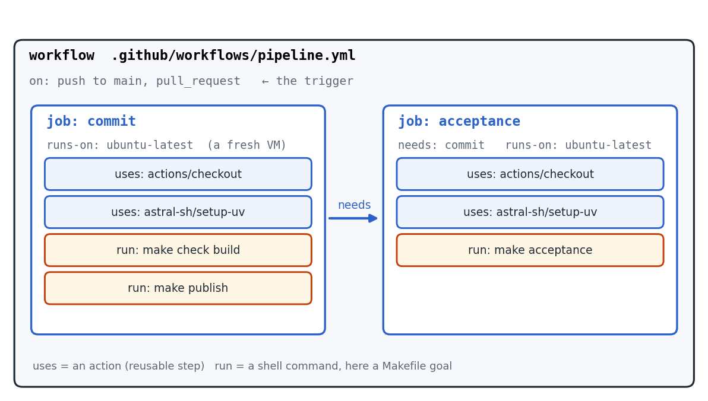
*Not in the slides: the pipeline workflow of the next section, drawn as workflow → jobs → steps.*

**The same components as the 500-line CI system, in GitHub Actions:**

| In 500 lines | In GitHub Actions |
|---|---|
| observer, polling | GitHub hosts the repository, so it knows about a push when it happens; `on` selects the events that matter |
| dispatcher | the Actions service: reads the workflow file, queues the jobs and assigns them to runners |
| test runner | a runner: a fresh virtual machine for each job, chosen with `runs-on`; the `checkout` action fetches the commit |
| what to run, fixed in the code | the workflow file, versioned in the repository |
| results, in a file on the dispatcher | a check on the commit or on the pull request, with its logs |

Same components, but somebody else builds and runs them. For anything else (environment variables, using a job's output in later jobs, dependencies between jobs,
filtering on paths, scheduled workflows) the slides point to the documentation, the Actions marketplace, the starter workflows, and also: ask an LLM, then test that it works.

**Usage limits.** The free tier gives 3000 minutes of workflow execution (with some rounding, be careful). You are responsible for your usage. If you run out, move
repositories within the team while **preserving the full commit history**: do not create a new repository whose first commit is "the already finished project".

## L1.6 Do not program in YAML: the Makefile

A `run` step can contain any shell script, so it is tempting to write the whole pipeline in YAML. Avoid it as much as possible:

- **you cannot run it locally**: debugging means pushing commits named "fix ci" until the run turns green;
- **nothing checks it**: a script inside a YAML string gets no linter, no tests, no editor support;
- **it drifts**: what the CI runs and what you run by hand slowly become two different commands;
- **it locks you in**: moving to another CI tool means rewriting everything.

> **The workflow is an execution environment.** The YAML says **when, where and with which permissions**. The Makefile says **what**.

What belongs in the workflow file: triggers (`on`), the order of the jobs (`needs`), permissions and secrets, the matrix of operating systems and versions, caching,
setting up the tools (`checkout`, `setup-uv`…). Everything else is a goal in a Makefile, or a script the goal calls, and the workflow runs it with a single line.
**The same command then runs on your machine, in a git hook and in the CI.**

**What is a Makefile?** A file that defines **goals**. Each goal has **prerequisites** and a **recipe** (shell commands). `make run` executes the recipe of `run` after its prerequisites.

```make
hello: hello.cpp greet.cpp
	g++ hello.cpp greet.cpp -o hello
run: hello
	./hello
.PHONY: run
```

A goal is usually a **file** to produce, and its recipe runs again only if a prerequisite is newer than the file. Goals that do not produce a file (like `run`) are declared
`.PHONY`. Recipes must be indented with a **tab**. An alternative is `just` (a `justfile`): only a command runner, but it must be installed, while `make` is everywhere.

**Before and after:**

```yaml
# Before
- name: Test
  run: |
    pip install -r requirements.txt
    pip install pytest ruff
    ruff check src tests
    if [ "${{ github.ref }}" = "refs/heads/main" ]; then
      pytest --cov=src --cov-fail-under=80
    else
      pytest -x
    fi
# After
- name: Test
  run: make check
```

**Lock-in.** GitLab CI, CircleCI, Bitbucket Pipelines, Forgejo/Gitea Actions, Azure Pipelines, Woodpecker, Jenkins: all share the same structure (a trigger, a machine,
a list of steps). If the workflow only calls `make check`, moving to another tool takes a few minutes.

**A basic pipeline.** The Makefile:

```make
TAG := build-$(shell git rev-parse HEAD)   # a unique id for this version
check:        # runs the linter and the tests
	uv run ruff check
	uv run pytest
build:        # builds a wheel, the installable Python format
	uv build --wheel
publish:      # uses GitHub to create a "release"
	gh release create $(TAG) dist/*.whl --target $(GITHUB_SHA) --notes ""
acceptance:   # downloads the release, installs it, runs smoke-test.sh
	gh release download $(TAG) --pattern "*.whl" --dir release
	uv venv staging
	uv pip install --python staging release/*.whl
	./scripts/smoke-test.sh staging
```

- `check`, `build` and `publish` are the **commit stage**;
- **GitHub releases** act as the **artifact repository** (deployment is left out);
- `acceptance` is the **acceptance stage**: note that it **only uses the artifact**.

The workflow:

```yaml
on:
  push:
    branches: [ main ]
  pull_request:
env:
  GH_TOKEN: ${{ github.token }}
jobs:
  commit:
    runs-on: ubuntu-latest
    permissions:
      contents: write
    steps:
      - uses: actions/checkout@v7
      - uses: astral-sh/setup-uv@v10.2.0
      - run: make check build          # linter and tests, then the wheel
      - run: make publish              # the wheel becomes a release
        if: github.ref == 'refs/heads/main'
  acceptance:
    needs: commit
    if: github.ref == 'refs/heads/main'
    runs-on: ubuntu-latest
    steps:
      - uses: actions/checkout@v7
      - uses: astral-sh/setup-uv@v10.2.0
      - run: make acceptance           # download the release, install it, smoke test
```

> [!TIP]
> **Not in the slides: reading the workflow.** On a pull request only `make check build` runs: the `if` conditions skip publishing and acceptance, so a PR gets fast feedback
> without creating releases. On `main`, the wheel is published as a release tagged with the commit hash, and only then (`needs: commit`) the acceptance job downloads
> *that* release and tests it.

## L1.7 Trunk-based development

**Branching considered harmful.** Git and other version control systems were not designed for iterative development, and **branches are dangerous in a CD environment**:
the longer we code on a local branch, the further we stray from the "public" codebase. The problem grows with:

- the **size of the team**: more developers, more branches, more conflicts;
- the **length of the branches**: a long-lived branch is "far" from the code it must be merged into;
- the **frequency of commits**, which in CD should be very high;
- the **size of the changes**: today an LLM can generate in 30 seconds a change equivalent to months of branch divergence.

Time spent solving merge conflicts (especially non-trivial ones that need calls, meetings and prayers) is time not spent producing increments.
**Branching is fine; long-lived branches do not work with continuous delivery.**

**Trunk-based development.** The radical solution:

- **avoid branching**: commit directly to the main branch, called **trunk** (*trunk-based development*);
- or **keep branches extremely short-lived**, merging back to trunk **at least once a day** (*scaled trunk-based development*).

It was developed in the early 2000s, independently by many companies, and it is a key practice to enable **continuous integration**, which is needed for continuous
delivery and deployment.

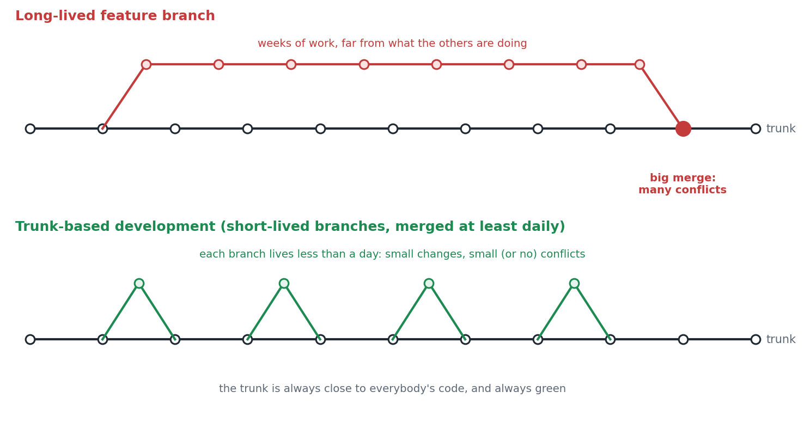
*Not in the slides: the same weeks of work, with one long-lived branch or with many short-lived ones.*

**Keeping the trunk green.** The priority is to avoid **bad commits** (commits that break the pipeline) on the trunk. Precautions:

- **branch protection**: a GitHub feature that forbids direct commits on some branches: for example you cannot push to `main` and must open a **pull request**;
- **code review and checks**: conditions on merging a pull request on a protected branch, such as a **successful workflow run** on the branch to merge, or **manual approval**
  by other team members. Approvals are effective but can become a bottleneck: notify each other when a PR waits too long;
- **developer's discipline** (section L1.9).

**Pull requests, GitHub flow:** a developer works on a local branch, asks ("requests") for the work to be integrated, and if approved it is merged into the receiving branch.

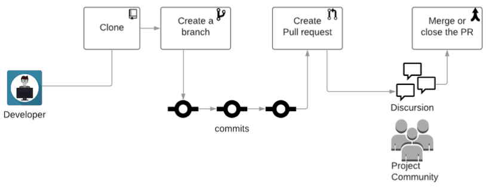
*From the slides.*

## L1.8 Building a feature with continuous integration

From Martin Fowler's *Continuous Integration*, step by step:

1. **Pull**, so that the local copy is up to date.
2. **Change the code and its tests**, running the build often.
3. **Pull again**: in the meantime, colleagues may have pushed.
4. **Run the build on the combined code**, and fix what breaks.
5. **Push** to the trunk.
6. The **CI service builds the commit** on its own machine.
7. **The work is done only when that build is green.**

With a protected trunk, step 5 becomes "open a pull request": the CI service builds it before it reaches the trunk.

The slides follow Alice and Bob: Alice commits `b2` while Bob pushes `c3`; when Alice pulls again, `b2` and `c3` changed the same line, so she solves the **conflict**
(maybe talking with Bob) and creates the merge commit `m4`. Even if the conflict is solved, she does not yet know whether `b2` and `c3` **work together**, so she runs
`make check` on `m4`: OK. She pushes, and the CI builds `m4`: **red**. It worked on her machine, but not on the CI service, and now **the trunk is broken for everybody**:
fixing it has priority. Her first fix `f5` is still red; `g6` is green. Bob gets everything at his next pull.

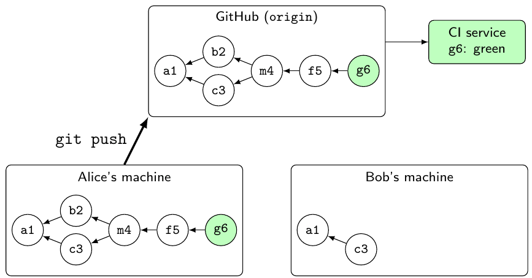
*From the slides: the final state, after two more commits (f5, g6).*

> [!TIP]
> **Not in the slides: "it works on my machine".** Alice's laptop may have a file not committed, a different Python version, or a cached dependency. The CI runner starts
> from a fresh virtual machine and the repository content only: that is why its verdict, not the local one, decides whether the work is done.

## L1.9 Developer's discipline and git hooks

The most effective tool in a CD environment is the **discipline to follow a workflow**:

- **always pull** before committing and pushing;
- **always run the unit tests locally** before pushing (a pre-commit hook can help);
- **always give priority to keeping the trunk green**: if your commit breaks the pipeline, fixing it is your priority; if someone else breaks it and does not come back to fix it,
  it is your job to fix it; if you can't, **revert** their commit;
- **always work in small increments**, even if "you know" you are the only one working on a file;
- **keep branches short-lived**, merge daily;
- **when in doubt, coordinate** with your teammates: better to lose 30 seconds writing a message than 30 minutes un-merging.

**Git hooks** are scripts that Git runs when an event happens (for example a commit); if the script fails, the operation is aborted.

| Side | Hook | Use |
|---|---|---|
| client (developer's machine) | `pre-commit` | runs before the commit is created, e.g. `make check`, the same command as the CI |
| client | `commit-msg` | can reject a commit message |
| client | `pre-push` | runs before `git push` sends anything |
| server (machine hosting the repository) | `pre-receive` | can reject a push, for everybody; **not available on GitHub** (branch protection and checks play this role) |

`.git/hooks` is **not versioned**, and hooks can be skipped with `--no-verify`. Hooks give feedback earlier, but **the pipeline decides** whether a commit is good.

## L1.10 Development patterns: feature flags and branch by abstraction

Trunk-based development is the most important step, but it does not solve everything: in CD we must always be releasable **and** commit very often, with short branches (if any).
How can we get anything big done if every commit must be releasable, small and merged daily?

**Feature flags.** New code is added incrementally and **coexists with the legacy code**; a condition outside the code, the **feature flag**, decides which one runs.
The simplest feature flag is an `if`:

```python
def sort_collection(collection):
    if FEATURE_FLAGS['new_sorting_algorithm']:
        return FancySorter.sort(collection)
    else:
        return sorted(collection)
```

Many feature flags are **technical debt** and make testing harder (a **combinatorial explosion** of flag combinations): finish the feature soon and **delete** the flags
no longer used. Toggles can also be implemented with the **Strategy or Command pattern**, **polymorphism**, or **compile-time macros** (e.g. `-D` in g++).

> [!NOTE]
> **Not in the slides: an example.** A team is rewriting the checkout page. Each day it merges a bit of the new page behind `FEATURE_FLAGS['new_checkout']`, off in
> production: the trunk stays releasable, and the new code is tested in the pipeline. When the page is complete, the flag is switched on (maybe first for 5% of users),
> and once it is stable the old page and the flag are deleted.

**Branch by abstraction.** To **replace a sub-system** without breaking the pipeline: first introduce an **interface** (an abstraction layer) that covers both the legacy
sub-system and the future one, and make the client code use it. Then develop the new sub-system **behind the interface**, and switch to it when ready.
Squint and it looks like an **Adapter**.

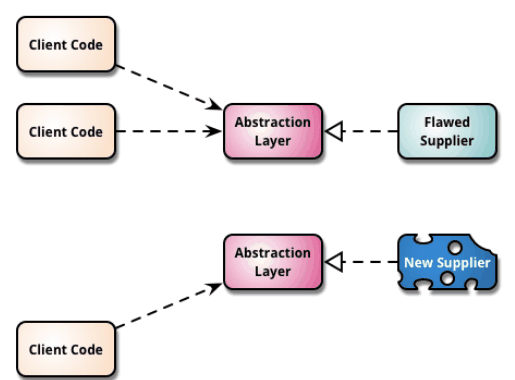
*From the slides.*

**Before the project: a checklist.** Refresh or learn: Git (commit, push, pull, merge); git hooks (pre-commit, commit-msg); the Makefile (goals and how to run them);
GitHub pull requests and branch protection (it might not be available on non-public repositories: check the docs); GitHub Actions: how to run workflows
(study the basics, then generate workflows with an LLM from a description).

**References from the slides:** *Continuous Delivery Pipelines* (short and practical) and *Continuous Delivery* (chapter 5); the *Trunk-based development* book;
GitHub docs on GitHub Flow, pull requests, branch protection and checks; Martin Fowler on branch by abstraction, feature toggles, branching and continuous integration;
DORA on trunk-based development (three or fewer active branches, merge to trunk at least once a day); Google's engineering practices on small changes and code review.

---

# Lab 2: Software testing

## L2.1 Testing in Scrum

**Software testing** is, very informally, **every process we perform to gain confidence that the software works as intended and according to requirements**.
Different kinds of software require different depths of testing (regulations, ethics…): it is not always worth testing everything in depth, and sometimes it is absolutely
necessary. The lab focuses on everyday testing **from a developer's perspective**.

**The link with Scrum** (quotes from the Scrum Guide):

- An **Increment** is a concrete stepping stone toward the Product Goal: it is additive to all prior increments and **thoroughly verified**, so they all work together,
  and it must be **usable**.
- The **Definition of Done** is a formal description of the state of the increment when it meets the quality measures required for the product.
  **Work cannot be part of an Increment unless it meets the Definition of Done.**
- **Who tests? The Scrum Team.** It is cross-functional (all the skills needed, no sub-teams or hierarchies) and responsible for all product-related activities, verification
  included. **Developers are always accountable for instilling quality by adhering to a Definition of Done.**
- And from the Agile Manifesto: *working software is the primary measure of progress*.

> [!NOTE]
> **Not in the slides: Rubin and the Scrum Guide.** The first part of the module uses Rubin's terms (development team, ScrumMaster); these quotes use the Scrum Guide's
> (Developers, Scrum Master). The idea is the same: there is no separate test phase or test team, testing is part of getting an item done.

## L2.2 Kinds of tests

- **By scope:** **unit** tests (functions, methods, classes, objects), **integration** tests (interactions between units), **end-to-end** tests (the whole system).
- **By what the test knows:** **white-box** (tests the internals, written reading the code) and **black-box** (tests the behavior, knowing only what the software promises:
  e.g. Git's tests run `git` in a terminal).
- **By requirement:** **functional** (explicit requirements: does it do what the user story says?) and **non-functional** (implicit requirements: performance, security…).
- **Manual** or **automated** (done without developer intervention). *Checked twice by hand? Candidate for an automated test.*

**What changes with the scope:**

| | What runs | What it needs | How long | When it is red | How many |
|---|---|---|---|---|---|
| **Unit** | one function or class | nothing | fast | you know where | many |
| **Integration** | a few parts together | a database, a server, files | slower | somewhere on the path | fewer |
| **End-to-end** | the whole system | a browser, a deployment | slow (even days) | somewhere | few |

The **test pyramid** is the last column. **Unit tests cannot tell if the pieces fit together; end-to-end tests cannot tell which piece is broken.**

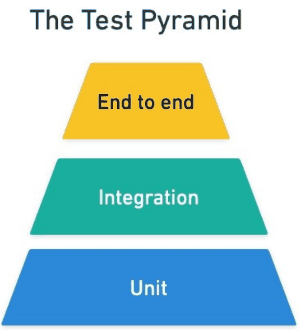
*From the slides.*

**Same test code, different roles.** (Almost) the same test plays a different role in different codebases:

```python
def test_pay_ten_euros():
    charge = {"amount": 1000, "currency": "eur"}
    answer = requests.post(URL + "/charges", json=charge)
    assert answer.json()["status"] == "succeeded"
```

- in the **requests** library, `URL` is a local fake server: a **unit** test;
- in an **e-commerce**, `URL` is the test server of the payment provider: an **integration** test;
- in the **payment provider**, `URL` is the deployed system and the test is just another client: an **end-to-end** test.

The name matters less than **what must be running, how long it takes, and where to look when it is red**.

## L2.3 Who runs the tests: the agile testing quadrants

Two axes: who cares about the test (**business people** or **developers**) and how it is run (**automated** or **manual**).

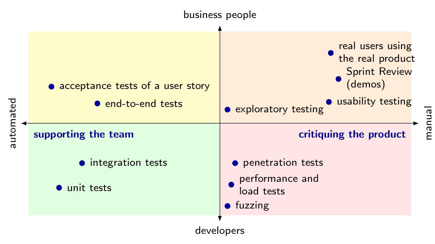
*From the slides.*

- **Left side, supporting the team:** unit tests, integration tests, end-to-end tests, acceptance tests of a user story. They are written **while building** and tell the team
  **when it is done**.
- **Right side, critiquing the product:** exploratory testing, usability testing, penetration tests, performance and load tests, fuzzing, and **real users using the real product**,
  including the **sprint review demos**. They look at what was built, **searching for what nobody thought of**.

**As LLM capabilities increase,** an agent can explore the part where requirements are **clear and verifiable** (external tools check its work), while the part that needs
**human feedback** (real users, demos) stays with people.

## L2.4 Where tests sit in the pipeline

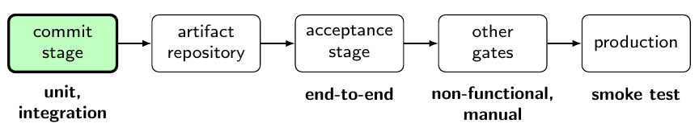
*From the slides.*

| Stage | Tests | Notes |
|---|---|---|
| **Commit stage** | unit and integration tests, on each commit | must answer in a few minutes: only fast tests |
| **Acceptance stage** | end-to-end tests | deploys a candidate release in a test environment and runs them on it |
| **Other gates** | non-functional and manual tests | e.g. load tests, manual tests of a new feature |
| **Production** | smoke test | after the deployment: is the release up? (e.g. the home page loads) |

- **Tests span the whole pipeline.**
- **Moving right:** more pieces running, slower tests, run less often.
- **Keeping the trunk green:** run the tests on trunk commits; if something breaks, fix it as soon as possible.

## L2.5 Tests in open source projects

| Project | What it is | Its pipeline |
|---|---|---|
| **lark** | a parsing library for Python | three workflows (`tests.yml`, `mypy.yml`, `codecov.yml`) on push and pull request: **only a commit stage**, no acceptance stage, nothing scheduled |
| **Zulip** | a team chat (Django server + web frontend) that you install on a server | `zulip-ci.yml` is the commit stage; `production-suite.yml` builds a **release tarball** (the artifact), installs it on 5 Linux distributions and checks the server is healthy: an **acceptance stage that only uses the artifact** |
| **scikit-learn** | a machine learning library published on PyPI | `unit-tests.yml` on push, PR **and nightly**; `wheels.yml` builds and tests the packages and uploads them to **staging**; `publish_pypi.yml`, started **by hand**, copies those packages to PyPI **without rebuilding them** |
| **SQLite** | a database library embedded in phones and browsers | the extreme: 590 times more test code than code, 100% branch coverage, ~300 thousand test cases before each check-in and ~250 million before a release |

Details worth remembering:

- **lark** `tests.yml` uses a **matrix**: one job becomes 10 (9 Python versions on Ubuntu, one on Windows), because a library must work everywhere; each job only calls
  `python -m tests`, as a developer would. Its test suite runs the same tests for each (lexer, parser) pair.
- **Zulip** runs **fast tests first** (fail early), runs the slow browser tests in only one job out of five, and passes the tarball between jobs as a workflow **artifact**
  (`upload-artifact`, then `download-artifact` by name).
- **scikit-learn** runs extra jobs (`scipy-dev`) only at night or when the commit message contains `[scipy-dev]`. One parametrized test runs **every check on every estimator**:
  new estimators get the same checks for free.
- **SQLite** writes tests in a small DSL (`do_test`, `execsql`, `crashsql`…) because with this many tests writing them must be cheap; it tests out-of-memory, disk errors
  and power loss in the middle of a write; one suite runs 7.2 million queries and compares the answers with PostgreSQL, MySQL, SQL Server and Oracle.

**When the machine writes part of the test:**

| Technique | Idea | In SQLite |
|---|---|---|
| **Fuzzing** | millions of generated inputs, random or mutated from valid ones; we only check that the program does not crash | the fuzzer mutates both the SQL text and the database file (about a billion inputs a day) |
| **Property-based testing** | generated inputs plus a **property** that holds for all of them, e.g. sorting a sorted list changes nothing | nobody writes 7.2 million expected answers: the property is "same answer as the other databases" |
| **Mutation testing** | the machine changes the code (e.g. `<` into `<=`): if no test fails, no test was checking that line | each branch of the compiled code is forced to "always jump" or "never jump": the suite must notice |

**Testing in production: Chaos Monkey.** A Netflix tool that **randomly shuts down servers in production**. With thousands of servers some fail every day, so the system
must survive it; a failure that happens every day gets handled ("if it hurts, do it more often"); it runs during working hours, when engineers are there to fix what breaks.
Bigger monkeys slow down the network or shut down a whole data center. **Chaos engineering:** define what "healthy" means (e.g. plays started per second), inject a failure,
check that the system stays healthy.

## L2.6 Unit testing frameworks

Most frameworks are inspired by **xUnit** (JUnit for Java) and give the same things in every language:

- **tests as code**: a test is a function, and it fails when it raises an error;
- **automatic discovery**: nothing to register;
- **assertions**: checks on the behavior of the code;
- **fixtures**: preparing the ground for a test and dismantling it (setup, teardown), typically for complex objects and integration tests;
- **parametrization**: one test, a table of cases;
- **filtering**: running a subset of the tests.

**pytest.** Discovery goes by name: files `test_*.py`, functions `test_*`.

```python
# tests/test_metro.py
def test_first_trip_costs_two_euros():
    metro = Metro()
    metro.tap_in("ciro", "toledo")
    assert metro.tap_out("ciro", "dante") == 2

def test_tap_out_without_tap_in_is_an_error():
    with pytest.raises(MetroError):          # the code must raise this error
        metro.tap_out("ciro", "dante")
```

| Command | Runs |
|---|---|
| `pytest` | every test of the project |
| `pytest tests/test_metro.py` | the tests of one file |
| `pytest tests/test_metro.py::test_first_trip_costs_two_euros` | one test |
| `pytest -x` | stops at the first failure |
| `pytest -k tap_out` | the tests with `tap_out` in their name |
| `pytest -m "not slow"` | by mark: skips those marked `@pytest.mark.slow` |
| `pytest --lf` | only the tests that failed last time |

**Fixtures:**

```python
@pytest.fixture
def database():
    connection = connect("test.sqlite")   # before the test
    yield connection                      # the test runs here
    connection.close()                    # after the test

def test_a_new_user_is_stored(database):
    database.add_user("ciro")
    assert database.users() == ["ciro"]
```

The test **asks for what it needs by name**, and the framework builds it and passes it in: an example of **dependency injection**. It is rebuilt for each test
(`@BeforeEach`, `@AfterEach` in JUnit); with `scope="class"` it is built once for a class of tests (`@BeforeAll`, `@AfterAll`).

**Each language has its own frameworks.** Tests in the same language as the code are a big advantage. Python has `unittest` in the standard library (most projects use pytest);
Java uses JUnit (not in the standard library); C++ is the wild west (Google's libraries are popular); modern languages put testing in the official toolchain:
Rust (`cargo test`), Go (`go test`).

| | pytest | unittest | JUnit 5 |
|---|---|---|---|
| A test | `def test_*` | `TestCase.test_*` | `@Test` |
| Assertions | `assert` | `self.assertEqual` | `assertEquals` |
| Exceptions | `pytest.raises` | `self.assertRaises` | `assertThrows` |
| Fixtures | `@pytest.fixture` | `setUp`, `tearDown` | `@BeforeEach` |
| Parameters | `@pytest.mark.parametrize` | `self.subTest` | `@ParameterizedTest` |
| Marks | `@pytest.mark.skip` | `@unittest.skip` | `@Disabled` |

Know one framework, and moving to another is mostly looking up the names. Old books on xUnit test patterns, design patterns and refactoring patterns (all from around 2000)
have become implicit knowledge: suites and fixtures were once a hot topic, and now feel natural in every framework.

**Anatomy of a test:**

```python
def test_tap_out_returns_the_price():
    # Arrange / Given / Setup
    metro = Metro()
    metro.tap_in("ciro", "toledo")
    # Act / When / Exercise
    price = metro.tap_out("ciro", "dante")
    # Assert / Then / Verify
    assert price == 2
```

The same structure has several names: **Arrange, Act, Assert**; **Given, When, Then**; the **four-phase test** of xUnit Test Patterns (**setup, exercise, verify, tear-down**,
where the fourth phase cleans up what the setup created). The **system under test (SUT)** is what we assert something on (here `metro`); a **depends-on component (DOC)** is
anything the SUT needs to work, e.g. a database (none here).

## L2.7 Tests that test something

> **A test tests something if there is a plausible bug that makes it fail.**

- **A test that cannot fail is decoration**: it costs time and gives false confidence.
- **See it fail once**: write the test on the buggy code, or break the code on purpose. If it stays green, it is not testing what you think.
- **Choose inputs that can tell right from wrong**: sorted input cannot test a sort.
- **Isolated tests**: tests must not affect each other and must be order independent.

> [!TIP]
> **Not in the slides: sorted input cannot test a sort.** `assert my_sort([1, 2, 3]) == [1, 2, 3]` passes even if `my_sort` returns its input unchanged.
> `assert my_sort([3, 1, 2]) == [1, 2, 3]` fails for that bug: only this second test tests something.

**From a bug report to a test:**

1. someone reports a bug;
2. write the **smallest test that reproduces it**: it must be **red**;
3. fix the code: the test turns **green**;
4. the test **stays in the suite, forever**.

This is a **regression test**: it is not written for today's fix, but for the day someone brings the bug back.

**Tests before changes.** During a refactoring the tests should stay green: make tiny changes and re-run the tests after each one.

- **No tests, no refactoring**: first write tests that lock what the code does today, then change it.
- **One thing at a time**: either you fix a bug, or you refactor.
- If a refactoring forces you to rewrite a test, **that test was about how the code works, not about what it does**.

## L2.8 Test-driven development

**TDD** interleaves the development of production code and of tests. Two rules:

1. **write new code only if an automated test has failed**;
2. **eliminate duplication**.

They "force" the developer into the **red-green-refactor** cycle: write a failing test (red), write the code that makes it pass (green), clean up (refactor).

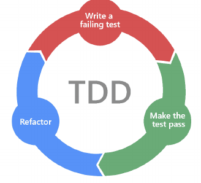
*From the slides.*

**The "hype".** According to its promoters, TDD makes it impossible not to write tests, gives high coverage (helping refactoring and regression testing), forces you to think
about the APIs, and produces descriptive tests ("living documentation"). But **all of these are benefits of having tests and of thinking about the interface before the
implementation**: none of them needs the tests to be written first, one at a time.

**The test is the first client of the API.** This test is written when `Metro` does not exist yet:

```python
def test_fourth_trip_is_discounted():
    metro = Metro()
    for _ in range(3):
        metro.tap_in("ciro", "toledo")
        metro.tap_out("ciro", "dante")
    metro.tap_in("ciro", "toledo")
    assert metro.tap_out("ciro", "dante") == 1
```

Writing it already took decisions: there is a `Metro` object, cards and stations are strings, `tap_out` returns the price. We write **the code we wish we had, from the caller's side**.
**A test awkward to write means an API awkward to use**, and we know it before implementing.

**Tests as living documentation.** Test names, read in a row (`pytest -v`), say what the code promises; each test is an example of use. Documentation gets old in silence,
a test fails when the code changes. At the extreme the documentation *is* the test (`doctest` in Python).

**TDD is not a silver bullet.** The slides quote an author admitting that one of his projects was "the most ignominious debacle" on his site
("Sudoku did not ship and will not"). **TDD, the good parts:** not a religion; do as much as you find useful;
writing tests before code gives most of the benefits; **the "driven" part is the problematic one**: it is naive to think that any system can emerge from TDD alone.

> [!NOTE]
> **Not in the slides: the link with the first part.** TDD is listed in the course among the technical practices that keep technical debt low and help sprint execution.
> The lab's position is consistent: tests are essential (the definition of done, the pipeline and refactoring rely on them), while writing every test strictly first is a choice.

---

# Lab exercises

**Lab 1.** Write a simple program (in C++, or a language you know) that reads a sequence of positive integers ending with 0 and outputs their sum. Then create a GitHub
workflow with two jobs:

- `build`: builds the program and uploads a `sequence-sum` executable **artifact**;
- `run`: downloads the artifact and runs the program on an input of your choice, provided by a workflow step (a shell script).

Useful actions: `checkout`, `upload-artifact`, `download-artifact`. Without C++, replace the build job with something else and use the source code as the artifact.

> [!TIP]
> **Not in the slides: the structure.** It is a tiny pipeline: `build` is the commit stage, the workflow artifact is the artifact repository, and `run` is an acceptance stage
> that uses only the artifact. `run` needs `needs: build`, since jobs run in parallel and do not share files otherwise.

**Lab 2** (in the same repository as your programming test submission): add **unit tests** run by a GitHub workflow. In a separate job you can add the linting step and the check
with the provided `*.in` / `*.out` files. Unit tests are new tests written with a framework, at the level of a single function; a script or Makefile re-runs the program on each
`*.in` and compares the output with the official `*.out` using `check.py`, after `lint.py`. Hint: **refactor the code to be easily testable**, with functions that work on strings
or custom types instead of reading lines from standard input.

---

# Cheat sheet of the labs

- **Pipeline** = infrastructure of continuous delivery: runs the tests on every version and **discards the bad ones**; what survives is releasable (meets the DoD).
- **Stages:** commit stage (build, unit tests, candidate release) → artifact repository (id = commit hash) → acceptance stage (production-like env, acceptance tests, **promote**) → deployment.
- **Build once**, then promote the same artifact. Grow the pipeline on a **walking skeleton**.
- **Continuous integration** ⊂ **continuous delivery** (always releasable, manual deploy) ⊂ **continuous deployment** (automatic deploy).
- **Git:** commit = immutable snapshot with a parent; branch = label; merge = two parents; conflict = same lines, Git asks you; push/pull. Pull request = GitHub, not Git.
- **CI system:** observer, dispatcher, test runners. **GitHub Actions:** workflow (YAML in `.github/workflows`, `on`) → jobs (runners, `runs-on`, `needs`, parallel by default) → steps (`run` / `uses`).
- **YAML = when, where, permissions; Makefile = what.** Same command locally, in hooks, in CI; no lock-in.
- **Trunk-based development:** commit to trunk or branches merged at least daily; branch protection, checks and review, discipline. Long-lived branches + CD do not work.
- **Fowler's CI:** pull, change with tests, pull again, build, push, CI builds; **done only when green**; broken trunk = top priority (fix or revert).
- **Hooks:** pre-commit, commit-msg, pre-push (client); pre-receive (server, not GitHub); skippable, the pipeline decides.
- **Feature flags** (new and old code coexist; remove them soon) and **branch by abstraction** (interface first, then swap the implementation).
- **Testing** = gaining confidence; the Scrum team tests; no increment without the DoD.
- **Scope:** unit (fast, many, precise) / integration / end-to-end (slow, few); **pyramid**. Black/white-box, functional/non-functional, manual/automated.
- **Quadrants:** supporting the team (written while building) vs critiquing the product (exploratory, usability, load, security, demos).
- **Pipeline:** commit stage = fast unit/integration; acceptance = end-to-end on the artifact; other gates; smoke test after deploy.
- **Machine-written tests:** fuzzing, property-based, mutation testing; **chaos engineering** in production.
- **xUnit frameworks:** tests as code, discovery, assertions, fixtures (setup/teardown, dependency injection), parametrization, filtering. AAA / Given-When-Then / four-phase; SUT and DOC.
- **A test tests something if a plausible bug makes it fail.** See it fail; good inputs; isolated. Bug → smallest red test → fix → keep it (**regression test**). No tests, no refactoring.
- **TDD:** code only after a failing test, remove duplication → red-green-refactor; test = first client of the API, living documentation; not a religion.
